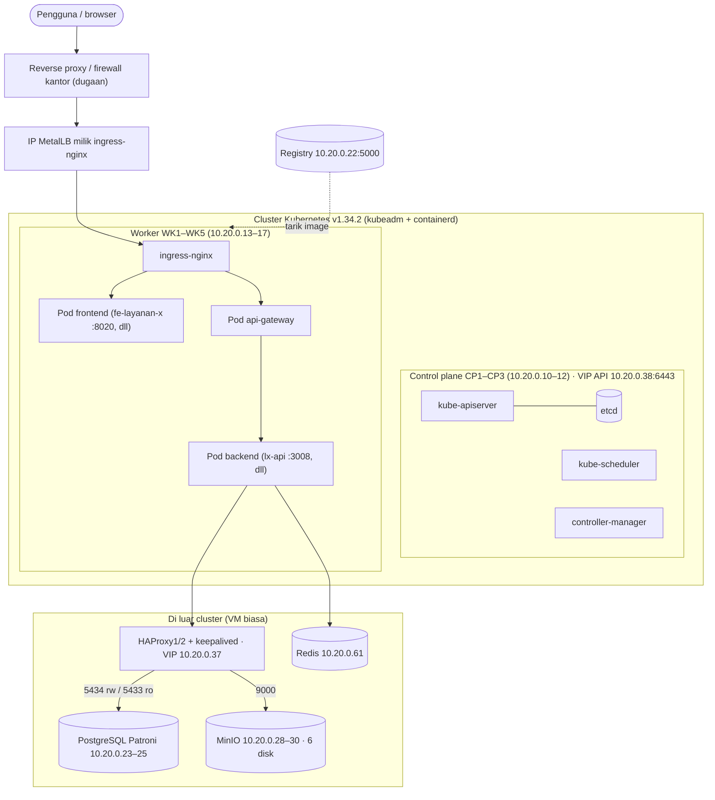
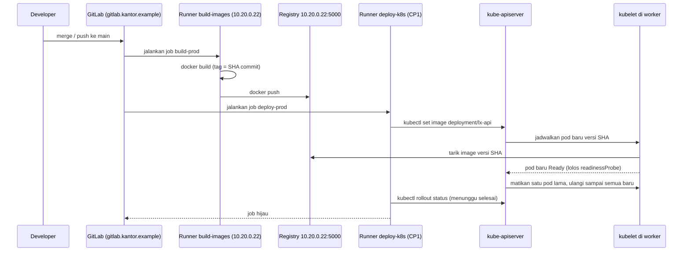

# 01 Arsitektur Cluster Kantor (CP, WK, MinIO)

Kembali ke [[00 Mulai di Sini]] · Lanjut ke [[02 Lab 1 - Kubernetes di Laptop]]

---

## 1. Kenapa perlu Kubernetes?

Coba lihat server development kantor (10.20.1.x). Di sana semua aplikasi jalan pakai `docker compose` di **satu** server. Itu cukup untuk dev, tapi untuk production ada masalah:

| Masalah dengan docker compose di 1 server | Bagaimana Kubernetes mengatasinya |
|---|---|
| Server mati = semua aplikasi mati | Aplikasi disebar ke 5 worker. Kalau 1 worker mati, pod-nya dipindah otomatis ke worker lain |
| Traffic naik, harus tambah container manual | `replicas: 5` atau autoscaler (HPA) yang menambah pod sendiri |
| Deploy = `docker compose down` lalu `up` → ada downtime | *Rolling update*: pod baru dinyalakan dulu, pod lama baru dimatikan setelah yang baru siap |
| Container crash, harus di-restart manual | Kubernetes me-restart otomatis |
| Versi sebelumnya hilang | `kubectl rollout undo` kembali ke versi sebelumnya dalam hitungan detik |

Intinya, di Kubernetes kamu **tidak** menyuruh "jalankan container X di server Y". Kamu cukup bilang **keadaan yang kamu inginkan** ("aku mau 5 salinan `lx-api` versi sekian"), lalu Kubernetes yang terus berusaha mewujudkan dan menjaga keadaan itu. Konsep ini namanya **desired state**, dan ini ide paling penting di seluruh catatan ini.

---

## 2. Kosakata dasar

Bayangkan Kubernetes sebagai **perusahaan logistik**:

| Istilah | Penjelasan | Analogi | Contoh di kantor |
|---|---|---|---|
| **Image** | Paket aplikasi beku hasil `docker build` (kode + Node.js + dependency) | Cetakan / resep | `10.20.0.22:5000/app/backend/api-layanan-x:<commit-sha>` |
| **Container** | Image yang sedang dijalankan | Kue yang sudah jadi dari cetakan | proses `node dist/main` |
| **Pod** | Unit terkecil di k8s: 1 atau lebih container yang berbagi IP dan disk. Biasanya 1 pod = 1 container aplikasi | Satu kotak kiriman | 1 pod `lx-api` |
| **Node** | Satu server (VM) di cluster | Satu gudang | `k8s-worker4` (10.20.0.16) |
| **Cluster** | Kumpulan node yang diatur bersama | Seluruh perusahaan | CP1–3 + WK1–5 |
| **Deployment** | "Surat perintah": image apa, berapa replika, env apa | SOP produksi | `deployment/lx-api` |
| **ReplicaSet** | Dibuat otomatis oleh Deployment, satu per versi. Tugasnya menjaga jumlah pod | Mandor per versi | muncul setiap kali `set image` |
| **Service** | Alamat tetap (nama DNS + IP virtual) untuk sekelompok pod. Pod bisa mati dan berganti IP, Service tetap | Nomor telepon kantor, bukan nomor HP pegawai | `lx-api` dipanggil api-gateway lewat Service |
| **Ingress** | Aturan "domain/path ini diarahkan ke Service mana" untuk traffic dari luar cluster | Resepsionis di pintu depan | dijalankan oleh `ingress-nginx` |
| **Namespace** | Folder untuk mengelompokkan objek | Divisi | `app-backend`, `app-frontend` |
| **ConfigMap / Secret** | Konfigurasi (env var, file) yang disuntikkan ke pod. Secret untuk data sensitif | Map dokumen | `DATABASE_URL`, `S3_ENDPOINT` |
| **HPA** | Horizontal Pod Autoscaler: menambah/mengurangi replika berdasarkan CPU/memori | Menambah kurir saat ramai | `fe-cms-hpa` (3–15 pod) |
| **kubectl** | CLI untuk bicara dengan cluster | Telepon ke kantor pusat | `kubectl get pods` |

---

## 3. Control Plane (CP1–CP3): otak cluster

CP1 (10.20.0.10), CP2 (10.20.0.11), CP3 (10.20.0.12). Di setiap CP berjalan 4 komponen inti:

| Komponen | Tugas | Analogi |
|---|---|---|
| **kube-apiserver** | Pintu masuk satu-satunya. `kubectl`, CI, dan kubelet semua bicara ke sini (port 6443) | Resepsionis kantor pusat |
| **etcd** | Database key-value yang menyimpan **seluruh** state cluster (semua Deployment, Service, Secret, dst). Port 2379 | Lemari arsip |
| **kube-scheduler** | Memilih worker mana yang akan menjalankan pod baru (lihat sisa CPU/RAM) | Bagian penugasan |
| **kube-controller-manager** | Loop yang terus membandingkan desired state vs kenyataan, lalu memperbaiki selisihnya | Supervisor yang keliling terus |

Contoh controller bekerja: Deployment `lx-api` minta 5 pod, ternyata cuma 4 yang hidup karena satu worker mati. Controller melihat selisihnya, membuat pod baru, scheduler memilih worker yang sehat, lalu kubelet di worker itu menjalankannya.

### Kenapa 3 CP, bukan 1 atau 2?

etcd memakai sistem **quorum** (suara mayoritas). Data baru hanya boleh ditulis kalau lebih dari setengah anggota setuju.

| Jumlah CP | Mayoritas | Boleh mati berapa | Keterangan |
|---|---|---|---|
| 1 | 1 | 0 | CP mati = cluster tidak bisa diubah |
| 2 | 2 | **0** | Tidak lebih baik dari 1, malah risiko gagal dobel |
| **3** | 2 | **1** | Pilihan kantor. Standar minimal untuk HA |
| 5 | 3 | 2 | Untuk cluster yang lebih kritikal |

Jadi selalu pakai jumlah ganjil.

> Kalau semua CP mati, **aplikasi yang sudah jalan tetap jalan** karena container hidup di worker. Yang hilang adalah kemampuan *mengubah* sesuatu: deploy, scale, dan self-healing.

### VIP untuk API server (10.20.0.38)

Worker dan CI butuh **satu** alamat untuk menghubungi API server. Kalau alamatnya ditulis `10.20.0.10` lalu CP1 mati, semuanya putus. Solusi kantor: **keepalived** di CP membuat *Virtual IP* `10.20.0.38`. Saat ini VIP itu dipegang CP1 (state `MASTER`, priority 101). Kalau CP1 mati, CP lain mengambil alih IP tersebut dalam hitungan detik.

Terbukti dari pengecekan: kelima worker terhubung ke `10.20.0.38:6443`, bukan langsung ke IP salah satu CP.

### Kenapa CP tidak menjalankan pod aplikasi?

Kubeadm memberi *taint* `node-role.kubernetes.io/control-plane:NoSchedule` pada node CP. Artinya scheduler dilarang menaruh pod biasa di sana. Tujuannya supaya aplikasi yang boros memori tidak mengganggu otak cluster. Yang tetap jalan di CP hanya pod "sistem" berupa **DaemonSet** (pod yang wajib ada di setiap node), seperti Calico, MetalLB speaker, dan agen Dynatrace.

---

## 4. Worker (WK1–WK5): tempat aplikasi jalan

WK1–WK5 = 10.20.0.13–17. Komponen di setiap worker:

| Komponen | Tugas |
|---|---|
| **kubelet** | Agen k8s di setiap node. Menerima perintah dari API server ("jalankan pod ini"), lalu menyuruh containerd. Melapor kesehatan node dan pod |
| **containerd** (v1.7.28) | *Container runtime*: yang benar-benar menarik image dan menjalankan container. Mirip Docker tapi lebih ramping. Kantor tidak memakai Docker di node k8s |
| **kube-proxy** | Mengatur aturan jaringan supaya IP Service diteruskan ke pod yang benar |
| **calico-node** | Jaringan antar-pod lintas worker (lihat bagian 5) |

Isi WK kantor saat dicek (per worker ±30–38 container):
- **Backend NestJS**: proses `node dist/main` di port 3000–3029 dan 3098. Contohnya `lx-api` (3008), `user-api`, `layanan-y-api`, `layanan-z-api`, `billing-api`.
- **Frontend**: Next.js (`next-server`) dan SPA statis (`serve -s dist -l 80xx`, port 8000–8034). Contohnya `fe-layanan-x` (8020).
- **Add-on**: ingress-nginx, Longhorn, MetalLB, metrics-server, Dynatrace.

> **Hal menarik:** port 3008 terlihat di kelima worker sekaligus. Port tidak bentrok karena **setiap pod punya IP sendiri** (10.244.x.x). Port 3008 di pod A dan port 3008 di pod B adalah alamat yang berbeda. Ini salah satu kelebihan k8s dibanding docker compose, di mana port host harus unik.

---

## 5. Add-on di cluster kantor

Kubernetes "polos" dari kubeadm belum bisa apa-apa. Beberapa komponen tambahan wajib dipasang:

| Add-on | Fungsi | Kenapa perlu |
|---|---|---|
| **Calico** (CNI) | Memberi IP ke setiap pod (rentang `10.244.0.0/16`) dan menghubungkan pod antar-worker lewat tunnel IPIP (`tunl0`) | Tanpa CNI semua node berstatus `NotReady` dan pod tidak bisa saling bicara |
| **CoreDNS** | DNS internal. Pod bisa memanggil `http://lx-api.app-backend.svc.cluster.local` | Pod tidak perlu tahu IP |
| **MetalLB** (controller + speaker) | Memberi IP sungguhan dari jaringan kantor ke Service bertipe `LoadBalancer` | Di cloud (AWS/GCP) IP ini disediakan cloud. Di server on-premise seperti kantor harus ada MetalLB |
| **ingress-nginx** | Satu pintu masuk HTTP untuk semua aplikasi. Mengarahkan domain/path ke Service yang tepat | Supaya 30+ aplikasi tidak butuh 30+ IP publik |
| **Longhorn** v1.7.3 | Disk persisten terdistribusi di atas disk worker (*PersistentVolume*) | Untuk pod yang butuh disk yang tidak hilang saat pod pindah |
| **metrics-server** | Mengumpulkan pemakaian CPU/RAM pod | Dibutuhkan HPA dan `kubectl top` |
| **Dynatrace operator + OpenTelemetry collector** | Monitoring dan tracing | Untuk tim ops melihat performa |

> **Catatan:** proyek ingress-nginx dari komunitas Kubernetes sudah **pensiun sejak Maret 2026** (tidak ada lagi update keamanan). Penggantinya adalah **Gateway API** (contoh implementasinya: Envoy Gateway, NGINX Gateway Fabric, Traefik). Tetap pelajari ingress karena kantor masih memakainya, tapi untuk cluster baru pertimbangkan Gateway API.

---

## 6. Di luar cluster: data tidak disimpan di Kubernetes

Prinsip penting di kantor:

> **Aplikasi (stateless) di dalam Kubernetes. Data (stateful) di luar, di VM khusus.**

Pod sifatnya "sekali pakai": bisa dimatikan, dipindah, diganti kapan saja. Kalau aplikasi menyimpan file di disk pod, file itu hilang saat pod diganti. Karena itu semua data disimpan di layanan khusus di luar cluster:

| Layanan | Host | Fungsi |
|---|---|---|
| **HAProxy1/2 + keepalived** | 10.20.0.26 / 10.20.0.27, **VIP 10.20.0.37** | Satu pintu ke semua layanan data. HAProxy1 = MASTER, HAProxy2 = cadangan |
| **PostgreSQL (Patroni)** | PGnode1–3 (10.20.0.23–25) | Database utama. Patroni mengatur siapa leader. Etcd kecil di port 2379 milik Patroni, **bukan** etcd Kubernetes |
| **PgPool** | 10.20.0.18 (10.20.0.19 cadangan) | Connection pooling |
| **MinIO** | MINIO1–3 (10.20.0.28–30) | Penyimpanan file (object storage) |
| **Redis** | 10.20.0.61 | Cache / session |
| **Registry** | 10.20.0.22:5000 | Gudang image Docker |

Port di VIP `10.20.0.37` (dari `/etc/haproxy/haproxy.cfg`):

| Port | Diteruskan ke | Kegunaan |
|---|---|---|
| 5434 | PGnode1–3:5432 | PostgreSQL **read-write** (leader) |
| 5433 | PGnode1–3:5432 | PostgreSQL **read-only** (replika) |
| 5435 | PGnode1–3:5432 | read-write untuk koneksi panjang |
| 5432 | PgPool1:9999 | lewat PgPool |
| 9000 | MINIO1–3:9000 | **MinIO S3 API** (dipakai aplikasi) |
| 9001 | MINIO1–3:9001 | MinIO web console |
| 7000 | — | halaman statistik HAProxy |

---

## 7. MinIO lebih detail

### Apa itu object storage?

Kalau database menyimpan **baris data**, object storage menyimpan **file utuh** (PDF sertifikat layanan-x, scan KTP, lampiran) beserta metadatanya.

- **Bucket** = folder level atas (misalnya `layanan-x`).
- **Object** = file, diakses dengan *key* (misalnya `permohonan/2026/11/abc.pdf`).
- Diakses lewat **HTTP API yang sama dengan Amazon S3**. Aplikasi memakai SDK S3 biasa (`@aws-sdk/client-s3`), cukup arahkan *endpoint*-nya ke MinIO.

Di `layanan-x-api/.env.default` kamu bisa lihat variabelnya:

```
S3_ENDPOINT=...    # alamat MinIO, lewat VIP HAProxy port 9000
S3_ACCESS_KEY=...  # seperti username
S3_SECRET_KEY=...  # seperti password
S3_BUCKET=...      # nama bucket
S3_URL=...         # URL publik untuk link download
```

### Kenapa tidak simpan file di disk server saja?

1. Pod bisa berpindah worker kapan saja, jadi disk lokal tidak bisa diandalkan.
2. Ada 5 replika `lx-api`. Kalau user upload ke pod A lalu download lewat pod B, file-nya harus bisa diakses dari semua pod.
3. MinIO bisa diperbesar dan di-backup terpisah dari aplikasi.

### Bagaimana MinIO kantor tahan rusak?

Dari proses di MINIO1:

```
minio server http://minio1/mnt/disk1 http://minio1/mnt/disk2 \
             http://minio2/mnt/disk1 http://minio2/mnt/disk2 \
             http://minio3/mnt/disk1 http://minio3/mnt/disk2
```

Artinya ini **MinIO mode distributed**: 3 node × 2 disk = 6 disk (masing-masing 15 TB) yang bekerja sebagai satu penyimpanan. Setiap file dipecah lalu ditambah potongan "cadangan" (**erasure coding**) dan disebar ke keenam disk. Kalau satu disk atau satu node rusak, file masih bisa disusun ulang dari potongan yang tersisa. Mirip RAID, tapi lintas server.

HAProxy membagi request ke ketiga node. Node mana pun yang menerima request bisa melayani file mana pun karena mereka satu cluster.

> Info: sejak akhir 2025, MinIO berhenti merilis image Docker dan binary resmi untuk edisi community gratis. Image lama masih bisa dipakai, tapi untuk setup baru cek dulu kondisi terbarunya.

---

## 8. Gambar besar



---

## 9. Alur satu request: user membuka halaman layanan

1. Browser membuka URL portal kantor. DNS mengarah ke reverse proxy/firewall kantor **(dugaan: Portal Proxy 10.20.2.10 atau perangkat jaringan lain)**.
2. Proxy meneruskan ke **IP MetalLB** milik Service `ingress-nginx-controller`.
3. **ingress-nginx** membaca aturan Ingress: host/path ini milik Service `fe-layanan-x`.
4. Service memilih salah satu pod `fe-layanan-x` (ada di WK2 dan WK4). Pod mengirim file HTML/JS.
5. JavaScript di browser memanggil API. Request ini masuk lagi lewat ingress menuju **`api-gateway`**.
6. `api-gateway` meneruskan ke `lx-api` memakai alamat dari env `LAYANAN_X_API_URL` (DNS Service internal) **(dugaan)**.
7. `lx-api` membaca database lewat `10.20.0.37:5434` (HAProxy → leader Patroni) dan, jika perlu file, mengambilnya dari MinIO lewat `10.20.0.37:9000`.
8. Jawaban kembali lewat jalur yang sama.

Paket antar-pod di worker berbeda (misalnya ingress di WK1 ke pod di WK4) dikirim Calico lewat tunnel `tunl0`.

---

## 10. Alur deploy: dari `git push` ke production

Ini isi asli `backend/layanan-x-api/.gitlab-ci.yml` (bagian production), dengan penjelasan:

```yaml
variables:
  IMAGE_TAG: $CI_COMMIT_SHORT_SHA        # tag image = 8 karakter pertama hash commit

build-prod:
  stage: build
  tags: [build-images]                   # dijalankan runner bertag build-images
  rules:
    - if: '$CI_COMMIT_BRANCH == "main"'  # hanya branch main
  script:
    - docker login -u <user-registry> -p $CI_REGISTRY_PASSWORD http://$CI_REGISTRY
    - docker build -t $CI_REGISTRY/app/backend/api-layanan-x:$IMAGE_TAG .
    - docker push  $CI_REGISTRY/app/backend/api-layanan-x:$IMAGE_TAG

deploy-prod:
  stage: deploy
  tags: [deploy-k8s]                     # dijalankan runner bertag deploy-k8s
  needs: [build-prod]                    # tunggu build sukses
  rules:
    - if: '$CI_COMMIT_BRANCH == "main"'
  script:
    - kubectl set image deployment/lx-api lx-api=$CI_REGISTRY/app/backend/api-layanan-x:$IMAGE_TAG -n app-backend
    - kubectl rollout status deployment/lx-api -n app-backend
```

Siapa menjalankan apa (dari proses `gitlab-runner` yang ditemukan):
- `gitlab-runner` ada di **Registry (10.20.0.22)**, yang juga punya Docker. Kemungkinan besar ini runner `build-images` **(dugaan)**.
- `gitlab-runner` ada di **CP1 (10.20.0.10)**, yang punya `kubectl`. Kemungkinan besar ini runner `deploy-k8s` **(dugaan)**.



**Rolling update** langkah demi langkah:
1. `set image` mengubah template pod di Deployment.
2. Deployment membuat **ReplicaSet baru** untuk versi baru. ReplicaSet lama tetap disimpan dengan replika 0 supaya bisa di-rollback.
3. Pod baru dinyalakan sedikit demi sedikit. Pod lama dimatikan hanya setelah pod baru **Ready**.
4. Kalau pod baru tidak pernah Ready (crash atau image tidak ada), proses macet di tengah, pod lama tetap melayani, dan `rollout status` akhirnya gagal sehingga job merah. Inilah kenapa deploy gagal di k8s jarang membuat layanan mati total.

**Hal penting yang sering dilupakan:** pipeline ini **hanya mengganti image**. Objek Deployment, Service, Ingress, env, jumlah replika, dan limit CPU/RAM dibuat **sekali secara manual** oleh seseorang dengan `kubectl apply`. Di repo hanya `frontend/landing-cms/k8s/deployment.yaml` yang menyimpan manifest. Jadi kalau ada service baru, langkah pertamanya adalah membuat manifest dan `kubectl apply`, baru setelah itu CI bisa `set image`.

---

## 11. Apa yang terjadi kalau…

| Kejadian | Yang terjadi |
|---|---|
| Satu pod `lx-api` crash | kubelet me-restart container. Kalau terus crash, statusnya `CrashLoopBackOff` dan Service berhenti mengirim traffic ke pod itu |
| WK3 mati total | Setelah ±40–50 detik node berstatus `NotReady`. Setelah ±5 menit pod di sana ditandai hilang dan dibuat ulang di worker lain. Selama itu replika di worker lain tetap melayani |
| CP1 mati | VIP 10.20.0.38 pindah ke CP2/CP3. etcd tetap punya mayoritas (2 dari 3). Cluster normal |
| 2 CP mati | etcd kehilangan mayoritas, API server tidak bisa menulis. Aplikasi **tetap jalan**, tapi deploy/scale/self-healing berhenti |
| Registry mati | Pod yang sudah jalan aman. Deploy baru dan pod yang harus pindah ke worker yang belum punya image akan `ImagePullBackOff` |
| HAProxy1 mati | keepalived memindahkan VIP 10.20.0.37 ke HAProxy2 |
| Satu node MinIO mati | Erasure coding masih bisa membaca dan menulis dari 4 disk yang tersisa |

---

## 12. Belajar dari setup kantor: hal yang bisa lebih baik

Tidak ada setup yang sempurna. Bagian ini bagus untuk melatih "mata DevOps"-mu:

| Temuan | Kenapa kurang ideal | Praktik yang lebih baik |
|---|---|---|
| Manifest (Deployment/Service/Ingress) tidak disimpan di Git, kecuali landing-cms | Tidak ada riwayat siapa mengubah apa. Kalau cluster hilang, susah dibangun ulang | Simpan manifest di repo, lalu pakai **GitOps** (Argo CD / Flux) |
| `docker login -p $CI_REGISTRY_PASSWORD` | Password terlihat di daftar proses dan bisa tercetak di log | `echo "$PASS" \| docker login --password-stdin` |
| Registry lewat HTTP polos | Image bisa disadap atau diganti di jalan | Pasang TLS (sertifikat internal) |
| `fe-cms` memakai tag `:latest` + `imagePullPolicy: Always` | Tidak bisa tahu versi mana yang jalan, rollback tidak jelas | Tag dengan SHA commit seperti service lain |
| Beberapa pod production jalan `nest start --debug --watch` dengan port inspector 9229 | Boros CPU/RAM dan membuka debugger | Image production hanya `node dist/main` |
| Runner deploy di CP1 **(dugaan)** memakai kubeconfig admin | Kalau runner disusupi, seluruh cluster ikut jatuh | Runner di VM terpisah, memakai ServiceAccount yang izinnya terbatas (diajarkan di Lab 3) |
| Backend PgPool di HAProxy hanya `pgpool1` | PgPool2 tidak terpakai sebagai cadangan | Tambahkan pgpool2 sebagai server `backup` |
| Proses chromium zombie di pod `lx-api` | Node.js sebagai PID 1 tidak membersihkan proses anak | Pakai `tini` / `dumb-init` sebagai entrypoint |
| ingress-nginx sudah pensiun | Tidak ada patch keamanan lagi | Rencanakan migrasi ke Gateway API |

---

## Cek pemahaman

Jawab tanpa melihat catatan:

1. Apa bedanya Pod, Deployment, dan ReplicaSet?
2. Kenapa jumlah CP ganjil?
3. Kenapa `lx-api` tidak menyimpan PDF di disk pod?
4. Kalau `kubectl set image` dijalankan dengan tag yang tidak ada di registry, apakah layanan mati? Kenapa?
5. Apa fungsi MetalLB, dan kenapa di AWS tidak perlu MetalLB?
6. VIP 10.20.0.38 dan VIP 10.20.0.37 masing-masing untuk apa?

Lanjut ke [[02 Lab 1 - Kubernetes di Laptop]].
