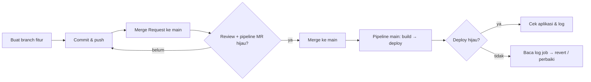

# 04 Lab 3: CI/CD, Deploy Otomatis Setiap Ada Perubahan di `main`

Kembali ke [[03 Lab 2 - Cluster seperti Kantor]] · Lanjut ke [[05 Cheat Sheet dan Troubleshooting]]

---

**Tujuan:** setiap kali ada push atau merge ke `main`, GitLab otomatis build image, push ke registry, lalu deploy ke cluster lab. Pipeline-nya meniru kantor, dengan beberapa perbaikan keamanan.

Prasyarat: cluster dan lab-infra dari [[03 Lab 2 - Cluster seperti Kantor]] masih hidup, dan Deployment `hello-api` sudah ada di namespace `demo`.

---

## 1. Konsep dulu

| Istilah | Arti |
|---|---|
| **CI** (*Continuous Integration*) | Setiap perubahan kode otomatis di-build (dan idealnya dites) supaya error ketahuan cepat |
| **CD** (*Continuous Delivery/Deployment*) | Hasil build otomatis dikirim ke server. *Delivery* = siap deploy tapi menunggu tombol. *Deployment* = langsung jalan. Kantor memakai yang kedua |
| **Pipeline** | Seluruh rangkaian kerja untuk satu commit. Didefinisikan di `.gitlab-ci.yml` |
| **Stage** | Tahap berurutan (`build` → `deploy`). Stage berikutnya jalan hanya jika stage sebelumnya sukses |
| **Job** | Satu tugas di dalam stage (misalnya `build-prod`) |
| **Runner** | Program `gitlab-runner` di sebuah server yang mengambil job dari GitLab lalu menjalankannya |
| **Executor** | Cara runner menjalankan job. **shell** = langsung di server itu (dipakai kantor). **docker** = di dalam container sekali pakai |
| **Tags** | Label runner. Job dengan `tags: [deploy-k8s]` hanya diambil runner bertag `deploy-k8s` |
| **rules / only** | Syarat kapan job jalan (misalnya hanya di branch `main`) |
| **Variabel bawaan** | `$CI_COMMIT_SHORT_SHA` (8 karakter hash commit), `$CI_COMMIT_BRANCH`, `$CI_REGISTRY`, dll |
| **CI/CD Variables** | Rahasia yang disimpan di pengaturan GitLab (misalnya `CI_REGISTRY_PASSWORD`), bukan di file YAML |

### Branch dan tujuan deploy di kantor

| Repo | Branch | Ke mana | Caranya |
|---|---|---|---|
| `layanan-x-api` | `development` | Server dev 10.20.1.x | Runner `portal-staging-backend`, `docker compose up` di `/home/<akun>/apps/layanan-x-api` |
| `layanan-x-api` | `main` | **Kubernetes production** | Runner `build-images` → registry → runner `deploy-k8s` → `kubectl set image` |
| `module-layanan-x` | `staging` | Server staging | docker compose |
| `module-layanan-x` | `main` | **Kubernetes production** | Sama seperti backend, namespace `app-frontend` |

Jadi, **"deploy kalau ada perubahan di master"** di kantor artinya: perubahan masuk ke `main`, pipeline jalan sendiri, selesai. Tidak ada yang SSH ke server untuk deploy.

### Kenapa tag image = hash commit?

- Dari image yang jalan, kamu tahu persis **kode mana** yang sedang di production (lihat jawaban sebelumnya tentang cara mengecek image `lx-api`).
- Setiap versi punya nama unik, jadi rollback tinggal kembali ke tag sebelumnya.
- Tag `latest` selalu menunjuk "yang terakhir", sehingga tidak bisa dipakai untuk dua hal di atas.

---

## 2. Siapkan repo di GitLab

Pakai akun **gitlab.com pribadi** untuk latihan, bukan `gitlab.kantor.example`.

1. Buat project baru (private) bernama `hello-api` di gitlab.com.
2. Di Mac:

```bash
cd ~/belajar-k8s/hello-api
git init -b main
git add server.js Dockerfile k8s/
git commit -m "Initial hello-api"
git remote add origin git@gitlab.com:<username-kamu>/hello-api.git
git push -u origin main
```

Pastikan **tidak ada Secret** di folder `k8s/` (Secret dibuat lewat command di Lab 2, bukan file).

---

## 3. Pasang runner build di lab-infra

Padanan runner `build-images` kantor (di VM Registry 10.20.0.22).

```bash
multipass shell lab-infra
curl -L "https://packages.gitlab.com/install/repositories/runner/gitlab-runner/script.deb.sh" | sudo bash
sudo apt-get install -y gitlab-runner
sudo usermod -aG docker gitlab-runner      # supaya job boleh menjalankan docker
sudo rm -f /home/gitlab-runner/.bash_logout   # menghindari error "prepare environment" di Ubuntu
sudo systemctl restart gitlab-runner
```

Daftarkan runner:

1. Di GitLab: project `hello-api` → **Settings → CI/CD → Runners → New project runner**.
2. Isi **Tags**: `lab-build`. Jangan centang *Run untagged jobs*. Klik **Create runner**.
3. GitLab menampilkan perintah berisi token `glrt-...`. Jalankan di lab-infra dengan `sudo`:

```bash
sudo gitlab-runner register --url https://gitlab.com --token glrt-xxxxxxxx
# Executor: shell
```

4. Halaman Runners di GitLab sekarang menunjukkan runner berstatus hijau (online).

---

## 4. Pasang runner deploy di lab-cp1 dengan izin terbatas

Padanan runner `deploy-k8s` kantor (di CP1).

### 4a. Kenapa tidak pakai admin.conf saja?

Itu cara tercepat, tapi berbahaya. Siapa pun yang bisa mengubah `.gitlab-ci.yml` di repo mana pun yang memakai runner itu otomatis bisa melakukan **apa saja** di cluster: menghapus namespace, membaca semua Secret (password database), dan seterusnya.

Prinsipnya **least privilege**: runner deploy hanya boleh mengubah image Deployment di namespace-nya sendiri.

### 4b. Buat ServiceAccount + Role

`k8s/ci-rbac.yaml` (simpan di repo, tapi di-apply oleh admin, bukan oleh pipeline):

```yaml
apiVersion: v1
kind: ServiceAccount
metadata:
  name: ci-deployer
  namespace: demo
---
apiVersion: rbac.authorization.k8s.io/v1
kind: Role
metadata:
  name: ci-deployer
  namespace: demo          # Role hanya berlaku di namespace ini
rules:
  - apiGroups: ["apps"]
    resources: ["deployments"]
    verbs: ["get", "list", "watch", "patch", "update"]   # cukup untuk set image, annotate, rollout
  - apiGroups: ["apps"]
    resources: ["replicasets"]
    verbs: ["get", "list", "watch"]                       # dibutuhkan rollout status / undo
  - apiGroups: [""]
    resources: ["pods", "pods/log"]
    verbs: ["get", "list", "watch"]                       # untuk melihat pod saat debugging
---
apiVersion: rbac.authorization.k8s.io/v1
kind: RoleBinding
metadata:
  name: ci-deployer
  namespace: demo
subjects:
  - kind: ServiceAccount
    name: ci-deployer
    namespace: demo
roleRef:
  apiGroup: rbac.authorization.k8s.io
  kind: Role
  name: ci-deployer
---
apiVersion: v1
kind: Secret
metadata:
  name: ci-deployer-token
  namespace: demo
  annotations:
    kubernetes.io/service-account.name: ci-deployer
type: kubernetes.io/service-account-token        # k8s mengisi token secara otomatis
```

Tidak ada izin untuk `secrets`, `nodes`, `namespaces`, atau `delete`.

```bash
kubectl apply -f k8s/ci-rbac.yaml
```

### 4c. Pasang runner dan kubeconfig-nya

```bash
multipass shell lab-cp1
curl -L "https://packages.gitlab.com/install/repositories/runner/gitlab-runner/script.deb.sh" | sudo bash
sudo apt-get install -y gitlab-runner
sudo rm -f /home/gitlab-runner/.bash_logout
```

Buat kubeconfig khusus untuk user `gitlab-runner`:

```bash
CP_IP=$(hostname -I | awk '{print $1}')
TOKEN=$(kubectl -n demo get secret ci-deployer-token -o jsonpath='{.data.token}' | base64 -d)
KC=/home/gitlab-runner/.kube/config

sudo -u gitlab-runner mkdir -p /home/gitlab-runner/.kube
sudo -u gitlab-runner kubectl config set-cluster lab --kubeconfig=$KC \
  --server=https://$CP_IP:6443 --certificate-authority=/etc/kubernetes/pki/ca.crt --embed-certs=true
sudo -u gitlab-runner kubectl config set-credentials ci-deployer --kubeconfig=$KC --token="$TOKEN"
sudo -u gitlab-runner kubectl config set-context ci --kubeconfig=$KC --cluster=lab --user=ci-deployer --namespace=demo
sudo -u gitlab-runner kubectl config use-context ci --kubeconfig=$KC
sudo chmod 600 $KC
unset TOKEN
```

Uji izinnya. Ini bagian yang paling penting:

```bash
sudo -u gitlab-runner kubectl --kubeconfig=$KC get deploy          # ✅ boleh
sudo -u gitlab-runner kubectl --kubeconfig=$KC get secrets         # ❌ Forbidden
sudo -u gitlab-runner kubectl --kubeconfig=$KC get nodes           # ❌ Forbidden
sudo -u gitlab-runner kubectl --kubeconfig=$KC delete deploy hello-api   # ❌ Forbidden
kubectl auth can-i --list --as=system:serviceaccount:demo:ci-deployer -n demo
```

Daftarkan runner seperti langkah 3, dengan tag **`lab-deploy`**, executor **shell**.

> Lebih ideal lagi, runner deploy **tidak** dipasang di node CP sama sekali, melainkan di VM terpisah yang hanya punya kubeconfig terbatas ini. Di lab kita taruh di CP supaya hemat VM.

---

## 5. Tulis pipeline

`~/belajar-k8s/hello-api/.gitlab-ci.yml`:

```yaml
stages:
  - build
  - deploy

variables:
  REGISTRY: "192.168.64.__:5000"          # IP lab-infra
  IMAGE: "$REGISTRY/demo/hello-api"

build:
  stage: build
  tags: [lab-build]
  rules:
    - if: '$CI_COMMIT_BRANCH == "main"'
  script:
    - docker build --build-arg APP_VERSION=$CI_COMMIT_SHORT_SHA -t $IMAGE:$CI_COMMIT_SHORT_SHA .
    - docker push $IMAGE:$CI_COMMIT_SHORT_SHA

deploy:
  stage: deploy
  tags: [lab-deploy]
  needs: [build]
  resource_group: production            # cegah dua deploy berjalan bersamaan
  environment:
    name: production                    # riwayat deploy tampil di Operate → Environments
  rules:
    - if: '$CI_COMMIT_BRANCH == "main"'
  script:
    - kubectl set image deployment/hello-api hello-api=$IMAGE:$CI_COMMIT_SHORT_SHA
    - kubectl annotate deployment/hello-api kubernetes.io/change-cause="$CI_COMMIT_SHORT_SHA $CI_COMMIT_TITLE" --overwrite
    - kubectl rollout status deployment/hello-api --timeout=120s
```

Bandingkan dengan pipeline `layanan-x-api` di [[01 Arsitektur Cluster Belajar]] bagian 10. Strukturnya sama: build dengan tag SHA, push, `set image`, `rollout status`. Tambahannya:
- `resource_group`: kalau dua orang merge berdekatan, deploy kedua menunggu yang pertama selesai.
- `annotate change-cause`: `kubectl rollout history` akan menampilkan commit dan judulnya, bukan cuma nomor revisi.
- Tidak ada `docker login -p` karena registry lab tanpa password. Kalau registry-mu pakai password, simpan di **Settings → CI/CD → Variables** (centang *Masked*) dan gunakan:
  ```yaml
  - echo "$CI_REGISTRY_PASSWORD" | docker login -u <user-registry> --password-stdin $REGISTRY
  ```

Push:

```bash
git add .gitlab-ci.yml k8s/ci-rbac.yaml
git commit -m "Add CI/CD pipeline"
git push
```

Buka GitLab → **Build → Pipelines**. Kamu akan melihat dua job: `build` lalu `deploy`. Klik tiap job untuk membaca log-nya.

---

## 6. Rasakan alurnya: ubah kode → otomatis production

1. Ubah pesan di `server.js`, misalnya `halo` menjadi `apa kabar`.
2. Di terminal lain, pantau aplikasi:
   ```bash
   while true; do curl -s http://hello.lab.local/; sleep 1; done
   ```
3. Commit dan push:
   ```bash
   git commit -am "Ubah sapaan"
   git push
   ```
4. Perhatikan pipeline berjalan. Saat job `deploy` jalan, output curl berganti dari `version: <sha lama>` ke `version: <sha baru>` tanpa ada request yang gagal.
5. Cek riwayat:
   ```bash
   kubectl -n demo rollout history deployment/hello-api
   kubectl -n demo get rs -o wide
   ```

Selamat, kamu baru saja melakukan hal yang sama dengan pipeline production kantor.

---

## 7. Latihan: ketika deploy gagal

### 7a. Build gagal

Tulis Dockerfile yang salah (misalnya `FROM node:99-tidak-ada`). Push.
- Job `build` merah, `deploy` tidak jalan.
- Production **tidak tersentuh sama sekali**.

### 7b. Aplikasi crash saat start

Tambahkan `process.exit(1);` di baris pertama `server.js`. Push.
- `build` hijau (image berhasil dibuat).
- `deploy`: pod baru `CrashLoopBackOff`, `rollout status` menunggu 120 detik lalu gagal, dan job merah.
- Production **tetap melayani** dengan pod lama karena `maxUnavailable: 0`.
- Tapi Deployment sekarang "menggantung" dengan satu pod rusak.

Perbaikan ada dua cara:

**Cara yang benar: revert lewat Git.** Ini membuat Git tetap menjadi sumber kebenaran.

```bash
git revert HEAD
git push
```

Pipeline berjalan lagi dan men-deploy kode yang sudah dibetulkan.

**Cara darurat: rollback langsung di cluster.**

```bash
kubectl -n demo rollout undo deployment/hello-api
```

Cepat, tapi sekarang isi cluster beda dengan isi `main`. Commit berikutnya ke `main` akan men-deploy kode itu lagi. Jadi tetap harus diikuti revert di Git.

### 7c. Rollback otomatis di pipeline (opsional)

Ganti baris terakhir script `deploy` dengan:

```yaml
    - kubectl rollout status deployment/hello-api --timeout=120s || { kubectl rollout undo deployment/hello-api; exit 1; }
```

Kalau rollout gagal, pipeline langsung mengembalikan ke versi sebelumnya, dan job tetap merah supaya tim tahu.

---

## 8. Alur kerja harian yang sehat



Atur di GitLab:
- **Settings → Repository → Protected branches**: `main` hanya boleh di-push Maintainer, developer lewat Merge Request.
- **Settings → Merge requests**: centang *Pipelines must succeed*.

---

## 9. Deploy perubahan di kantor (dunia nyata)

Sebagai developer, langkahmu:

1. Buat branch dari `main`, kerjakan perubahan, lalu buat Merge Request ke `main` di `gitlab.kantor.example`.
2. Setelah di-review dan di-merge, pipeline `build-prod` → `deploy-prod` jalan **sendiri**.
3. Pantau di GitLab → **Build → Pipelines**. Pastikan kedua job hijau.
4. Kalau ingin memastikan versi yang jalan, cek tag image Deployment-nya (lihat [[05 Cheat Sheet dan Troubleshooting#Cek versi yang sedang jalan di kantor]]). Tag-nya harus sama dengan 8 karakter pertama commit merge-mu.
5. Kalau `deploy-prod` merah: baca log job-nya. Pod lama masih melayani. Koordinasikan dengan tim sebelum `rollout undo`, dan utamakan revert MR.

**Service baru** (belum pernah ada di cluster): pipeline kantor hanya melakukan `set image`, yang gagal kalau Deployment-nya belum ada (`deployments.apps "xxx" not found`). Deployment, Service, dan Ingress-nya harus dibuat dulu oleh tim infra dengan `kubectl apply`, seperti contoh `frontend/landing-cms/k8s/deployment.yaml`.

---

## 10. Langkah berikutnya setelah lab ini

Urutkan dari yang paling berguna:

1. **Tambah stage test** sebelum build: `npm ci && npm test` (pakai image Node di job dengan executor docker, atau `docker run` di runner shell).
2. **Pipeline untuk Merge Request**: jalankan build/test (tanpa deploy) untuk setiap MR, memakai `rules: - if: '$CI_PIPELINE_SOURCE == "merge_request_event"'`.
3. **Environment staging**: namespace `demo-staging`, branch `staging` men-deploy ke sana, `main` ke production.
4. **Manifest dikelola sepenuhnya oleh Git**: pakai Kustomize (`kubectl apply -k`) atau Helm, sehingga pipeline melakukan `apply`, bukan cuma `set image`.
5. **GitOps dengan Argo CD**: cluster menarik sendiri state dari repo, dan pipeline cukup meng-commit tag image baru. Runner tidak perlu akses ke cluster sama sekali.
6. **Scan keamanan image** dengan Trivy di stage build.
7. Registry dengan TLS dan autentikasi, lalu `imagePullSecrets` di Deployment (Kantor memakai secret `regcred`).

## Cek pemahaman

- [ ] Kenapa image ditag dengan `$CI_COMMIT_SHORT_SHA`, bukan `latest`?
- [ ] Apa fungsi `tags` di job, dan bagaimana kantor memakainya untuk memisahkan build dan deploy?
- [ ] Kenapa runner deploy sebaiknya tidak memakai `admin.conf`?
- [ ] Saat aplikasi crash setelah deploy, kenapa user tidak terdampak? Lalu apa yang tetap harus kamu lakukan?
- [ ] Kenapa revert di Git lebih baik daripada `rollout undo`?
- [ ] Apa yang harus disiapkan sebelum service baru bisa di-deploy oleh pipeline kantor?

Lanjut ke [[05 Cheat Sheet dan Troubleshooting]].
