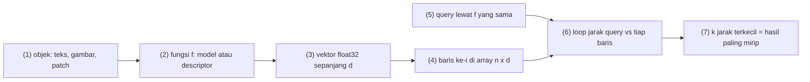

## Pernyataan inti
Sebuah fungsi `f` (model embedding, atau descriptor buatan tangan seperti SIFT)
mengubah setiap objek menjadi `d` angka. `d` angka itu adalah koordinat satu titik di
R^d. Fungsi `f` dirancang atau dilatih supaya objek yang "mirip" (menurut kriteria
`f`) mendarat di titik yang berdekatan menurut satu metrik jarak. Begitu itu berlaku,
"cari objek yang mirip" berubah jadi "cari titik terdekat" (kNN), yaitu masalah
geometri murni. Index hanya melihat titik dan jarak. Ia tidak tahu, dan tidak peduli,
apa arti titik itu.

## Istilah
| Istilah | Arti | Contoh |
|---|---|---|
| R^d | Ruang semua daftar `d` bilangan real. `d` disebut dimensi. | `(2, 1, 1)` ada di R^3 |
| vektor / titik | Satu anggota R^d. Disebut "vektor" kalau dilihat sebagai panah, "titik" kalau dilihat sebagai posisi. Isinya sama. | `x = (1, 3, 0)` |
| komponen / koordinat | Angka ke-`i` dari vektor, ditulis `x[i]`. Satu komponen = posisi di satu sumbu. | `x[1] = 3` |
| embedding | Vektor hasil `f(objek)`. Untuk model terlatih, sumbu-sumbunya umumnya tidak punya arti yang bisa dibaca manusia. | teks → 768 angka |
| descriptor | Embedding yang dirumuskan manual, bukan dilatih. Sumbunya punya arti. | SIFT: histogram arah gradien |
| fungsi `f` | Aturan objek → vektor. Query dan data **wajib** lewat `f` yang sama. | `f("aabc") = (2, 1, 1)` |
| jarak L2 kuadrat | `‖a − b‖² = Σ (a[i] − b[i])²`. Detail metrik lain ada di [[07-concepts/T1-02-l2-cosine-inner-product]]. | `‖(3,1,0) − (1,3,0)‖² = 8` |
| kNN (k nearest neighbors) | `k` titik dengan jarak terkecil ke query. | k = 2 → dua titik terdekat |
| ground truth | kNN yang benar, dihitung brute force: jarak query ke **semua** `n` titik. | daftar 10 id terdekat per query |
| recall@k | Fraksi ground truth top-k yang ikut dikembalikan index. | 9 dari 10 benar → 0.9 |
| float32 | Format bilangan 4 byte (IEEE 754). Hanya mampu menyimpan sekitar 7 digit desimal. | `0.1` tersimpan sebagai `0.100000001490...` |
| row-major | Cara menyimpan matriks `n × d`: baris ke-0 utuh, lalu baris ke-1, dst., berderet di memori. | vektor `i` mulai di byte `i·d·4` |

## Gambaran


> [!info] Cara membaca
> Langkah (1)–(4) terjadi saat insert. Langkah (5)–(7) terjadi saat query. Arti
> "mirip" hanya hidup di kotak (2). Setelah kotak (3), semua yang tersisa adalah angka
> dan jarak. Index vektor hanya bekerja di kotak (4)–(7).

## Penjelasan bertahap
1. **Objek jadi daftar angka.** Komputer tidak bisa membandingkan "makna" dua kalimat,
   tapi bisa membandingkan dua daftar angka. Jadi langkah pertama selalu: ubah objek
   jadi vektor dengan panjang tetap `d`, sama untuk semua objek.
2. **Daftar angka = posisi.** `(2, 1, 1)` adalah titik: 2 langkah di sumbu pertama, 1 di
   sumbu kedua, 1 di sumbu ketiga. Dengan `d = 128` sumbunya ada 128. Tidak bisa
   digambar, tapi rumus jaraknya sama dengan di 2D: jumlahkan selisih kuadrat per sumbu.
3. **`f` yang membuat dekat = mirip.** Ini bukan kebetulan. SIFT dirumuskan supaya patch
   gambar yang mirip menghasilkan histogram yang mirip, jadi selisih per komponennya
   kecil. Model embedding terlatih umumnya dioptimasi dengan loss yang menarik pasangan
   mirip supaya jaraknya kecil dan mendorong pasangan tak-mirip supaya jaraknya besar,
   **dalam metrik tertentu**. "Mirip" = "dekat" hanya benar sejauh `f` berhasil, dan
   hanya untuk metrik yang dipakai saat `f` dirancang.
4. **Similarity search jadi kNN.** "Objek apa yang paling mirip dengan query?" menjadi
   `argmin_x dist(f(q), x)`. Itu soal geometri. Tidak ada teks atau gambar di index.
5. **Dua sumber kesalahan yang terpisah.** (a) `f` gagal: objek tak-mirip mendarat
   berdekatan (tiga string berbeda jadi satu titik di contoh bawah). (b) Index gagal:
   titik terdekat yang sebenarnya tidak ditemukan. Recall@k
   ([[07-concepts/T2-02-definisi-recall-at-k]]) hanya mengukur (b), karena ground
   truth-nya brute force di geometri yang sama
   ([[07-concepts/T2-03-ground-truth-brute-force]]), bukan penilaian manusia.
6. **Di memori, titik = satu baris float32.** Vektor ke-`i` adalah byte `i·d·4` sampai
   `(i+1)·d·4 − 1`. "Menghitung jarak ke titik `i`" = membaca `4d` byte itu dan
   menjalankan satu loop sepanjang `d`. Koordinatnya pun bukan bilangan real: float32
   adalah grid berhingga, dan grid itu makin renggang untuk nilai yang makin besar.

## Mekanisme / formula
Pemetaan dan pertanyaannya:

```
f : Objek → R^d                       (dipanggil sekali per objek, saat insert)
kNN(q) = k elemen x di X dengan ‖f(q) − x‖ terkecil
```

Invariant yang bisa dicek: kalau `f(o1) = f(o2)`, **tidak ada** metrik dan **tidak ada**
index yang bisa membedakan `o1` dan `o2`. Jaraknya 0. Yang dibuang `f` hilang permanen.

### Contoh angka kecil (d = 3)
`f(s)` = jumlah huruf `a`, `b`, `c` di string `s`. Ini descriptor buatan tangan: sumbunya
punya arti ("berapa banyak huruf a"). Query `q = "aaab"`, jadi `f(q) = (3, 1, 0)`.

| Rank | String | f(s) | ‖f(q) − f(s)‖² |
|---|---|---|---|
| 1 | `aabc` | (2, 1, 1) | 2 |
| 1 | `abca` | (2, 1, 1) | 2 |
| 1 | `caba` | (2, 1, 1) | 2 |
| 4 | `abbb` | (1, 3, 0) | 8 |
| 4 | `abcc` | (1, 1, 2) | 8 |
| 6 | `bbcc` | (0, 2, 2) | 14 |
| 7 | `cccc` | (0, 0, 4) | 26 |

String dengan komposisi huruf mirip memang dekat: `f` berhasil untuk definisi "mirip"
miliknya sendiri. Tapi `aabc`, `abca`, dan `caba` adalah tiga string berbeda di **titik
yang sama**, karena `f` membuang urutan huruf. Index sempurna pun mengembalikannya seri.

### Trace langkah demi langkah
Loop jarak untuk `f(q) = (3, 1, 0)` melawan `f("abbb") = (1, 3, 0)`:

| i | q[i] | x[i] | t = q[i] − x[i] | t² | jumlah berjalan |
|---|---|---|---|---|---|
| 0 | 3 | 1 | 2 | 4 | 4 |
| 1 | 1 | 3 | −2 | 4 | 8 |
| 2 | 0 | 0 | 0 | 0 | 8 |

Setiap sumbu menyumbang satu suku. Jarak adalah akumulasi sumbangan per sumbu.
Pola "jumlah dari `d` sumbangan kecil" ini yang nanti menjelaskan distance
concentration ([[07-concepts/T1-04-distance-concentration]]).

### Di level loop
Layout `n × d` float32, row-major, `d = 128` (dimensi SIFT):

| Vektor i | Byte awal | Byte akhir |
|---|---|---|
| 0 | 0 | 511 |
| 1 | 512 | 1023 |
| 999.999 | 511.999.488 | 511.999.999 |

Satu juta vektor 128 dimensi = 512.000.000 byte data mentah (sekitar 488 MiB), belum
termasuk edge graf. Satu perbandingan L2 kuadrat = `d` pengurangan, `d` perkalian,
`d` penjumlahan, dan membaca `4d` byte data kandidat. Di Go, vektor `i` cukup
`data[i*d : (i+1)*d]`: slice ke blok yang sama, bukan salinan.

`0.1` tersimpan sebagai `0.10000000149011611938`. Jarak ke float32 berikutnya `1.19e-07`
di sekitar 1.0, tapi `7.63e-06` di sekitar 100. Dua kandidat yang jaraknya berselisih
kurang dari grid itu tidak bisa dibedakan dengan andal.

`[implementasi: hnswlib]` `[dicek di source hnswlib master, 2026-11-23]` vektor disimpan di blok `data_level0_memory_`,
bersebelahan dengan edge layer 0 dan label tiap elemen. Cek `getDataByInternalId`.
`[implementasi: faiss]` `[cukup yakin]` `IndexFlat` menyimpan vektor flat row-major
di `codes`; `get_xb()` mengembalikan pointer float ke awal blok.

## Kenapa ini penting untuk risetku
- RQ1 dan RQ2 bicara tentang recall. Recall mengukur kegagalan **index** (sumber b),
  bukan kegagalan `f` (sumber a). Delete dan compaction hanya merusak sumber (b).
  Proposal harus menyatakan batas ini, supaya "recall turun" tidak dibaca sebagai
  "pengguna dapat hasil lebih buruk" (construct validity).
- Fase 2 (HNSW dari nol): layout `n × d` di atas adalah titik awal desain memori.
  Byte per vektor menentukan berapa vektor muat di cache, jadi biaya setiap hop graf.

## Salah paham yang umum
- "Dekat = mirip secara makna, selalu." Hanya sejauh `f` berhasil. Contoh
  `aabc`/`abca`/`caba` menunjukkan `f` bisa menyamakan objek berbeda.
- "Sumbu ke-17 artinya sesuatu." Untuk descriptor buatan tangan, ya. Untuk embedding
  terlatih, umumnya tidak; yang bermakna adalah posisi relatif antar titik.
- "Query boleh pakai model lain asal dimensinya sama." Tidak. Dua `f` berbeda
  menghasilkan dua geometri berbeda; jarak di antara keduanya tidak bermakna.
- "Index bisa memperbaiki embedding yang buruk." Tidak. Paling bagus ia mengembalikan kNN asli.

## Cara memverifikasi ini sendiri
```python
import numpy as np

def f(s):  # descriptor mainan d = 3: hitung huruf a, b, c
    return np.array([s.count(ch) for ch in "abc"], dtype=np.float32)

docs = ["aabc", "abca", "abbb", "bbcc", "cccc", "abcc", "caba"]
X = np.stack([f(s) for s in docs]); fq = f("aaab")
d2 = ((X - fq) ** 2).sum(1)
print([(docs[i], float(d2[i])) for i in np.argsort(d2, kind="stable")])
# [('aabc', 2.0), ('abca', 2.0), ('caba', 2.0), ('abbb', 8.0), ('abcc', 8.0), ('bbcc', 14.0), ('cccc', 26.0)]

x = f("abbb"); s = np.float32(0)
for i in range(3):              # trace loop jarak
    t = fq[i] - x[i]; s += t * t
    print(i, float(t), float(s))  # 0 2.0 4.0 / 1 -2.0 8.0 / 2 0.0 8.0

print(f"{float(np.float32(0.1)):.20f}")  # 0.10000000149011611938
print(np.spacing(np.float32(1.0)), np.spacing(np.float32(100.0)))  # 1.1920929e-07 7.6293945e-06
print(1_000_000 * 128 * 4)               # 512000000 byte untuk SIFT1M mentah
```
Di SIFT1M asli: baca `sift_base.fvecs` (format dibahas di T8-01, Track 8), cek
`X.shape == (1000000, 128)`, `X.dtype == float32`, dan `X.nbytes`.

## Rujukan
- Lowe, "Distinctive Image Features from Scale-Invariant Keypoints", IJCV 2004
  `[yakin]`: descriptor SIFT 128 dimensi = 4×4 sel spasial × 8 bin arah gradien.
- Deep10M berdimensi 96 `[cukup yakin]`; cek sendiri saat mengunduh.
- Selebihnya definisi dasar aljabar linear dan format IEEE 754, tidak butuh sitasi.
