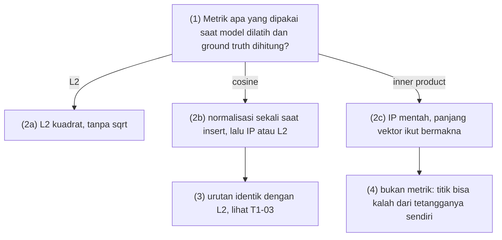

## Pernyataan inti
L2 mengukur jarak garis lurus antar dua titik, jadi arah **dan** panjang ikut
dihitung. Inner product `q · x = ‖q‖‖x‖cos θ` mencampur sudut dengan panjang `x`,
jadi vektor panjang diuntungkan. Cosine membuang panjang dan hanya melihat sudut.
Ketiganya bisa memilih tetangga terdekat yang berbeda untuk query yang sama. Aturan
pakainya satu: **pakai metrik yang dipakai saat embedding dilatih dan saat ground
truth dihitung**. Hanya L2 yang memenuhi keempat aksioma metrik.

## Istilah
| Istilah | Arti | Contoh |
|---|---|---|
| jarak L2 (Euclidean) | `‖a − b‖ = sqrt(Σ (a[i] − b[i])²)`. Kecil = mirip. | `‖(1,0) − (0.8,0.3)‖ = 0.3606` |
| L2 kuadrat | `‖a − b‖²`, tanpa `sqrt`. Urutannya sama dengan L2 karena `sqrt` monoton naik. | `0.13` untuk pasangan di atas |
| inner product (IP, dot) | `a · b = Σ a[i]·b[i]`. Ini similarity: besar = mirip. | `(1,0) · (4,1) = 4` |
| norma `‖a‖` | `sqrt(a · a)`, panjang vektor. | `‖(4,1)‖ = 4.1231` |
| cosine similarity / distance | Similarity `(a · b) / (‖a‖‖b‖)`, dari −1 sampai 1. Distance `1 − cos`, supaya "kecil = mirip". | searah: 1 / 0 |
| angular distance | `arccos(cos)`, sudut dalam radian. | tegak lurus = 1.5708 |
| distance vs similarity | Distance diurutkan menaik, similarity menurun. Tools sering mengubah similarity jadi distance. | `1 − IP` |
| metrik | Fungsi jarak yang memenuhi: `d ≥ 0`; `d(a,b) = 0` hanya jika `a = b`; simetris; triangle inequality. | L2 |
| triangle inequality | `d(a,c) ≤ d(a,b) + d(b,c)`: jalan memutar tidak pernah lebih pendek. | gagal untuk L2 kuadrat |
| MIPS | Maximum inner product search: cari `x` dengan `q · x` terbesar, tanpa normalisasi. | rekomendasi produk |
| ulp | Jarak antara satu float dan float berikutnya. Makin besar nilainya, makin besar ulp-nya. | ulp float32 di 1.28e6 = 0.125 |
| BLAS | Library standar perkalian vektor/matriks yang sangat dioptimasi. Brute force batch memakainya. | `sgemm` |
| catastrophic cancellation | Mengurangkan dua bilangan besar yang hampir sama; digit benar hilang, sisanya noise pembulatan. | `1281707.8 − 1281707.7` |

## Gambaran


> [!info] Cara membaca
> Pilihan metrik bukan selera; ia ditentukan model embedding dan ground truth. Cabang
> (2b) paling umum untuk embedding teks. Cabang (2c) satu-satunya yang keluar dari
> dunia metrik, dan itu berkonsekuensi untuk graph index.

## Penjelasan bertahap
1. **Index butuh satu fungsi pembanding.** Setiap langkah index (sortir kandidat, pilih
   edge, berhenti mencari) hanya bertanya "mana yang lebih dekat?". Yang dibutuhkan:
   satu fungsi dua-vektor-ke-satu-angka, plus arah sortirnya.
2. **L2: posisi.** L2 menjumlahkan selisih per sumbu. Dua titik searah tapi beda panjang
   tetap berjauhan. `sqrt` di akhir tidak mengubah urutan, jadi implementasi membuangnya.
3. **Inner product: proyeksi dikali panjang.** `q · x = ‖q‖‖x‖cos θ`. Untuk satu query
   `‖q‖` konstan, jadi urutan ditentukan `‖x‖·cos θ`: vektor panjang bisa menang walau
   sudutnya lebar. Untuk `q = (1, 0)`: `q · q = 1` tapi `q · 2q = 2`, jadi `q` bukan
   tetangga terdekat dirinya sendiri. Dipakai kalau panjang memang berarti, misalnya
   matrix factorization untuk rekomendasi, yang skornya **didefinisikan** sebagai dot.
4. **Cosine: arah saja.** Kedua norma dibagi keluar. Dipakai kalau model dilatih dengan
   cosine (banyak model embedding teks; cek dokumentasi modelnya). Di praktik vektor
   dinormalisasi sekali saat insert, lalu IP biasa, dan urutannya identik dengan L2
   ([[07-concepts/T1-03-cosine-ekuivalen-l2-setelah-normalisasi]]).
5. **Kenapa aksioma metrik penting.** Proximity graph bersandar pada intuisi "tetangga
   dari tetanggaku juga dekat denganku", bentuk informal triangle inequality. L2 kuadrat
   dan `1 − cos` melanggarnya (contoh bawah), tapi urutannya sama dengan metrik (L2, dan
   angular distance), jadi kNN aman. IP mentah tidak bisa setara dengan metrik apa pun
   tanpa transformasi, karena "`d(a,a)` minimum" saja sudah gagal.
6. **Di level mesin.** Ketiganya satu loop sepanjang `d` dengan biaya mirip (tabel
   bawah). Yang berbahaya justru `‖a−b‖² = ‖a‖² + ‖b‖² − 2a·b`, dipakai brute force batch
   karena bisa memakai perkalian matriks. Di float32, untuk vektor panjang yang
   berdekatan, rumus ini kehilangan semua digit benar.

## Mekanisme / formula
```
L2²(a,b)   = Σ (a[i] − b[i])²                 urut menaik
IP(a,b)    = Σ a[i]·b[i] = ‖a‖‖b‖ cos θ        urut menurun
cos(a,b)   = IP(a,b) / (‖a‖‖b‖)                urut menurun
```
Reduksi MIPS ke L2: dengan `M = max ‖x‖`, ubah `x' = (x, sqrt(M² − ‖x‖²))` dan
`q' = (q, 0)`. Maka `‖q' − x'‖² = ‖q‖² + M² − 2 q·x`; dua suku pertama konstan, jadi
argmin L2 di ruang baru = argmax IP di ruang lama (dicek di kode bawah).

### Contoh angka kecil (d = 2)
Query `q = (1, 0)`.

| Kandidat | L2² | IP | cos | `1 − IP` (gaya hnswlib) |
|---|---|---|---|---|
| A = (0.8, 0.3) | **0.1300** | 0.8 | 0.9363 | 0.2 |
| B = (4, 1) | 10.0000 | **4.0** | 0.9701 | −3.0 |
| D = (2, 0) | 1.0000 | 2.0 | **1.0000** | −1.0 |
| E = (0, 1) | 2.0000 | 0.0 | 0.0000 | 1.0 |

Tiga metrik, tiga pemenang: L2 memilih A (titik terdekat), IP memilih B (paling
panjang), cosine memilih D (arah persis sama). Perhatikan `1 − IP` bisa negatif.
Pelanggaran triangle inequality, dihitung:

| Fungsi | Kasus | `d(a,c)` | `d(a,b) + d(b,c)` | Triangle inequality |
|---|---|---|---|---|
| L2² | titik 0, 1, 2 di garis | 4 | 2 | gagal |
| `1 − cos` | sudut 0°, 45°, 90° | 1.0000 | 0.5858 | gagal |
| angular distance | sudut 0°, 45°, 90° | 1.5708 | 1.5708 | lolos (sama persis) |

### Trace langkah demi langkah
Satu loop menghitung semua akumulator sekaligus. `a = (1, 2, 2)`, `b = (2, 0, 1)`, float32:

| i | a[i] | b[i] | Σ a·b | Σ a·a | Σ b·b | Σ (a−b)² |
|---|---|---|---|---|---|---|
| 0 | 1 | 2 | 2 | 1 | 4 | 1 |
| 1 | 2 | 0 | 2 | 5 | 4 | 5 |
| 2 | 2 | 1 | 4 | 9 | 5 | 6 |

Akhir: IP = 4, L2² = 6, cos = 4 / sqrt(9·5) = 0.5963. Cek: 9 + 5 − 2·4 = 6.

### Di level loop
Biaya per perbandingan, `d = 128`, float32:

| Metrik | Operasi per perbandingan (byte kandidat dibaca: 512 untuk semua) |
|---|---|
| IP, atau cosine pada data ternormalisasi | 128 kali + 128 tambah |
| L2² | 128 kurang + 128 kali + 128 tambah |
| cosine naif | 3 akumulator (3×128 kali + 3×128 tambah) + sqrt + bagi |

Dengan FMA (fused multiply-add), "kali + tambah" jadi satu instruksi. Cancellation pada
rumus terurai, `a ≈ 100` per komponen, `b = a + noise 1e-3`, `d = 128`, float32:

| Seed | L2² langsung | `‖a‖² + ‖b‖² − 2a·b` |
|---|---|---|
| 0 | 1.4579e-04 | 0.0 |
| 1 | 1.0867e-04 | 0.25 |

`‖a‖² ≈ 1.28e6` dan ulp float32 di sana 0.125, ribuan kali lebih besar dari jarak
sebenarnya. Hasil rumus terurai = noise pembulatan. Angka persisnya bisa beda di BLAS
lain; skala error-nya (orde ulp `‖a‖²`) tidak.

`[implementasi: hnswlib]` `[dicek di source hnswlib master, 2026-11-23]` space `'l2'` memakai `L2Sqr` (kuadrat, tanpa
`sqrt`); space `'ip'` memakai `InnerProductDistance` yang mengembalikan `1 − dot`.
`[implementasi: faiss]` `[cukup yakin]` `IndexFlatL2` mengembalikan L2 kuadrat,
`IndexFlatIP` mengembalikan IP (besar = baik). Brute force batch besar lewat BLAS
dengan rumus terurai (`exhaustive_L2sqr_blas`), dan hasil negatif di-clamp ke 0 dengan
komentar "negative values can occur for identical vectors due to roundoff errors" `[dicek di source faiss main, 2026-11-23]`.

## Kenapa ini penting untuk risetku
- Ground truth SIFT1M dihitung dengan L2 `[cukup yakin]`. Untuk Deep10M, cek metrik
  ground truth dan norma vektornya sebelum memilih space. Metrik index yang beda dari
  ground truth membuat recall mengukur hal yang salah.
- RQ1 (C-002): proxy signal seperti "jarak hasil ke-k" bergantung pada semantik angka
  jarak. Di `'ip'` hnswlib jarak bisa negatif; di faiss IP besar = baik. Definisikan
  sinyal per metrik, jangan disalin antar setup.
- Ground truth buatan sendiri dengan rumus terurai di float32 bisa salah urut untuk
  near duplicate. Hitung ulang di float64 untuk kandidat yang jaraknya sangat kecil.

## Salah paham yang umum
- "IP dan cosine itu sama." Hanya untuk vektor ternormalisasi (B vs D di atas).
- "L2 kuadrat itu metrik." Bukan; tapi urutannya sama dengan L2, jadi aman untuk kNN.
- "Jarak hnswlib dan faiss bisa dibandingkan langsung." Tidak: `1 − dot` vs dot.

## Cara memverifikasi ini sendiri
```python
import numpy as np
q = np.array([1.0, 0.0])
C = {"A": [0.8, 0.3], "B": [4.0, 1.0], "D": [2.0, 0.0], "E": [0.0, 1.0]}
for k, v in C.items():
    x = np.array(v); ip = q @ x
    print(k, round(((q - x) ** 2).sum(), 4), ip, round(ip / np.linalg.norm(x), 4))
# A 0.13 0.8 0.9363 / B 10.0 4.0 0.9701 / D 1.0 2.0 1.0 / E 2.0 0.0 0.0

u = lambda deg: np.array([np.cos(np.radians(deg)), np.sin(np.radians(deg))])
print(1 - u(0) @ u(90), (1 - u(0) @ u(45)) + (1 - u(45) @ u(90)))  # ~1.0 0.5858: triangle gagal

for seed in [0, 1]:  # cancellation rumus terurai di float32
    rng = np.random.default_rng(seed)
    a = (100 + rng.normal(size=128)).astype(np.float32)
    b = (a + 1e-3 * rng.normal(size=128)).astype(np.float32)
    print(((a - b) ** 2).sum(dtype=np.float32), (a @ a) + (b @ b) - 2 * (a @ b))
# 0.00014578935 0.0 / 0.00010866509 0.25 (kolom kedua bisa beda di BLAS lain)

rng = np.random.default_rng(0)  # reduksi MIPS -> L2
X = rng.normal(size=(1000, 16)) * rng.uniform(0.5, 3, size=(1000, 1)); qq = rng.normal(size=16)
M = np.linalg.norm(X, axis=1).max(); qp = np.append(qq, 0)
Xp = np.hstack([X, np.sqrt(M**2 - (X**2).sum(1))[:, None]])
ip_top = np.argsort(-(X @ qq))[:10]
print(np.array_equal(ip_top, np.argsort(((Xp - qp) ** 2).sum(1))[:10]))  # True
print(np.array_equal(ip_top, np.argsort(((X - qq) ** 2).sum(1))[:10]))    # False: L2 mentah beda
```
Di source: hnswlib `space_l2.h` (`L2Sqr`) dan `space_ip.h` (`InnerProductDistance`).

## Rujukan
Aksioma metrik dan definisi L2/IP/cosine: matematika dasar, tanpa sitasi. Reduksi MIPS
ke L2 dengan satu dimensi tambahan: Bachrach et al., RecSys 2014 `[cukup yakin]`
`[⚠️ VERIFY: judul persis]`.
