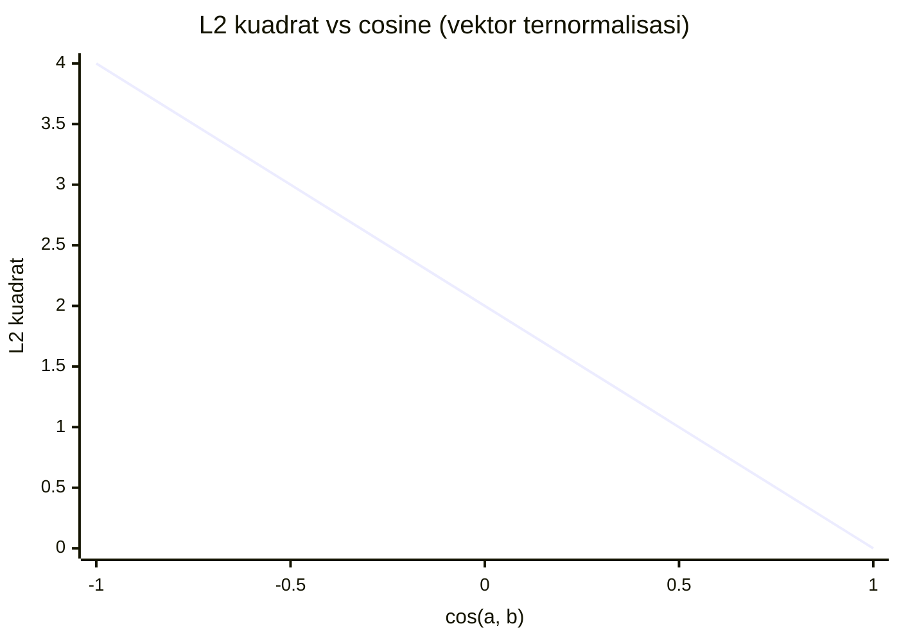

> **Catatan untuk Claude Code:** ini catatan contoh. Tiru format dan tingkat
> ketelitiannya: tabel istilah, diagram yang tampil di Obsidian, contoh angka kecil
> yang dihitung dengan kode, sudut pandang low-level, dan cara verifikasi.
> Tidak ada satu pun angka benchmark yang dikarang.

## Pernyataan inti
Untuk vektor yang sudah dinormalisasi ke panjang 1, mengurutkan tetangga berdasarkan
jarak L2 menaik menghasilkan urutan yang **identik** dengan mengurutkan berdasarkan
cosine similarity menurun. Karena itu index yang dibangun dengan metrik L2 di atas
data ternormalisasi menjawab query cosine dengan benar. Ini bukan pendekatan, tapi
ekuivalensi eksak pada tingkat *ranking*. Nilai jaraknya tetap berbeda; yang sama
adalah urutannya.

## Istilah
| Istilah | Arti | Contoh |
|---|---|---|
| vektor di R^d | Daftar `d` angka real. Embedding 128 dimensi = 128 angka. | `a = (0.8, 0.6)`, d = 2 |
| dot product `a · b` | Jumlah perkalian per komponen: `a[0]*b[0] + ... + a[d-1]*b[d-1]`. | `(0.8,0.6)·(1,0) = 0.8` |
| norma `‖a‖` | Panjang vektor: `sqrt(a · a)`. | `‖(3,4)‖ = 5` |
| normalisasi | Membagi setiap komponen dengan norma, supaya panjangnya jadi 1 (*unit vector*). | `(3,4) → (0.6, 0.8)` |
| unit sphere | Kumpulan semua titik yang panjangnya 1. Di d = 2, bentuknya lingkaran berjari-jari 1. | `(0.6, 0.8)` ada di unit sphere |
| cosine similarity | `cos(a,b) = (a · b) / (‖a‖ ‖b‖)`. Nilainya −1 sampai 1; makin besar, makin mirip arahnya. | searah = 1, tegak lurus = 0 |
| jarak L2 (Euclidean) | `‖a − b‖`, jarak garis lurus antar dua titik. Banyak implementasi memakai L2 kuadrat `‖a − b‖²` supaya tidak perlu `sqrt`. | `‖(0.8,0.6) − (1,0)‖² = 0.4` |
| ranking | Urutan kandidat dari paling mirip ke paling tidak mirip. kNN hanya peduli ranking. | p2, p1, p3 |
| fungsi monoton menurun | Kalau input naik, output pasti turun. Fungsi seperti ini menjaga urutan (dibalik). | `f(x) = 2 − 2x` |
| inner product search | Mencari kandidat dengan dot product terbesar, tanpa normalisasi. | `max a · q` |

## Gambaran
Untuk vektor ternormalisasi, `‖a − b‖² = 2 − 2·cos(a,b)`. Grafik ini menggambar
hubungan itu: garis lurus yang selalu turun.



> [!info] Cara membaca
> Setiap kenaikan cosine selalu menurunkan L2 kuadrat. Jadi kandidat dengan cosine
> tertinggi pasti punya L2 terendah. Urutannya sama, hanya arah sortirnya dibalik.

## Penjelasan bertahap
1. **Apa yang dibutuhkan kNN.** kNN tidak butuh nilai jaraknya; ia hanya butuh
   *urutan* kandidat. Jadi dua ukuran jarak bisa dianggap setara untuk kNN kalau
   keduanya selalu menghasilkan urutan yang sama.
2. **Cosine mengukur arah, L2 mengukur posisi.** Cosine hanya melihat sudut antara dua
   vektor; panjangnya dibuang lewat pembagian `‖a‖ ‖b‖`. L2 melihat seberapa jauh dua
   ujung panah, jadi panjang ikut berpengaruh. Itu sebabnya r1 = (3, 0) menang di
   cosine tapi kalah di L2 (contoh di bawah).
3. **Normalisasi menghapus perbedaan panjang.** Setelah dibagi normanya, semua vektor
   punya panjang 1. Artinya semua titik berada di permukaan bola berjari-jari 1
   (*unit sphere*). Di permukaan bola itu, satu-satunya yang membedakan dua titik
   adalah sudut di antara keduanya.
4. **Di unit sphere, jarak hanya ditentukan sudut.** Makin kecil sudutnya, makin dekat
   dua titik. Rumus `‖a − b‖² = 2 − 2·cos` adalah versi pastinya. Karena hubungan ini
   selalu turun, "cosine terbesar" dan "L2 terkecil" menunjuk kandidat yang sama.
5. **Di level mesin.** Normalisasi dibayar sekali per vektor saat insert. Setelah itu,
   setiap perbandingan cukup satu loop sepanjang `d`, baik dot product maupun L2.
   Index cukup mendukung satu metrik, dan query cosine tetap dijawab dengan benar.

## Mekanisme / formula
Untuk `a` dan `b` dengan `‖a‖ = ‖b‖ = 1`:

```
‖a - b‖² = ‖a‖² + ‖b‖² - 2(a · b)
         = 1 + 1 - 2(a · b)
         = 2 - 2 cos(a, b)
```

`‖a−b‖²` adalah fungsi menurun monoton terhadap `cos(a,b)`. Fungsi menurun monoton
mempertahankan urutan (dibalik), jadi argmin L2 = argmax cosine.

Syarat yang mudah dilupakan: **kedua** vektor harus ternormalisasi. Menormalisasi
hanya sisi query tidak cukup.

### Contoh angka kecil (d = 2)
Query `q = (0.8, 0.6)`. Semua vektor di bawah sudah punya panjang 1.

| Kandidat | cos(q, p) | ‖q − p‖² | 2 − 2·cos |
|---|---|---|---|
| p1 = (1, 0) | 0.80 | 0.40 | 0.40 |
| p2 = (0.6, 0.8) | 0.96 | 0.08 | 0.08 |
| p3 = (0, 1) | 0.60 | 0.80 | 0.80 |

Ranking cosine menurun: p2, p1, p3. Ranking L2 menaik: p2, p1, p3. Sama.

Contoh tandingan **tanpa** normalisasi, query `q = (1, 0)`:

| Kandidat | cos(q, r) | ‖q − r‖² |
|---|---|---|
| r1 = (3, 0) | 1.00 | 4.0 |
| r2 = (0.5, 0.5) | 0.71 | 0.5 |

Cosine memilih r1 (arahnya sama persis). L2 memilih r2 (titiknya lebih dekat). Ranking
berbeda, karena panjang r1 ikut memperbesar jarak L2.

### Di level loop
Setelah data dinormalisasi sekali saat insert, setiap perbandingan cukup satu loop
sepanjang `d`. Tidak ada `sqrt` atau pembagian per perbandingan.

```go
// d perkalian + d penjumlahan
func dot(a, b []float32) (s float32) {
	for i := range a { s += a[i] * b[i] }
	return
}

// d pengurangan + d perkalian + d penjumlahan
func l2sq(a, b []float32) (s float32) {
	for i := range a { t := a[i] - b[i]; s += t * t }
	return
}
```

Normalisasi sendiri butuh satu `dot(a, a)`, satu `sqrt`, dan `d` pembagian per vektor.
Biaya ini dibayar sekali per vektor, bukan sekali per query.

Identitasnya eksak di aritmetika real. Di `float32`, dua kandidat yang jaraknya nyaris
sama secara teori bisa bertukar urutan karena pembulatan. Pada tes 200.000 vektor acak
128 dimensi (kode di bawah, `float32`), top-100 hasil L2 dan cosine tetap identik.

## Kenapa ini penting untuk risetku
Menentukan apakah eksperimen delete-ku harus diulang untuk metrik cosine.
Kalau ekuivalensi ini berlaku pada setup-ku, satu metrik cukup, dan itu menghemat
setengah matriks eksperimen. Kalau tidak (misalnya data tidak ternormalisasi, atau
implementasi memakai inner product mentah pada vektor tak-ternormalisasi), maka
"metrik" jadi variabel bebas tambahan dan harus disebut di threat to validity.

SIFT descriptor **tidak** ternormalisasi secara default. Cek dulu sebelum berasumsi.

`[implementasi: hnswlib]` `[dicek di source hnswlib master, 2026-11-23]` di `python_bindings/bindings.cpp`, space `'cosine'`
membuat `InnerProductSpace` dan menyalakan `normalize = true`. Fungsi `normalize_vector`
dipanggil di `addItems` dan `knnQuery_return_numpy`, jadi vektor data dan query sama-sama
dinormalisasi. Jarak yang dikembalikan `InnerProductDistance` adalah `1 − dot`.

## Salah paham yang umum
- "Cosine dan L2 itu sama." Salah tanpa syarat normalisasi (lihat contoh r1/r2).
- "Nilai jaraknya sama." Salah. Yang sama urutannya, bukan nilainya. Threshold yang
  dikalibrasi untuk cosine tidak bisa langsung dipakai untuk L2.
- "Inner product = cosine." Hanya kalau ternormalisasi. Maximum inner product search
  pada vektor tak-ternormalisasi adalah masalah berbeda, dan proximity graph tidak
  otomatis benar untuk itu karena inner product bukan metrik (tidak memenuhi
  pertidaksamaan segitiga).

## Cara memverifikasi ini sendiri
```python
import numpy as np
rng = np.random.default_rng(0)
X = rng.normal(size=(2000, 128)); q = rng.normal(size=128)
Xn = X / np.linalg.norm(X, axis=1, keepdims=True)
qn = q / np.linalg.norm(q)

l2    = np.argsort(((Xn - qn) ** 2).sum(1))[:10]
cos   = np.argsort(-(Xn @ qn))[:10]
print(np.array_equal(l2, cos))          # True

# tanpa normalisasi:
l2_raw  = np.argsort(((X - q) ** 2).sum(1))[:10]
cos_raw = np.argsort(-(X @ q) / np.linalg.norm(X, axis=1))[:10]
print(np.array_equal(l2_raw, cos_raw))  # umumnya False

# float32, 200 ribu vektor, top-100:
X32 = rng.normal(size=(200_000, 128)).astype(np.float32)
X32 /= np.linalg.norm(X32, axis=1, keepdims=True)
q32 = rng.normal(size=128).astype(np.float32); q32 /= np.linalg.norm(q32)
a = np.argsort(((X32 - q32) ** 2).sum(1), kind="stable")[:100]
b = np.argsort(-(X32 @ q32), kind="stable")[:100]
print(np.array_equal(a, b))             # True pada seed ini
```
Jalankan juga pada SIFT1M asli untuk melihat apakah datanya sudah ternormalisasi.

## Rujukan
Identitas aljabar dasar, bukan klaim dari paper tertentu, jadi tidak butuh sitasi.
Untuk konteks maximum inner product search sebagai masalah terpisah:
`[⚠️ VERIFY]` cari literatur MIPS sebelum mengutip apa pun.
