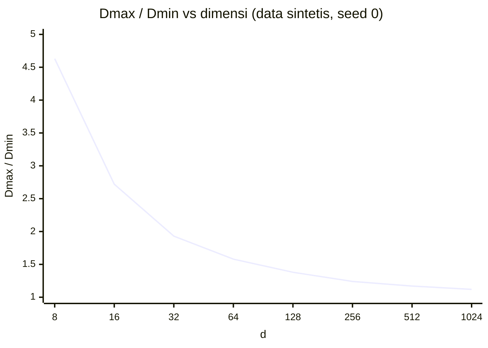

## Pernyataan inti
Jarak L2 kuadrat adalah jumlah `d` sumbangan per dimensi. Kalau sumbangan itu
independen dan seukuran, rata-ratanya tumbuh sebanding `d`, simpangannya hanya
sebanding `sqrt(d)`. Setelah `sqrt`, jarak semua titik ke query menumpuk di sekitar
`sqrt(d·μ)` dengan lebar kira-kira konstan, jadi `Dmax / Dmin → 1`. Ini hukum bilangan
besar, bukan bug pembulatan. Syaratnya (banyak dimensi, independen, seukuran) sering
dilanggar data nyata, dan di situ ANN masih punya harapan
([[07-concepts/T1-07-kenapa-ann-tetap-bekerja]]).

## Istilah
| Istilah | Arti | Contoh |
|---|---|---|
| distance concentration | Jarak dari query ke semua titik makin seragam (relatif terhadap besarnya) saat `d` naik. | d = 1000: semua jarak 12.6–13.4 |
| curse of dimensionality | Payung untuk gejala buruk di dimensi tinggi. Concentration salah satunya. | index pohon gagal di d besar |
| uniform `[0,1]^d` | Tiap komponen acak rata di 0..1, independen. Data sintetis paling sederhana. | `rng.random((n, d))` |
| i.i.d. | Independent and identically distributed: tiap dimensi independen dan berdistribusi sama. | komponen uniform di atas |
| `Dmin`, `Dmax` | Jarak terkecil dan terbesar dari satu query ke `n` titik. | 0.318 dan 0.975 |
| `E[·]`, `Var[·]` | Nilai harapan dan variansi; di kode didekati rata-rata sampel. | `E[(x−q)²] = 1/6` untuk uniform |
| std, std / mean | Simpangan baku, dan lebar sebaran relatif terhadap besarnya. | std/mean 0.447 di d = 2, 0.017 di d = 1024 |
| hukum bilangan besar | Rata-rata banyak suku acak independen makin dekat ke nilai harapannya. | `D²/d → 1/6` |
| partial distance search | Optimasi loop: berhenti menjumlah begitu jumlah sementara melewati jarak terbaik sejauh ini. | abort di dimensi ke-5 dari 8 |
| SIMD | Satu instruksi CPU memproses 8 atau 16 float sekaligus. | AVX2: 8 float32 |

## Gambaran
Data sintetis, seed 0: `n = 1000` titik uniform `[0,1]^d`, rata-rata dari 50 query uniform.



> [!info] Cara membaca
> Di d = 8, titik terjauh 4.6 kali lebih jauh dari yang terdekat; di d = 1024 hanya 1.12
> kali. Kurva terus mendekati 1. d = 2 dan 4 (81.3, 12.7) tidak digambar supaya skala terbaca.

## Penjelasan bertahap
1. **Intuisi.** Di 2D, beberapa titik sangat dekat dengan query, beberapa sangat jauh.
   Di 1000D, delapan titik acak semuanya berjarak 12.6–13.4 (tabel bawah).
2. **Jarak = jumlah sumbangan per dimensi.** Dari trace loop di
   [[07-concepts/T1-01-vektor-embedding-sebagai-titik-di-rd]]: `D² = Σ (x[i] − q[i])²`.
   Untuk data uniform, tiap suku punya rata-rata `μ = 1/6` dan variansi `σ²`.
3. **Jumlah `d` suku independen.** Rata-ratanya `d·μ`, variansinya `d·σ²`, jadi std-nya
   `sqrt(d)·σ`. Rasio `std / mean` dari `D²` = `σ / (μ·sqrt(d))`, turun seperti
   `1/sqrt(d)`. Setiap titik "mengundi" `d` kali; dengan banyak undian, semua titik
   mendapat total yang mirip.
4. **Setelah `sqrt`, lebarnya konstan.** `D ≈ sqrt(d·μ)`, sedangkan std(D) ≈
   `σ / (2·sqrt(μ))`, **tidak bergantung `d`**. Terukur: mean D naik 0.53 → 13.04, std D
   tetap sekitar 0.22. Jarak naik, celah antar titik tidak. Maka `Dmax / Dmin → 1`.
5. **Kenapa ini masalah untuk kNN.** Kalau tetangga terdekat hanya 1% lebih dekat dari
   titik rata-rata, gangguan kecil (noise di data, error approximate) cukup untuk
   menukar urutan. Beyer et al. (1999) berargumen bahwa di kondisi ini "nearest
   neighbor" kehilangan makna. Semua cara memangkas kandidat (batas jarak di pohon,
   abort di loop) butuh celah jarak, dan celah itu hilang.
6. **Syaratnya yang menentukan.** Langkah 3 butuh banyak dimensi independen yang
   menyumbang seukuran. Kalau data hanya bervariasi di beberapa arah, jumlah "undian"
   efektifnya kecil dan concentration lemah
   ([[07-concepts/T1-06-intrinsic-vs-ambient-dimensionality]]).
7. **Di level loop.** Partial distance search abort saat jumlah sementara melewati jarak
   terbaik. Di dimensi tinggi hampir semua kandidat baru melewatinya di dimensi akhir,
   jadi optimasi ini nyaris tidak menghemat apa-apa.

## Mekanisme / formula
Untuk komponen i.i.d. dengan `μ = E[(x[i]−q[i])²]` dan `σ² = Var[(x[i]−q[i])²]`:

```
E[D²] = d·μ        std(D²) = sqrt(d)·σ        std(D²)/E[D²] = σ / (μ·sqrt(d)) → 0
D ≈ sqrt(d·μ)      std(D) ≈ σ / (2·sqrt(μ))   (pendekatan orde pertama)
```
Invariant yang bisa dicek: untuk uniform dengan `q` tetap lalu dirata-rata atas `q`,
`μ = 1/6` dan rata-rata variansi bersyarat `σ² = 1/30`, jadi std(D) ≈ 0.2236. Terukur
0.222–0.237. `mean D² / d` terukur 0.164–0.173, dekat `1/6 = 0.1667`.

Bentuk formal `[cukup yakin]` (Beyer et al. 1999): kalau variansi relatif jarak → 0 saat
`d → ∞`, maka untuk setiap `ε > 0`, `P[Dmax ≤ (1+ε)·Dmin] → 1`, dengan `n` tetap.
Rumusan persis syaratnya `[⚠️ VERIFY]`.

### Contoh angka kecil (n = 8)
Data uniform, seed 0. Jarak L2 terurut dari query ke 8 titik:

| d | Jarak terurut | Dmax / Dmin |
|---|---|---|
| 2 | 0.318, 0.354, 0.375, 0.389, 0.507, 0.508, 0.541, 0.975 | 3.067 |
| 3 | 0.503, 0.570, 0.668, 0.742, 0.794, 0.963, 1.020, 1.130 | 2.249 |
| 1000 | 12.640, 12.815, 12.826, 12.837, 12.838, 12.929, 13.238, 13.374 | 1.058 |

### Trace langkah demi langkah
Statistik saat `d` naik (data sintetis, seed 0, `n = 1000`, 50 query). Kolom terakhir:
fraksi dimensi yang benar-benar dibaca partial distance search (k = 1).

| d | Dmax/Dmin | mean D | std D | std/mean | mean D²/d | dimensi dibaca |
|---|---|---|---|---|---|---|
| 2 | 81.303 | 0.531 | 0.237 | 0.4468 | 0.1729 | 0.532 |
| 4 | 12.665 | 0.776 | 0.231 | 0.2976 | 0.1655 | 0.344 |
| 8 | 4.629 | 1.134 | 0.230 | 0.2029 | 0.1684 | 0.310 |
| 16 | 2.721 | 1.613 | 0.226 | 0.1401 | 0.1663 | 0.378 |
| 32 | 1.932 | 2.282 | 0.224 | 0.0983 | 0.1645 | 0.530 |
| 64 | 1.580 | 3.249 | 0.223 | 0.0687 | 0.1658 | 0.641 |
| 128 | 1.379 | 4.616 | 0.225 | 0.0487 | 0.1669 | 0.729 |
| 256 | 1.243 | 6.523 | 0.222 | 0.0340 | 0.1664 | 0.814 |
| 512 | 1.170 | 9.232 | 0.222 | 0.0240 | 0.1666 | 0.866 |
| 1024 | 1.119 | 13.042 | 0.222 | 0.0171 | 0.1662 | 0.902 |

"Dimensi dibaca" turun dulu lalu naik: di d = 2 abort paling cepat setelah 1 dari 2
dimensi, jadi minimal 50%. Setelah d = 8, makin tinggi `d`, makin akhir abort terjadi.

Isi loop untuk satu query, `d = 8`, 5 kandidat (seed 1):

| Kandidat | best sebelum | dimensi dibaca | jumlah saat berhenti | jadi best baru? |
|---|---|---|---|---|
| 0 | ∞ | 8 | 1.207 | ya |
| 1 | 1.207 | 8 | 1.263 | tidak (lewat di dimensi ke-8) |
| 2 | 1.207 | 8 | 0.724 | ya |
| 3 | 0.724 | 6 | 0.795 | tidak |
| 4 | 0.724 | 5 | 1.079 | tidak |

### Di level loop
Partial distance search menambah satu cabang `if s > best` per dimensi, dan cabang itu
menghalangi SIMD. Untuk hemat 10–27% dimensi (d = 128–1024 di tabel), ia kemungkinan
kalah dari loop penuh tanpa cabang. `[implementasi: hnswlib]` `[dicek di source hnswlib master, 2026-11-23]` fungsi L2
di `space_l2.h` (`L2Sqr` dan varian SIMD-nya) menjumlah semua dimensi tanpa early abort.

Float32 bukan penyebabnya. Di d = 1024 (50 query, `n = 1000`), loop float32 berurutan
memberi top-10 sama dengan float64 di 50/50 query: celah relatif `D²(2)/D²(1) − 1`
terkecil 4.45e-04, error relatif float32 terbesar 2.0e-06.

## Kenapa ini penting untuk risetku
- `05-proposal/03` menaruh "dimensi" sebagai variabel bebas. Tapi `d` ambient bukan
  variabel yang tepat; kesulitan diatur oleh berapa arah yang benar-benar bervariasi
  (T1-06). Memotong/menambah kolom mengubah keduanya sekaligus: threat to validity.
- Fase 1, pertanyaan terbuka: apakah dataset dengan concentration lebih kuat lebih
  sensitif terhadap delete? Diukur, bukan diasumsikan.

## Salah paham yang umum
- "Di dimensi tinggi jarak jadi sama persis." Celah absolutnya kira-kira tetap
  (std D ≈ 0.22); yang hilang adalah celah **relatif**.
- "Ini masalah presisi float." Tidak. Float32 masih ratusan kali lebih teliti dari celahnya.
- "Semua data berdimensi tinggi pasti terkena." Hanya kalau syarat langkah 3 kira-kira
  berlaku. Ukur dulu di datamu ([[07-concepts/T1-05-contrast-ratio]]).

## Cara memverifikasi ini sendiri
```python
import numpy as np
rng = np.random.default_rng(0); n = 1000
for d in [2, 4, 8, 16, 32, 64, 128, 256, 512, 1024]:
    X = rng.random((n, d)); Q = rng.random((50, d)); r, sd, mn, m2, fr = [], [], [], [], []
    for q in Q:
        C = np.cumsum((X - q) ** 2, axis=1); D = np.sqrt(C[:, -1])
        r.append(D.max() / D.min()); sd.append(D.std()); mn.append(D.mean()); m2.append(C[:, -1].mean() / d)
        best, read = np.inf, 0
        for row in C:  # partial distance search, k = 1
            read += min(np.searchsorted(row, best, side="right") + 1, d); best = min(best, row[-1])
        fr.append(read / (n * d))
    print(d, *[round(np.mean(v), 4) for v in (r, mn, sd, m2, fr)])
# kolom: d, Dmax/Dmin, mean D, std D, mean D²/d, dimensi dibaca (std/mean = kolom 4 / kolom 3)
# 2 81.3028 0.5312 0.2374 0.1729 0.5321 ... 1024 1.1186 13.0419 0.2224 0.1662 0.9024

for d in [2, 3, 1000]:  # contoh n = 8
    g = np.random.default_rng(0); X = g.random((8, d)); q = g.random(d)
    print(d, np.round(np.sort(np.sqrt(((X - q) ** 2).sum(1))), 3))

g = np.random.default_rng(1); X = g.random((5, 8)); q = g.random(8); best = np.inf
for x in X:  # trace partial distance search, d = 8
    s, j = 0.0, 0
    while j < 8 and s <= best: s += (x[j] - q[j]) ** 2; j += 1
    print(j, round(s, 3)); best = min(best, s)  # 8 1.207 / 8 1.263 / 8 0.724 / 6 0.795 / 5 1.079

g = np.random.default_rng(0); X = g.random((1000, 1024)); Q = g.random((50, 1024)); same, gap, err = 0, [], []
for q in Q:  # loop float32 berurutan vs float64
    D64 = ((X - q) ** 2).sum(1); s = np.sort(D64); gap.append(s[1] / s[0] - 1)
    D32 = np.cumsum((X.astype(np.float32) - q.astype(np.float32)) ** 2, axis=1, dtype=np.float32)[:, -1]
    same += np.array_equal(np.argsort(D64)[:10], np.argsort(D32)[:10]); err.append(np.max(np.abs(D32 - D64) / D64))
print(same, f"{min(gap):.2e} {max(err):.1e}")  # 50 4.45e-04 2.0e-06
```
Di SIFT1M: ambil 100 query, hitung `Dmax/Dmin` dan `std/mean` jarak ke semua base vector,
bandingkan dengan baris d = 128. Kalau SIFT1M jauh kurang seragam, datanya tidak i.i.d.

## Rujukan
- Beyer, Goldstein, Ramakrishnan, Shaft, "When Is 'Nearest Neighbor' Meaningful?",
  ICDT 1999 `[yakin]`. Bentuk persis teoremanya `[⚠️ VERIFY]`.
- Aggarwal, Hinneburg, Keim, "On the Surprising Behavior of Distance Metrics in High
  Dimensional Space", ICDT 2001 `[cukup yakin]`: untuk norma Lp, `Dmax − Dmin` tumbuh
  sekitar `d^(1/p − 1/2)`; untuk L2 kira-kira konstan, cocok dengan std D di atas.
