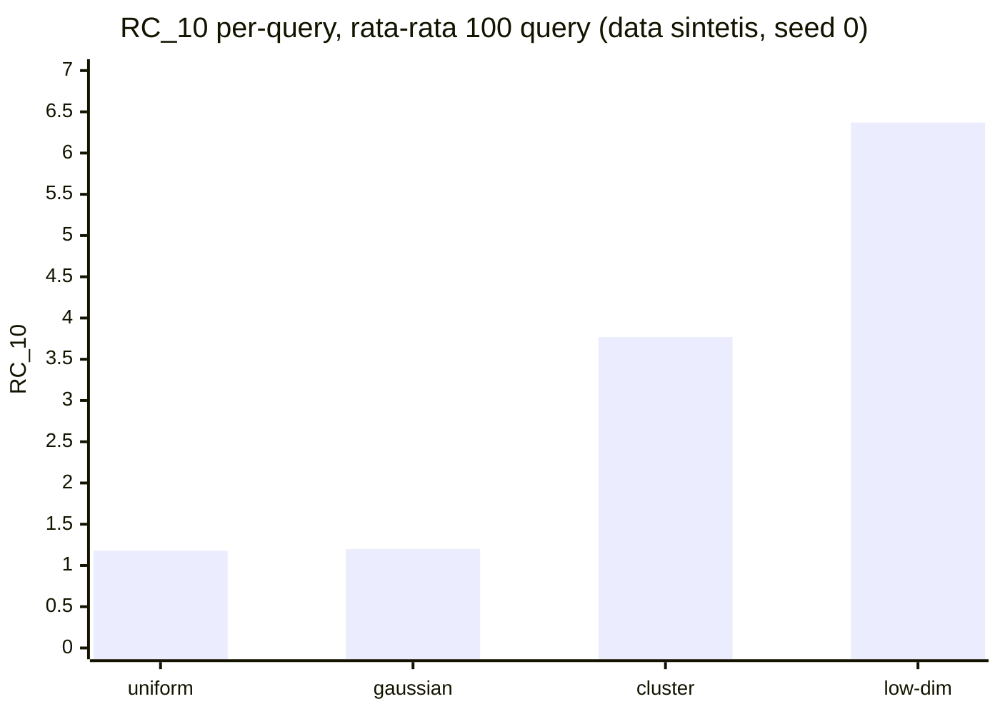

## Pernyataan inti
Relative contrast (RC) membandingkan jarak "target" dengan jarak "latar":
`RC_k(q) = D_mean(q) / D_k(q)`. Kalau RC mendekati 1, tetangga ke-k hampir tidak lebih
dekat dari titik rata-rata, jadi ada banyak kandidat yang nyaris seri, dan query itu
sulit bagi index apa pun. RC besar berarti target menonjol dan query mudah. Nama
"relative contrast" dipakai untuk lebih dari satu rumus. Setiap angka RC harus
menyebut: rumus mana, `k` berapa, jarak atau jarak kuadrat, per-query atau agregat.
Pembilangnya murah (bisa disampel); penyebutnya butuh ground truth.

## Istilah
| Istilah | Arti | Contoh |
|---|---|---|
| ground truth | kNN sebenarnya, dari brute force ke semua `n` titik. | 10 id terdekat per query |
| `D_k(q)` | Jarak dari query ke tetangga terdekat ke-k yang sebenarnya. `D_1` = terdekat. | `D_2 = 0.1140` |
| `D_mean(q)` | Rata-rata jarak query ke **semua** `n` titik. Mewakili "titik acak biasa". | `0.3437` |
| relative contrast (RC) | `D_mean / D_k`. Selalu ≥ 1 untuk `k` kecil. Makin dekat 1, makin sulit. | `RC_2 = 3.0148` |
| per-query vs agregat | Per-query: hitung RC tiap query lalu rata-rata. Agregat: bagi rata-rata pembilang dengan rata-rata penyebut. Hasilnya bisa beda. | lihat rumus di bawah |
| near tie | Titik yang jaraknya hampir sama dengan `D_k`, di sini: `≤ 1.1 · D_k`. | 782 titik pada data uniform |
| top-k heap | Struktur yang menyimpan `k` jarak terkecil sejauh ini selama satu pass. | `[0.1118, 0.114]` |
| Gaussian mixture | Data dari beberapa pusat cluster, tiap titik = pusat + noise. | 20 cluster, noise 0.3 |
| data low-dim | Data yang sebenarnya hanya punya sedikit arah variasi, ditanam di `d` besar. | 4 dimensi laten → 128 |
| upper bound | Batas atas: nilai sebenarnya tidak pernah melebihinya. | `D_k` dari index ≥ `D_k` asli |

## Gambaran
Data sintetis, seed 0, `n = 10.000`, `d = 128`, 100 query dari distribusi yang sama.



> [!info] Cara membaca
> Keempat dataset punya `d = 128` yang sama, tapi RC-nya beda lebih dari 5 kali. Jadi
> dimensi ambient sendiri tidak menentukan kesulitan. Uniform dan gaussian (i.i.d.)
> terkena distance concentration penuh; cluster dan low-dim tidak.

## Penjelasan bertahap
1. **Butuh angka kesulitan yang tidak bergantung index.** Kalau recall HNSW di dataset
   A lebih rendah dari di B, apakah index-nya lebih buruk, atau soalnya lebih sulit?
   Butuh ukuran properti data + query saja.
2. **Bandingkan target dengan latar.** `D_k` adalah jarak target. `D_mean` adalah jarak
   titik biasa. Rasio keduanya bilang seberapa menonjol target. RC = 6 berarti titik
   biasa 6 kali lebih jauh dari tetangga ke-k.
3. **Hubungan dengan concentration.** Di bawah distance concentration
   ([[07-concepts/T1-04-distance-concentration]]), semua jarak menumpuk, jadi
   `D_k ≈ D_mean` dan RC → 1. Uniform dan gaussian di `d = 128`: RC 1.18–1.20.
4. **Kenapa RC ≈ 1 sulit: near tie.** Pada data uniform, rata-rata 782 dari 10.000 titik
   berjarak ≤ 1.1 × `D_10`. Recall menilai **identitas** hasil, bukan jaraknya. Index
   yang meleset 10% dalam jarak punya ratusan kandidat salah yang "hampir benar", dan
   harus memilih tepat 10 yang asli. Pada data low-dim hanya 14.5 titik di zona itu.
5. **RC itu kasar.** Data cluster punya RC 3.77 (tampak mudah), tapi masih 168 near tie:
   cluster lain yang jauh menaikkan `D_mean`, sementara di dalam cluster jaraknya tetap
   menumpuk. RC mencampur latar global dengan struktur lokal. Ukuran lokal ada di
   [[07-concepts/T1-06-intrinsic-vs-ambient-dimensionality]].
6. **Biaya menghitungnya.** Satu pass per query: jumlah berjalan untuk `D_mean`, top-k
   heap untuk `D_k`, total `n·d` operasi jarak. `D_mean` cukup dari sampel 100 titik
   (error RC maksimum 1.3–7.4% di tabel). `D_k` tidak bisa disampel: ia **adalah** ground
   truth ([[07-concepts/T2-03-ground-truth-brute-force]]).

## Mekanisme / formula
Tiga rumus yang beredar dengan nama mirip:

```
RC_k(q)  = D_mean(q) / D_k(q)                    per-query, lalu dirata-rata
C_k      = E_q[D_mean(q)] / E_q[D_k(q)]          agregat (He et al. 2012 memakai k = 1)
RC_Beyer = (Dmax − Dmin) / Dmin                  gaya Beyer et al. 1999 / Aggarwal et al. 2001
```
Invariant 1: `D_k` dari index ≥ `D_k` asli, karena `k` titik mana pun punya jarak ke-k
≥ minimum yang mungkin. Jadi RC yang dihitung dari hasil index adalah **lower bound**
RC asli. Kode di bawah meng-`assert` ini.

Invariant 2: RC dari jarak kuadrat ≠ RC dari jarak. hnswlib dan faiss mengembalikan L2
kuadrat ([[07-concepts/T1-02-l2-cosine-inner-product]]), jadi angkanya harus di-`sqrt`
dulu kalau ingin dibandingkan dengan literatur yang memakai jarak.

### Contoh angka kecil dan trace langkah demi langkah (d = 2, n = 8)
Query `q = (0.5, 0.5)`, `k = 2`. Satu pass atas titik dalam urutan simpan (bukan
terurut); kolom terakhir = isi top-k heap setelah langkah itu.

| i | titik | D_i | D_i² | jumlah berjalan | top-2 |
|---|---|---|---|---|---|
| 0 | (0.09, 0.24) | 0.4855 | 0.2357 | 0.4855 | [0.4855] |
| 1 | (0.80, 0.58) | 0.3105 | 0.0964 | 0.7960 | [0.3105, 0.4855] |
| 2 | (0.09, 0.43) | 0.4159 | 0.1730 | 1.2119 | [0.3105, 0.4159] |
| 3 | (0.48, 0.16) | 0.3406 | 0.1160 | 1.5525 | [0.3105, 0.3406] |
| 4 | (0.73, 0.11) | 0.4528 | 0.2050 | 2.0053 | [0.3105, 0.3406] |
| 5 | (0.39, 0.52) | 0.1118 | 0.0125 | 2.1171 | [0.1118, 0.3105] |
| 6 | (0.43, 0.59) | 0.1140 | 0.0130 | 2.2311 | [0.1118, 0.1140] |
| 7 | (0.74, 0.96) | 0.5188 | 0.2692 | 2.7499 | [0.1118, 0.1140] |

Akhir: `D_mean = 2.7499 / 8 = 0.3437`, `D_1 = 0.1118`, `D_2 = 0.1140`. Dari data yang
sama: `RC_1 = 3.0745`, `RC_2 = 3.0148`, `(Dmax − Dmin)/Dmin = 3.6407`, dan `RC_2` dari
jarak kuadrat = `10.7769`. Empat angka "contrast" untuk satu query: inilah kenapa
definisinya wajib ditulis. Semua 8 jarak harus dihitung; tidak ada jalan pintas untuk `D_k`.

### Di level loop
Semua rumus, empat dataset sintetis (seed 0, `n = 10.000`, `d = 128`, 100 query):

| Dataset | RC_10 per-query | C_1 agregat | (Dmax−Dmin)/Dmin | near tie ≤ 1.1·D_10 | RC_10 dari D² | error RC, sampel 100 titik |
|---|---|---|---|---|---|---|
| uniform | 1.182 | 1.240 | 0.462 | 782.18 | 1.401 | 1.3% |
| gaussian | 1.199 | 1.260 | 0.535 | 645.23 | 1.442 | 1.5% |
| cluster | 3.773 | 3.992 | 3.762 | 168.09 | 14.666 | 3.3% |
| low-dim | 6.373 | 12.340 | 24.552 | 14.49 | 45.081 | 7.4% |

Urutan keempat dataset sama di semua kolom RC, tapi nilainya jauh berbeda antar rumus.
Untuk SIFT1M dengan 10.000 query, menghitung RC_k eksak = 10^4 × 10^6 perbandingan
128 dimensi, sama dengan biaya ground truth. Kalau ground truth sudah dihitung, simpan
`D_k` dan `D_mean` di pass yang sama; tambahannya hanya satu akumulator per query.

## Kenapa ini penting untuk risetku
- **RQ1 / C-002.** Kondisi pembantah C-002: "sinyal kuat di SIFT1M tapi runtuh di
  Deep10M → sinyal menangkap properti dataset". RC per-query adalah properti itu.
  Simpan RC (dan LID, T1-06) di samping setiap proxy signal, lalu cek apakah sinyal
  masih memprediksi recall **di dalam** kelompok query dengan RC serupa.
- **C-001, hipotesis yang perlu dicek.** Delete terklaster menghapus tetangga asli
  query di region itu. Ground truth baru punya `D_k` lebih besar, jadi RC query itu
  turun: soalnya sendiri jadi lebih sulit, terlepas dari kerusakan graf. Karena itu
  pembanding yang adil adalah tombstone vs full rebuild pada data sisa yang sama,
  bukan tombstone vs sebelum delete. Ukur RC sebelum dan sesudah delete.

## Salah paham yang umum
- "RC tinggi = mudah." Tidak selalu: data cluster RC 3.77 tapi 168 near tie.
- "Angka RC dari dua paper bisa dibandingkan." Hanya kalau rumus, `k`, jarak vs kuadrat,
  dan per-query vs agregat sama. Contoh angka kecil memberi empat nilai berbeda.
- "RC bisa dimonitor online." Pembilang bisa; penyebut butuh ground truth. Dari hasil
  index hanya didapat lower bound RC (invariant 1).

## Cara memverifikasi ini sendiri
```python
import numpy as np
X = np.round(np.random.default_rng(3).random((8, 2)), 2); q = np.array([0.5, 0.5]); k = 2
total, top = 0.0, []
for i, x in enumerate(X):  # satu pass: jumlah berjalan + top-k (tabel trace)
    Di = np.sqrt(((x - q) ** 2).sum()); total += Di; top = sorted(top + [float(round(Di, 4))])[:k]
    print(i, x.tolist(), float(round(Di, 4)), float(round(total, 4)), top)
D = np.sqrt(((X - q) ** 2).sum(1)); s = np.sort(D)
print(round(D.mean() / s[0], 4), round(D.mean() / s[k - 1], 4), round((s[-1] - s[0]) / s[0], 4),
      round((D**2).mean() / s[k - 1]**2, 4), (D**2).round(4).tolist())  # 3.0745 3.0148 3.6407 10.7769 [0.2357, ...]

rng = np.random.default_rng(0); n, d, k = 10_000, 128, 10
C20 = rng.normal(size=(20, d)); A = rng.normal(size=(4, d))
make = {"uniform": lambda m: rng.random((m, d)), "gaussian": lambda m: rng.normal(size=(m, d)),
        "cluster": lambda m: C20[rng.integers(0, 20, m)] + 0.3 * rng.normal(size=(m, d)),
        "low-dim": lambda m: rng.random((m, 4)) @ A + 0.01 * rng.normal(size=(m, d))}
for name, f in make.items():
    X, Q = f(n), f(100)
    D = np.stack([np.sqrt(((X - q) ** 2).sum(1)) for q in Q]); Ds = np.sort(D, axis=1)
    d1, dk, dm = Ds[:, 0], Ds[:, k - 1], D.mean(1)
    rc = dm / dk; near = (D <= 1.1 * dk[:, None]).sum(1).mean()
    samp = np.stack([D[i, rng.choice(n, 100, replace=False)].mean() for i in range(100)]) / dk
    fake = np.stack([np.sort(rng.choice(Ds[i, :20], k, replace=False))[-1] for i in range(100)])
    assert np.all(dm / fake <= rc)  # index palsu: 10 acak dari top-20 asli -> RC estimasi <= RC asli
    print(name, *[round(float(v), 3) for v in (rc.mean(), dm.mean() / d1.mean(), ((Ds[:, -1] - d1) / d1).mean(),
          near, ((D**2).mean(1) / dk**2).mean(), np.abs(samp / rc - 1).max())])
# uniform 1.182 1.24 0.462 782.18 1.401 0.013 / gaussian 1.199 1.26 0.535 645.23 1.442 0.015
# cluster 3.773 3.992 3.762 168.09 14.666 0.033 / low-dim 6.373 12.34 24.552 14.49 45.081 0.074
```
Di SIFT1M: saat menghitung ground truth top-100, simpan juga `D_mean` per query, lalu plot
histogram RC_10. Sebutkan rumus dan "jarak, bukan kuadrat" di catatan experiment.

## Rujukan
- He, Kumar, Chang, "On the Difficulty of Nearest Neighbor Search", ICML 2012
  `[cukup yakin]`: mendefinisikan relative contrast `C_r = E[D_mean] / E[D_min]` dan
  mengaitkannya dengan kompleksitas LSH. Bentuk persis hubungannya `[⚠️ VERIFY]`.
- Aggarwal, Hinneburg, Keim, ICDT 2001 `[cukup yakin]`: memakai `(Dmax − Dmin)/Dmin`;
  apakah mereka menamainya "relative contrast" `[⚠️ VERIFY]`.
- Aumüller, Ceccarello, "The Role of Local Intrinsic Dimensionality in Benchmarking
  Nearest Neighbor Search", SISAP 2019 `[cukup yakin]`: memakai LID, RC, dan expansion
  sebagai ukuran kesulitan query. Versi jurnalnya `[⚠️ VERIFY: venue/tahun]`.
