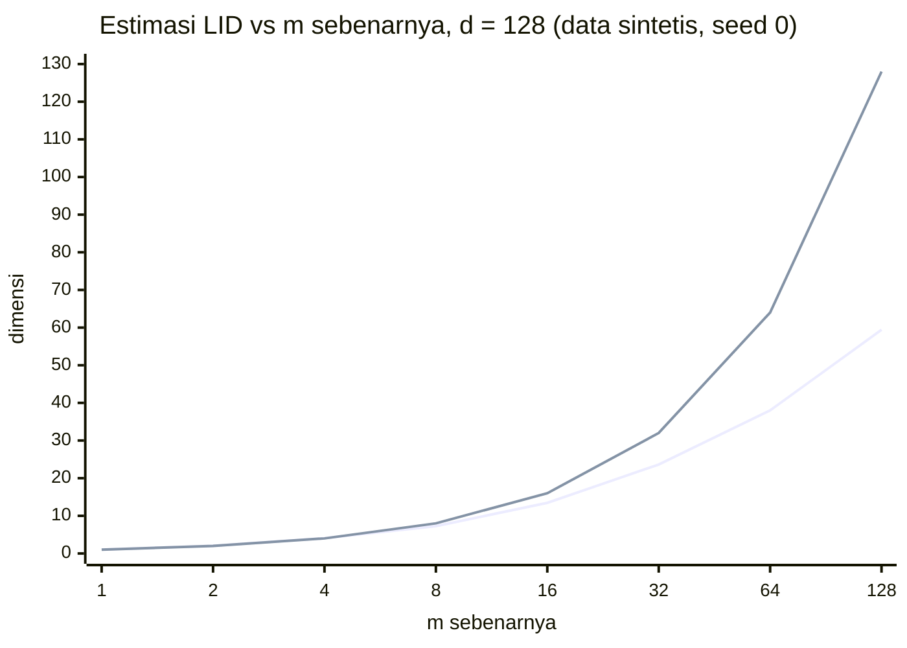

## Pernyataan inti
Ambient dimensionality `d` adalah jumlah float yang disimpan per vektor. Intrinsic
dimensionality `m` adalah jumlah derajat kebebasan yang benar-benar dipakai data.
Untuk search, `m` yang menentukan: di `m` dimensi, jumlah titik di dalam bola berjari-jari
`r` tumbuh seperti `r^m`, jadi `m` mengatur seberapa cepat lingkungan sebuah query
"penuh" kandidat. `m` tidak bisa dibaca dari format; ia harus diestimasi. PCA mengestimasi
dimensi linear global; MLE dari jarak kNN mengestimasi dimensi lokal. Keduanya bisa salah
dengan cara berbeda, jadi angka `m` selalu disebut bersama estimator dan parameternya.

## Istilah
| Istilah | Arti | Contoh |
|---|---|---|
| ambient dimensionality `d` | Panjang vektor yang disimpan. Ditentukan format. | SIFT: 128 |
| intrinsic dimensionality `m` | Jumlah arah bebas yang benar-benar dipakai data. | titik di garis dalam 3D: m = 1 |
| manifold | Permukaan berdimensi `m` (bisa melengkung) di dalam R^d. | lingkaran = manifold 1D di R^2 |
| derajat kebebasan | Berapa angka yang cukup untuk menunjuk satu titik di data. | garis: cukup `t` |
| PCA | Mencari arah variansi terbesar lewat eigenvalue matriks kovariansi `d × d`. | eigenvalue `[0.45, 0, 0]` |
| PCA95 | Jumlah komponen PCA untuk menjelaskan 95% variansi. Estimator dimensi linear global. | kurva: 18 |
| LID | Local intrinsic dimensionality: dimensi di sekitar **satu** titik, dari laju pertumbuhan jumlah tetangga. | 0.99 di satu titik garis |
| `r_j` | Jarak ke tetangga ke-j dari titik itu (tanpa dirinya sendiri). | `r_1 = 0.0607` |
| MLE | Maximum likelihood estimator: rumus estimasi yang diturunkan dari model probabilitas. | rumus LID di bawah |
| RC | Relative contrast `D_mean / D_k` dari [[07-concepts/T1-05-contrast-ratio]]. Dekat 1 = sulit. | 6.37 vs 1.18 |
| bias estimator | Selisih sistematis antara rata-rata estimasi dan nilai sebenarnya. | m = 64 diestimasi 38.0 |

## Gambaran
Data sintetis, seed 0: uniform di `[0,1]^m`, ditanam ke R^128 lewat basis ortonormal acak
(jarak tidak berubah). `n = 10.000`, LID MLE dengan `k = 20`, rata-rata 300 titik sampel.
Titik terakhir (m = 128) adalah uniform `[0,1]^128` langsung.



> [!info] Cara membaca
> Garis atas = nilai sebenarnya, garis bawah = estimasi LID. Sampai m = 4 keduanya
> berimpit; setelah itu estimator makin meremehkan (m = 128 terbaca 59.4). "LID rendah"
> bisa benar-benar rendah, atau tinggi tapi tak terukur dengan `n` dan `k` yang ada.

## Penjelasan bertahap
1. **`d` hanya format.** 128 float per vektor tidak berarti data memakai 128 arah. Contoh
   ekstrem: 10 titik `t·(1,2,2)/3` di R^3. Tiga koordinat, tapi satu angka `t` cukup.
2. **Dimensi menurut search: laju pertumbuhan lingkungan.** Di `m` dimensi, banyak titik
   dalam bola radius `r` sebanding `r^m`. Gandakan radius, jumlah titik naik `2^m` kali:
   2 kali di garis, 4 kali di bidang, sekitar sejuta kali di m = 20. Inilah yang dirasakan
   index. Di `m` besar, sedikit melebarkan radius menelan banyak sekali kandidat: near tie
   ([[07-concepts/T1-05-contrast-ratio]]).
3. **Estimasi dari jarak kNN (MLE).** Kalau `N(r) ∝ r^m` di sekitar titik `x`, maka untuk
   `j < k`, `(r_j / r_k)^m` berperilaku seperti bilangan uniform di 0..1. Logaritmanya
   memberi `E[ln(r_k / r_j)] = 1/m`. Balik rata-ratanya:
   `m̂ = (k − 1) / Σ_{j<k} ln(r_k / r_j)`. Jarak yang cepat membesar (r_1 jauh lebih kecil
   dari r_k) berarti `m` kecil.
4. **PCA vs LID.** PCA menghitung arah **linear**. Untuk subruang datar keduanya benar
   (PCA95 = m sampai m = 16). Untuk manifold melengkung, PCA salah besar: kurva tertutup
   1D di R^128 (tabel bawah) butuh 18 komponen PCA, sedangkan LID membaca 1.06. Tapi LID
   punya bias sendiri: di m besar ia meremehkan (grafik). Tidak ada estimator "benar";
   yang ada estimator dengan bias yang diketahui.
5. **Kaitan dengan concentration.** Argumen di
   [[07-concepts/T1-04-distance-concentration]] butuh banyak arah independen yang
   bervariasi. Jumlah arah itu kira-kira `m`, bukan `d`. Data low-dim di T1-05 (m = 4,
   d = 128) punya RC 6.37; uniform di d = 128 hanya 1.18.
6. **Di level loop.** LID per titik butuh `k` jarak tetangga sebenarnya: satu brute
   force `n·d` per titik sampel. Karena itu LID dihitung pada sampel (di sini 300), bukan
   semua titik. Dua jebakan numerik: (a) memakai L2 **kuadrat** (output default hnswlib
   dan faiss) membuat estimasi jadi separuhnya, karena `ln(r²) = 2·ln(r)`; (b) duplikat
   membuat `r_1 = 0`, suku `ln(r_k / 0) = ∞`, dan estimasi jatuh diam-diam ke 0, tanpa NaN.

## Mekanisme / formula
```
N(r) ∝ r^m                                     model lokal: laju tumbuh tetangga
m̂_k(x) = (k − 1) / Σ_{j=1}^{k−1} ln(r_k / r_j)       Levina–Bickel, per titik
LID(x)  = −[ (1/k) Σ_{i=1}^{k} ln(r_i / r_k) ]^(−1)   bentuk Amsaleg et al., normalisasi k
```
Dua bentuk ini beda normalisasi (`k − 1` vs `k`); di `k = 20` selisihnya 5%. Untuk satu angka
global, ada yang merata-rata `m̂` per titik, ada yang merata-rata `1/m̂` lalu dibalik. Sebut
mana yang dipakai.

### Contoh angka kecil (d = 3, n = 10)
`garis`: 10 titik `t·v`, `v = (1,2,2)/3`. `bidang`: 10 titik `t·v + s·w`, `w = (2,−1,0)/√5`.
`t, s` uniform di −1..1 (seed 0). LID dengan `k = 4`:

| Data | eigenvalue PCA | PCA95 | LID per titik (10 nilai) | median |
|---|---|---|---|---|
| garis | 0.4509, 0, 0 | 1 | 0.99 3.41 0.72 0.72 1.78 0.76 0.83 1.61 1.04 0.78 | 0.91 |
| bidang | 0.5311, 0.3745, 0 | 2 | 0.83 1.82 5.57 1.78 2.33 1.99 0.84 4.32 8.23 2.37 | 2.16 |

PCA bersih karena datanya datar. LID per titik sangat noisy di `n = 10, k = 4` (garis:
0.72–3.41), tapi mediannya mendekati 1 dan 2. Pelajaran: baca distribusinya, bukan satu titik.

### Trace langkah demi langkah
Menghitung LID titik 0, `k = 4`:

| Data | r_1..r_4 | ln(r_4/r_1), ln(r_4/r_2), ln(r_4/r_3) | jumlah | m̂ = 3 / jumlah |
|---|---|---|---|---|
| garis | 0.0607, 0.1851, 0.1867, 0.3526 | 1.7602, 0.6447, 0.6360 | 3.0409 | 0.99 |
| bidang | 0.1124, 0.3925, 0.5792, 0.9868 | 2.1723, 0.9219, 0.5329 | 3.6271 | 0.83 |
| bidang + duplikat titik 0 | 0, 0.1124, 0.3925, 0.5792 | ∞, ... | ∞ | 0.00 |

Titik 0 di bidang terbaca 0.83, bukan 2: satu tetangga sangat dekat (`r_1` kecil)
mendominasi jumlah log. Baris terakhir adalah jebakan duplikat.

### Di level loop
Data sintetis, seed 0, `d = 128`, `n = 10.000`, `k = 20`, 300 titik sampel:

| Data | m sebenarnya | LID rata-rata | LID median | PCA95 |
|---|---|---|---|---|
| subruang linear | 4 | 4.05 | 3.97 | 4 |
| subruang linear | 16 | 13.45 | 12.90 | 16 |
| subruang linear | 64 | 38.00 | 36.45 | 61 |
| uniform penuh | 128 | 59.42 | 57.32 | 121 |
| kurva tertutup (10 frekuensi) | 1 | 1.06 | 1.03 | 18 |
| kurva, tapi dari L2 kuadrat | 1 | 0.53 | — | — |

Biaya: 300 titik × 10.000 × 128 ≈ 3.8·10^8 operasi kurang-kali-tambah untuk LID; PCA butuh
matriks kovariansi 128 × 128 (16.384 float64 = 128 KiB) plus satu eigendecomposition.

## Kenapa ini penting untuk risetku
- `05-proposal/03` menaruh "dimensi" sebagai variabel bebas. Variabel yang bermakna
  adalah `m`, bukan `d`. Laporkan distribusi LID (estimator, `k`, jarak bukan kuadrat)
  untuk SIFT1M dan Deep10M dari pengukuranmu sendiri; jangan kutip angka paper.
- RQ1 / C-002: LID per-query adalah kovariat kesulitan, sama seperti RC. Sinyal yang
  hanya mengikuti LID akan "berhasil" di satu dataset dan runtuh di dataset lain.
- Duplikat di dataset nyata akan membuat LID 0 diam-diam. Cek `r_1 == 0` sebelum
  menyimpulkan apa pun.

## Salah paham yang umum
- "SIFT 128 dimensi berarti masalahnya 128 dimensi." Belum tentu; ukur `m`.
- "PCA memberi dimensi intrinsik." Hanya dimensi linear. Kurva 1D di atas: PCA95 = 18.
- "LID rendah pasti berarti data mudah." Estimator meremehkan di `m` besar (m = 128 → 59.4).

## Cara memverifikasi ini sendiri
```python
import numpy as np
rng = np.random.default_rng(0); n, k = 10_000, 20
def lid(X, idx, k, sq=False):
    r = np.array([np.sort(np.r_[np.sqrt(((np.delete(X, i, 0) - X[i]) ** 2).sum(1))])[:k] for i in idx])
    r = r ** 2 if sq else r
    with np.errstate(divide="ignore"):
        return (k - 1) / np.log(r[:, -1:] / r[:, :-1]).sum(1)
def pca95(X):
    ev = np.linalg.eigvalsh(np.cov(X.T))[::-1]; return int(np.searchsorted(np.cumsum(ev) / ev.sum(), 0.95) + 1)
idx = rng.choice(n, 300, replace=False)
for m in [1, 2, 4, 8, 16, 32, 64]:
    Z = rng.random((n, m)); R, _ = np.linalg.qr(rng.normal(size=(128, m))); X = Z @ R.T
    l = lid(X, idx, k); print(m, round(l.mean(), 2), round(np.median(l), 2), pca95(X))
X = rng.random((n, 128)); l = lid(X, idx, k); print(128, round(l.mean(), 2), round(np.median(l), 2), pca95(X))
# 1 1.04 1.02 1 / 2 2.05 2.0 2 / 4 4.05 3.97 4 / 8 7.26 6.82 8 / 16 13.45 12.9 16
# 32 23.62 22.63 31 / 64 38.0 36.45 61 / 128 59.42 57.32 121
t = rng.uniform(0, 2 * np.pi, n); A = rng.normal(size=(10, 128)); B = rng.normal(size=(10, 128))
X = sum(np.outer(np.cos((f + 1) * t), A[f]) + np.outer(np.sin((f + 1) * t), B[f]) for f in range(10))
print(round(lid(X, idx, k).mean(), 2), pca95(X), round(lid(X, idx, k, sq=True).mean(), 2))  # 1.06 18 0.53

g = np.random.default_rng(0); t, s = g.uniform(-1, 1, 10), g.uniform(-1, 1, 10)  # contoh n = 10
v, w = np.array([1.0, 2, 2]) / 3, np.array([2.0, -1, 0]) / np.sqrt(5)
L, P = np.outer(t, v), np.outer(t, v) + np.outer(s, w)
for X in [L, P]:
    print(np.round(np.linalg.eigvalsh(np.cov(X.T))[::-1], 4), np.round(lid(X, range(10), 4), 2))
# [ 0.4509  0.     -0.    ] [0.99 3.41 0.72 0.72 1.78 0.76 0.83 1.61 1.04 0.78]
# [0.5311 0.3745 0.    ] [0.83 1.82 5.57 1.78 2.33 1.99 0.84 4.32 8.23 2.37]
print(lid(np.vstack([P, P[0]]), [0], 4))  # [0.] : duplikat membuat r_1 = 0
for X in [L, P]:  # trace titik 0
    r = np.sort(np.sqrt(((X[1:] - X[0]) ** 2).sum(1)))[:4]; lg = np.log(r[-1] / r[:-1])
    print(np.round(r, 4), np.round(lg, 4), round(lg.sum(), 4))
# [0.0607 0.1851 0.1867 0.3526] [1.7602 0.6447 0.636 ] 3.0409 / [0.1124 0.3925 0.5792 0.9868] [2.1723 0.9219 0.5329] 3.6271
```
Di SIFT1M: ambil 1.000 base vector acak, hitung LID dengan `k = 20` dan `k = 100`
terhadap seluruh base, buang yang `r_1 = 0`, plot histogramnya. Bandingkan PCA95-nya.

## Rujukan
- Levina, Bickel, "Maximum Likelihood Estimation of Intrinsic Dimension", NIPS 2004
  `[cukup yakin]`: rumus `m̂_k` di atas.
- Amsaleg et al., "Estimating Local Intrinsic Dimensionality", KDD 2015 `[cukup yakin]`:
  bentuk MLE dengan normalisasi `k`, dalam kerangka LID dari extreme value theory.
- Estimator global lain, belum dibahas: correlation dimension (Grassberger, Procaccia,
  1983) `[cukup yakin]`, TwoNN (Facco et al., 2017) `[cukup yakin]`.
