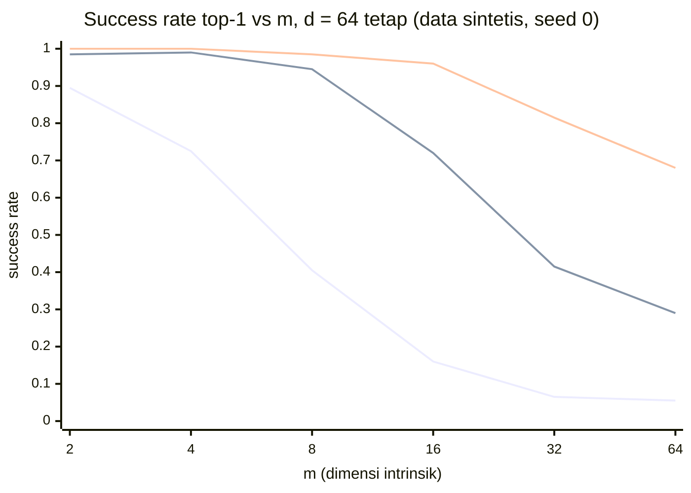

## Pernyataan inti
Curse of dimensionality (concentration, pruning yang gagal) berlaku untuk data dengan
banyak arah variasi independen, yaitu intrinsic dimensionality `m` tinggi, dan untuk
pencarian **eksak**. ANN lolos lewat tiga celah yang terpisah: (1) data nyata sering
punya `m` jauh di bawah `d`, (2) ANN melonggarkan tujuan menjadi "sebagian besar top-k
benar", dan (3) di rezim `m` yang benar-benar tinggi, nearest neighbor eksak sendiri
nyaris tidak lebih dekat dari titik lain. Graph index memanfaatkan celah (1): langkah
greedy maju selama lingkungan tiap node berdimensi rendah. Tidak ada jaminan umum; "ANN
bekerja" adalah properti data + index + parameter yang harus diukur.

## Istilah
| Istilah | Arti | Contoh |
|---|---|---|
| ANN | Approximate nearest neighbor: boleh salah sebagian, ditukar dengan kecepatan. | recall@10 = 0.9 |
| c-approximate NN | Kembalikan titik `p` dengan `dist(q,p) ≤ c · D_1(q)`, untuk `c > 1`. Definisi teori. | c = 1.1 |
| kNN graph | Graf berarah: tiap node punya edge ke `K` tetangga terdekatnya. Bentuk paling sederhana proximity graph. | K = 3 di contoh |
| entry point | Node awal pencarian. | node 9 |
| greedy search | Pindah ke tetangga yang lebih dekat ke query; berhenti kalau tidak ada. | 9 → 3 → 2 |
| local minimum | Node yang semua tetangganya lebih jauh dari query, padahal bukan NN sebenarnya. | berhenti di 9, NN asli 4 |
| beam search, `ef` | Greedy yang menyimpan `ef` kandidat terbaik sekaligus, bukan satu. `ef = 1` = greedy. | ef = 50 |
| distance computations | Jumlah evaluasi jarak per query. Proksi biaya CPU. Brute force = `n`. | 432 dari 5.000 |
| RC, LID | Ukuran kesulitan query dari T1-05 (`D_mean / D_k`) dan T1-06 (dimensi lokal). | RC_1 = 1.36 di m = 64 |
| min-heap / max-heap | Antrian prioritas: ambil elemen terkecil / terbesar dalam O(log n). | `heapq` di Python |
| success rate | Fraksi query yang hasil top-1-nya = NN sebenarnya (recall@1). | 0.680 |

## Gambaran
Data sintetis, seed 0: kNN graph `K = 10`, satu layer (**bukan HNSW**), entry node 0,
`n = 5.000`, `d = 64` tetap, `m` divariasikan, 200 query dari distribusi yang sama.



> [!info] Cara membaca
> Tiga garis dari bawah ke atas = `ef = 1` (greedy), `ef = 10`, `ef = 50`. `d` sama di
> semua titik; yang berubah hanya `m`. Di m ≤ 8, ef = 50 hampir sempurna. Di m = 64,
> ef = 50 hanya 0.68. Ini celah (1) dari pernyataan inti, terlihat langsung.

## Penjelasan bertahap
1. **Apa yang sebenarnya dikatakan curse.** Hasil di
   [[07-concepts/T1-04-distance-concentration]] butuh banyak arah independen yang
   bervariasi. Itu `m` tinggi, bukan `d` tinggi. Dan yang gagal adalah pencarian eksak
   dengan pruning (pohon, [[07-concepts/T3-01-kd-tree-dan-ball-tree]]).
2. **Celah 1: `m` data nyata sering kecil.** Descriptor dan embedding dihasilkan proses
   yang terstruktur, bukan undian i.i.d. per sumbu. Di grafik, `d = 64` yang sama memberi
   hasil yang sangat berbeda tergantung `m`. Tapi `m` SIFT1M atau Deep10M harus
   **diukur** ([[07-concepts/T1-06-intrinsic-vs-ambient-dimensionality]]), bukan diasumsikan.
3. **Celah 2: tujuan dilonggarkan.** ANN tidak menjanjikan top-k eksak. Di teori, Indyk &
   Motwani (1998) menunjukkan c-approximate NN bisa dijawab lebih cepat dari scan linear
   untuk `c > 1`, dengan ketergantungan pada `d` yang tidak eksponensial `[cukup yakin]`.
   Di praktik, index di-tune sampai recall mencapai target (Track 2).
4. **Celah 3: di rezim terburuk, eksak pun kurang bermakna.** Kalau RC ≈ 1
   ([[07-concepts/T1-05-contrast-ratio]]), jawaban yang 5% lebih jauh dari NN hampir
   sama bergunanya (argumen Beyer et al. 1999). Recall tetap turun di sana; yang murah
   adalah **kegunaan** jawabannya, bukan angka recall-nya.
5. **Mekanisme di graf.** Greedy maju kalau node sekarang punya tetangga yang lebih
   dekat ke query. Di `m` kecil, 10 tetangga sudah menutupi hampir semua arah di sekitar
   node. Jumlah arah yang perlu ditutup tumbuh kira-kira eksponensial dalam `m`, jadi di
   `m` besar 10 tetangga menutupi sedikit arah, dan greedy berhenti di local minimum
   (ef = 1: 0.895 → 0.055). Beam search menyimpan `ef` kandidat, sehingga banyak local
   minimum terlewati, dengan biaya lebih banyak distance computations.
6. **Di level loop.** Pada ef = 50: m ≤ 8 butuh 194–262 evaluasi jarak dari 5.000
   (sekitar 4–5% brute force) untuk ≥ 0.985. m = 64 butuh 432 evaluasi untuk 0.680.
   Biaya naik **dan** akurasi turun bersamaan dengan `m`. Tidak ada jaminan worst case:
   Indyk & Xu (2023) membahas input yang membuat graph index populer lambat `[cukup yakin]`.

## Mekanisme / formula
```
beam search satu layer (ef = 1 → greedy murni):
  cand = min-heap {entry}, res = max-heap {entry} berukuran ≤ ef
  ulangi: c = pop terdekat dari cand
          kalau dist(c) > dist(terjauh di res): berhenti      ← tak ada harapan perbaikan
          untuk tiap tetangga v dari c yang belum dikunjungi:  ← satu distance computation
              kalau res belum penuh atau dist(v) < terjauh di res: masukkan v ke cand dan res
```
Invariant: dengan `ef = 1`, beam search identik dengan greedy murni. Di contoh kecil
keduanya berhenti di node 9 (kode memeriksa ini).

### Contoh angka kecil dan trace langkah demi langkah (d = 2, n = 10)
10 titik acak (seed 0, dibulatkan 2 desimal), kNN graph `K = 3`, greedy dari node 9.
Query dipilih untuk menunjukkan dua kasus.

| Langkah | Node | dist ke q | tetangga (dist ke q) | keputusan |
|---|---|---|---|---|
| q = (0.9, 0.9), NN asli = 2 | | | | |
| 1 | 9 | 0.768 | 0: 0.682, 3: 0.336, 1: 1.230 | pindah ke 3 |
| 2 | 3 | 0.336 | 4: 0.362, 2: 0.091, 8: 0.362 | pindah ke 2 |
| 3 | 2 | 0.091 | 3: 0.336, 4: 0.362, 8: 0.362 | berhenti, **benar** |
| q = (0.1, 0.9), NN asli = 4 (0.442) | | | | |
| 1 | 9 | 0.520 | 0: 0.830, 3: 0.538, 1: 0.882 | berhenti, **local minimum** |

Kasus kedua: node 4 adalah tetangga node 3, tapi 3 sedikit lebih jauh dari q (0.538 vs
0.520), jadi greedy tidak pernah ke sana. Beam search dengan `ef = 2` menyimpan 3 sebagai
kandidat kedua, lalu menemukan 4 (dicek di kode, 7 distance computations).

### Di level loop
Data sintetis yang sama dengan grafik. Sel = success rate / rata-rata distance computations:

| m | ef = 1 | ef = 10 | ef = 50 | RC_1 rata-rata |
|---|---|---|---|---|
| 2 | 0.895 / 140 | 0.985 / 155 | 1.000 / 203 | 124.20 |
| 4 | 0.725 / 71 | 0.990 / 102 | 1.000 / 194 | 11.77 |
| 8 | 0.405 / 49 | 0.945 / 108 | 0.985 / 262 | 3.86 |
| 16 | 0.160 / 41 | 0.720 / 130 | 0.960 / 357 | 2.18 |
| 32 | 0.065 / 33 | 0.415 / 136 | 0.815 / 409 | 1.62 |
| 64 | 0.055 / 32 | 0.290 / 133 | 0.680 / 432 | 1.36 |

Brute force = 5.000 evaluasi untuk success 1.000. Di m = 2 greedy berjalan jauh (hop
banyak, 140 evaluasi) tapi sampai; di m = 64 ia cepat berhenti (32 evaluasi) di tempat salah.

## Kenapa ini penting untuk risetku
- **RQ1 / C-002.** "Panjang traversal" adalah kandidat proxy signal. Tabel di atas
  menunjukkan distance computations sudah berubah 4 kali lipat (32 → 140 pada ef = 1)
  hanya karena `m`, **tanpa delete apa pun**. Sinyal traversal harus dinormalisasi atau
  distratifikasi per kesulitan query (RC, LID), atau ia akan mengukur dataset.
- **Fase 1, hipotesis untuk diuji.** Mekanisme langkah 5 bilang greedy butuh tetangga
  "ke arah" query. Delete menghapus arah. Dugaan: kerusakan recall akibat delete lebih
  parah di `m` tinggi, dan delete terklaster (C-001) menghapus semua arah ke satu
  region. Belum ada bukti; ini yang diukur.
- Laporkan LID dan RC SIFT1M vs Deep10M di setiap perbandingan antar dataset
  (external validity).

## Salah paham yang umum
- "Curse of dimensionality berarti ANN mustahil di d = 128." `d = 64` yang sama memberi
  1.000 atau 0.680 tergantung `m`.
- "Recall rendah berarti index rusak." Bisa juga soalnya sulit. Bandingkan pada biaya
  sama, dengan baseline, dan dengan RC/LID diketahui.
- "Hasil kNN graph di atas = perilaku HNSW." Bukan. HNSW punya hierarki layer dan
  neighbor selection heuristic (Track 4) yang mengubah angkanya; mekanisme greedy-nya sama.

## Cara memverifikasi ini sendiri
```python
import numpy as np, heapq
def beam(X, G, q, ef, start=0):
    d0 = float(((X[start] - q) ** 2).sum()); seen = {start}; nc = 1; cand = [(d0, start)]; res = [(-d0, start)]
    while cand:
        dc, c = heapq.heappop(cand)
        if dc > -res[0][0]: break
        nb = [v for v in G[c] if v not in seen]; seen.update(nb); nc += len(nb)
        for v, dv in zip(nb, ((X[nb] - q) ** 2).sum(1) if nb else []):
            if len(res) < ef or dv < -res[0][0]:
                heapq.heappush(cand, (dv, v)); heapq.heappush(res, (-dv, v))
                if len(res) > ef: heapq.heappop(res)
    return max(res)[1], nc
rng = np.random.default_rng(0); n, d = 5000, 64
for m in [2, 4, 8, 16, 32, 64]:
    R, _ = np.linalg.qr(rng.normal(size=(d, m))); X = rng.random((n, m)) @ R.T; Q = rng.random((200, m)) @ R.T
    sq = (X ** 2).sum(1); D = sq[:, None] + sq[None] - 2 * X @ X.T; np.fill_diagonal(D, np.inf)  # float64
    G = np.argsort(D, axis=1)[:, :10]; dq = [np.sqrt(((X - q) ** 2).sum(1)) for q in Q]; row = []
    for ef in [1, 10, 50]:
        r = [beam(X, G, q, ef) for q in Q]
        row.append(f"{np.mean([g == t.argmin() for (g, _), t in zip(r, dq)]):.3f}/{np.mean([c for _, c in r]):.0f}")
    print(m, *row, round(np.mean([t.mean() / t.min() for t in dq]), 2))  # kolom terakhir: RC_1
# 2 0.895/140 0.985/155 1.000/203 124.2 ... 64 0.055/32 0.290/133 0.680/432 1.36

X = np.round(np.random.default_rng(0).random((10, 2)), 2)  # contoh d = 2, K = 3, dari node 9
D = np.sqrt(((X[:, None] - X[None]) ** 2).sum(2)); np.fill_diagonal(D, np.inf); G = np.argsort(D, axis=1)[:, :3]
for q in [np.array([0.9, 0.9]), np.array([0.1, 0.9])]:
    dq = np.sqrt(((X - q) ** 2).sum(1)); cur = 9
    while True:
        print(cur, round(float(dq[cur]), 3), [(int(v), round(float(dq[v]), 3)) for v in G[cur]])
        if dq[G[cur]].min() >= dq[cur]: break
        cur = int(G[cur][np.argmin(dq[G[cur]])])
    print("hasil", cur, "NN asli", int(np.argmin(dq)), round(float(dq.min()), 3))
# 9 0.768 [(0, 0.682), (3, 0.336), (1, 1.23)] / 3 0.336 [...(2, 0.091)...] / 2 0.091 ... / hasil 2 NN asli 2 0.091
# 9 0.52 [(0, 0.83), (3, 0.538), (1, 0.882)] / hasil 9 NN asli 4 0.442
print([int(beam(X, G, np.array([0.1, 0.9]), ef, start=9)[0]) for ef in [1, 2]])  # [9, 4]: ef = 2 lolos
```
Di SIFT1M dengan hnswlib: buat plot recall@10 vs `ef` (rencana E-2026-08-02-01), lalu
ulangi pada subset query dengan LID tertinggi vs terendah. Prediksi catatan ini: kurvanya
terpisah.

## Rujukan
- Indyk, Motwani, "Approximate Nearest Neighbors: Towards Removing the Curse of
  Dimensionality", STOC 1998 `[yakin]`. Bentuk persis batas waktunya `[⚠️ VERIFY]`.
- Beyer et al., ICDT 1999 `[yakin]`, lihat T1-04.
- Indyk, Xu, "Worst-case Performance of Popular Approximate Nearest Neighbor Search
  Implementations: Guarantees and Limitations", NeurIPS 2023 `[cukup yakin]`. Isi
  teoremanya `[⚠️ VERIFY]` sebelum dikutip.
