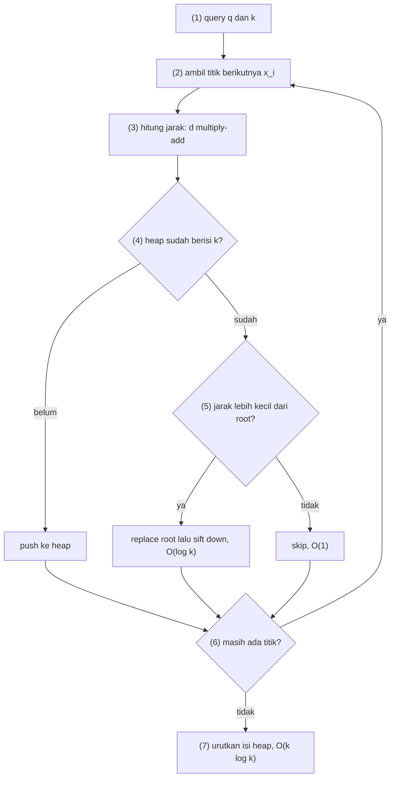

## Pernyataan inti
Exact kNN (brute force) menghitung jarak query ke **setiap** dari `n` titik dan menyimpan
`k` yang terkecil. Biaya per query: `n·d` multiply-add, `n·d·4` byte dibaca (float32), plus
seleksi top-k `O(n log k)` dengan bounded max-heap. Tidak ada titik yang boleh dilewati.
Biaya ini linear di `n` dan dibayar ulang setiap query: fatal di produksi, tapi juga
satu-satunya sumber ground truth.

## Istilah
| Istilah | Arti | Contoh |
|---|---|---|
| kNN | `k` titik dengan jarak terkecil ke query `q`. | k = 3 → tiga titik terdekat |
| exact kNN / brute force / linear scan | kNN yang dijawab dengan menghitung jarak ke semua `n` titik. Hasilnya pasti benar. | faiss `IndexFlatL2` |
| `n`, `d` | Jumlah titik di dataset, dan jumlah dimensi per titik. | SIFT1M: n = 1.000.000, d = 128 |
| multiply-add | Satu perkalian lalu satu penjumlahan ke akumulator: `s += a*b`. Satuan kerja dot product. | dot product d = 128 → 128 multiply-add |
| float32 | Angka pecahan 4 byte. Satu vektor d = 128 = 512 byte. | `np.float32` |
| top-k selection | Memilih `k` nilai terkecil dari `n` nilai tanpa harus mengurutkan semuanya. | 3 terkecil dari 8 jarak |
| bounded max-heap | Heap berukuran maksimal `k`. Root = elemen **terbesar** di dalamnya = kandidat terburuk dari k terbaik sementara. | root 2.50 = batas masuk |
| sift down | Memperbaiki urutan heap setelah root diganti: tukar dengan anak terbesar, ulangi. Paling banyak `log2 k` langkah. | k = 10 → ≤ 4 tukar |
| SIMD | Satu instruksi CPU memproses beberapa float sekaligus. Mempercepat loop dalam, tidak mengurangi jumlah kerja. | 8 float32 per instruksi |
| tie | Dua kandidat dengan jarak persis sama. Urutannya ditentukan implementasi. | p3 dan p4 sama-sama 2.50 |
| ground truth, recall, QPS | Jawaban exact sebagai kunci; fraksi kunci yang ditemukan index; query per detik. Detail di T2-02 s.d. T2-04. | recall 0.9 = 9 dari 10 |
| memory bandwidth | Berapa byte per detik yang bisa dialirkan dari RAM ke CPU. Batas bawah waktu scan. | diukur, bukan ditebak |

## Gambaran


> [!info] Cara membaca
> Loop (2)→(6) berjalan tepat `n` kali. Kotak (3) selalu dikerjakan, jadi `n·d`
> multiply-add tidak bisa dihindari. Cabang mahal (replace) jarang; kebanyakan titik "skip".

## Penjelasan bertahap
1. **Kenapa semua titik harus dilihat.** Kalau scan berhenti di titik ke-`n − 1`, titik
   terakhir bisa saja tepat di posisi query. Tanpa struktur index, tidak ada cara
   membuktikan ia jauh tanpa menghitung jaraknya. Jadi wajib `n` jarak.
2. **Satu jarak = `d` multiply-add.** L2 kuadrat butuh `d` pengurangan, `d` perkalian,
   `d` penjumlahan. Dot product butuh `d` multiply-add. Jadi satu query = `n·d` unit kerja.
   SIFT1M: `10^6 × 128 = 1,28 × 10^8` multiply-add per query.
3. **Menyimpan k terbaik.** Naif: simpan `n` jarak (`4n` byte), sort `O(n log n)`. Standar:
   bounded max-heap ukuran `k`. Root = jarak terbesar di antara k terbaik sementara, yaitu
   "batas masuk". Titik baru dibandingkan dengan root: lebih kecil → ganti root, sift down
   (`≤ log2 k` tukar); tidak → buang. Memori tambahan hanya `k` slot.
4. **Replace itu jarang.** Pada urutan acak, titik ke-`i` masuk top-k sementara dengan
   peluang `k/i`, jadi ekspektasi replace = `k·(H_n − H_k) ≈ k·ln(n/k)` (`H_m` = bilangan
   harmonik). n = 100.000, k = 10: ≈ 92 replace. Biaya scan didominasi `n·d`, bukan heap.
   Kasus terburuk (data datang dari jauh ke dekat) tetap `O(n log k)`.
5. **Di level memori.** Setiap query membaca seluruh dataset: SIFT1M = 512 MB per query.
   Itu melebihi cache CPU (cek: `sysctl -a | grep cachesize` di macOS, `lscpu` di Linux),
   jadi data dialirkan dari RAM setiap query. Batas bawah latency ≈ `n·d·4 / bandwidth`.
   Tiap byte yang dibaca dipakai sekali saja, jadi CPU lebih banyak menunggu memori.
6. **Kenapa fatal di produksi.** Kerja per detik = `QPS × n × d`. Data 10× → tiap query 10×
   lebih mahal. SIMD, thread, dan batching ([[07-concepts/T2-04-qps-throughput-batching]])
   hanya mengubah konstanta. ANN membalik tradeoff: mengunjungi sebagian kecil titik, dengan
   risiko melewatkan tetangga sejati (recall < 1).

## Mekanisme / formula
```
kerja_jarak(q)  = n · d multiply-add
byte_dibaca(q)  = n · d · 4                  (float32, tanpa reuse antar query)
seleksi_top_k   = O(n log k) terburuk;  sort penuh = O(n log n)
kerja_per_detik = QPS · n · d
latency(q)     ≳ n · d · 4 / bandwidth_memori   (kalau dataset tidak muat di cache)
```
Invariant heap yang bisa dicek: setelah memproses `i` titik pertama, heap berisi `k`
jarak terkecil di antara `i` titik itu, dan root = yang terbesar di antaranya.

### Contoh angka kecil
Query `q = (1.5, 1.5)`, d = 2, n = 8, k = 3. Jarak = L2 kuadrat.

| Titik | Koordinat | ‖q − p‖² | Ranking |
|---|---|---|---|
| p0 | (4, 1) | 6.50 | 6 |
| p1 | (1, 1) | 0.50 | 1 |
| p2 | (3, 3) | 4.50 | 5 |
| p3 | (0, 2) | 2.50 | 3 |
| p4 | (2, 0) | 2.50 | 4 |
| p5 | (5, 4) | 18.50 | 8 |
| p6 | (0, 4) | 8.50 | 7 |
| p7 | (2, 2) | 0.50 | 2 |

### Trace langkah demi langkah
Bounded max-heap, k = 3. Kolom terakhir adalah **isi array heap apa adanya di memori**:
indeks 0 = root (jarak terbesar), anak dari indeks `i` ada di `2i+1` dan `2i+2`.

| Langkah | Titik | Jarak | Aksi | Isi array heap |
|---|---|---|---|---|
| 1 | p0 | 6.50 | push (belum penuh) | `[p0:6.50]` |
| 2 | p1 | 0.50 | push (belum penuh) | `[p0:6.50 p1:0.50]` |
| 3 | p2 | 4.50 | push (belum penuh) | `[p0:6.50 p1:0.50 p2:4.50]` |
| 4 | p3 | 2.50 | replace (2.50 < 6.50) | `[p2:4.50 p1:0.50 p3:2.50]` |
| 5 | p4 | 2.50 | replace (2.50 < 4.50) | `[p3:2.50 p1:0.50 p4:2.50]` |
| 6 | p5 | 18.50 | skip (18.50 ≥ 2.50) | `[p3:2.50 p1:0.50 p4:2.50]` |
| 7 | p6 | 8.50 | skip (8.50 ≥ 2.50) | `[p3:2.50 p1:0.50 p4:2.50]` |
| 8 | p7 | 0.50 | replace (0.50 < 2.50) | `[p4:2.50 p1:0.50 p7:0.50]` |

Hasil heap: {p1, p7, p4}. `np.argsort` (stable): {p1, p7, p3}. **Keduanya benar**: p3 dan
p4 sama-sama 2.50 di posisi ke-3. Dua algoritma exact bisa memberi ID berbeda kalau ada
tie; lihat [[07-concepts/T2-02-definisi-recall-at-k]].

### Di level loop
Dua loop bersarang: luar `n` kali (titik), dalam `d` kali (dimensi), lalu satu perbandingan
dengan root per titik. Tidak ada `break`; loop luar tidak bisa berhenti lebih awal.

| Skala | n | d | multiply-add per query | byte dibaca per query |
|---|---|---|---|---|
| SIFT1M | 1,000,000 | 128 | 128,000,000 | 512,000,000 |
| Deep10M | 10,000,000 | 96 | 960,000,000 | 3,840,000,000 |
| hipotetis | 100,000,000 | 768 | 76,800,000,000 | 307,200,000,000 |

Ukuran SIFT1M dan Deep10M `[cukup yakin]`; pastikan dari header file `.fvecs` saat
mengunduh (topik T8-01/T8-02). Baris "hipotetis" hanya ilustrasi aritmetika.

## Kenapa ini penting untuk risetku
Deliverable Fase 0 "ground truth top-100 brute force, catat berapa lama" = catatan ini
dijalankan 10.000 kali (jumlah query SIFT1M `[cukup yakin]`): `1,28 × 10^12` multiply-add.
Waktunya harus dari mesinmu sendiri. Ini inti problem statement: recall tidak bisa
diobservasi di produksi karena pembandingnya mahal
([[07-concepts/T2-03-ground-truth-brute-force]]). Untuk RQ1 (C-002), `n·d` per query
sampel menentukan anggaran sampling ground truth.

## Salah paham yang umum
- "Brute force lambat karena sorting." Bukan. Dengan heap, seleksi top-k murah dan replace
  jarang. Yang mahal adalah `n·d` jarak dan `n·d·4` byte yang harus dibaca.
- "SIMD/thread menyelesaikan masalahnya." Hanya membagi konstanta; kerja tetap linear di `n`.
- "Hasil exact selalu sama persis antar implementasi." Tidak kalau ada tie (trace di atas).

## Cara memverifikasi ini sendiri
```python
import heapq, numpy as np
P = np.array([[4,1],[1,1],[3,3],[0,2],[2,0],[5,4],[0,4],[2,2]], float)
q = np.array([1.5, 1.5]); k = 3
d2 = ((P - q) ** 2).sum(1)                          # tabel "Contoh angka kecil"
heap = []                                            # max-heap lewat negasi: (-jarak, id)
for i, v in enumerate(d2):
    if len(heap) < k: heapq.heappush(heap, (-v, i))
    elif v < -heap[0][0]: heapq.heapreplace(heap, (-v, i))
    print(i + 1, " ".join(f"p{j}:{-a:.2f}" for a, j in heap))   # kolom "isi array heap"
print(sorted(float(-a) for a, _ in heap), np.sort(d2)[:k])      # [0.5, 0.5, 2.5] [0.5 0.5 2.5]
print(sorted(j for _, j in heap), sorted(np.argsort(d2, kind="stable")[:k].tolist()))  # [1, 4, 7] [1, 3, 7]

# berapa kali heap benar-benar diubah: urutan acak, n = 100.000, k = 10, 20 percobaan
rng = np.random.default_rng(0); n, k = 100_000, 10; reps = []
for _ in range(20):
    x = rng.random(n); h = [-v for v in x[:k]]; heapq.heapify(h); r = 0
    for v in x[k:]:
        if v < -h[0]: heapq.heapreplace(h, -v); r += 1
    reps.append(r)
H = lambda m: (1 / np.arange(1, m + 1)).sum()
print(np.mean(reps), round(k * (H(n) - H(k)), 1))   # 91.7 91.6
```
Ukur bandwidth efektif mesinmu sendiri (hasilnya bergantung mesin, jadi tidak ditulis di sini):
```python
import time, numpy as np
X = np.random.default_rng(1).random((1_000_000, 128), dtype=np.float32); q = X[0].copy()  # 512 MB
ts = []
for _ in range(5):
    t = time.perf_counter(); X @ q; ts.append(time.perf_counter() - t)
print(f"{X.nbytes / min(ts) / 1e9:.1f} GB/s efektif, {min(ts)*1e3:.1f} ms per query")
```
`[implementasi: faiss]` `[dicek di source faiss main, 2026-11-23]`: fungsi `knn_L2sqr` di `faiss/utils/distances.cpp`
memakai jalur berurutan `exhaustive_L2sqr_seq` kalau `nx · d` (jumlah query × dimensi) di
bawah `distance_compute_blas_threshold` (default 128000), dan jalur BLAS
`exhaustive_L2sqr_blas` kalau di atasnya. Ada juga jalur paralel per database yang dicek
lebih dulu. Cek lagi di versi faiss yang kamu pasang.

## Rujukan
Heap: Cormen, Leiserson, Rivest, Stein, *Introduction to Algorithms* (bab heap) `[yakin]`.
Ekspektasi `k·(H_n − H_k)` diturunkan dari peluang `k/i` dan dicek dengan kode, bukan paper.
