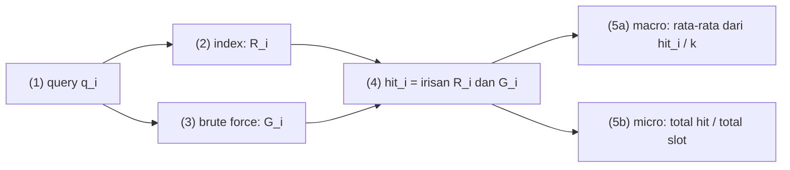

## Pernyataan inti
Untuk satu query `q_i`: `recall_i@k = |R_i ∩ G_i| / k`, dengan `G_i` = top-k exact (ground
truth) dan `R_i` = k hasil index. Untuk banyak query ada dua cara merangkum: **macro**
(hitung per query, lalu rata-rata) dan **micro / agregat** (jumlahkan semua hit, bagi jumlah
semua slot). Kalau penyebutnya selalu `k`, keduanya identik secara aljabar. Keduanya
berbeda saat penyebut per kelompok tidak sama (window, shard, atau range search). Ada juga
sumbu kedua: hit dihitung per **ID** atau per **jarak**. ANN-Benchmarks memakai macro
berbasis jarak `[implementasi: ann-benchmarks]` `[dicek di source ANN-Benchmarks branch main, 2026-11-23]`.

## Istilah
| Istilah | Arti | Contoh |
|---|---|---|
| `G_i` (ground truth) | Himpunan k ID terdekat sejati untuk query i, dari brute force. | `G_0 = {4, 1, 8}` |
| `R_i` (hasil) | Himpunan ID yang dikembalikan index untuk query i. Idealnya berisi k. | `R_0 = {4, 8, 1}` |
| hit | Anggota `R_i` yang juga ada di `G_i`, yaitu ukuran irisan `R_i ∩ G_i`. Urutan di dalam list tidak dihitung. | 3 hit |
| recall@k | Fraksi tetangga sejati yang ditemukan: `hit / k`. | 2 dari 3 → 0.667 |
| precision@k | Fraksi hasil yang benar: `hit` dibagi jumlah hasil. Sama dengan recall kalau jumlah hasil = k. | 2 dari 2 → 1.0 |
| macro average | Rata-rata dari recall per query. Setiap query berbobot sama. | mean(1, 0.667, …) |
| micro average / agregat | Total hit dibagi total slot. Setiap slot berbobot sama. | 8 / 12 |
| tie | Dua titik berjarak persis sama di batas posisi ke-k. | p3 dan p4 = 2.50 |
| ID-based vs distance-based | Hit dihitung karena ID-nya ada di `G_i`, atau karena jaraknya ≤ jarak tetangga ke-k sejati (+ toleransi ε). | ε = 0.001 |
| operating point | Konfigurasi tempat angka recall diukur. Detail di [[07-concepts/T2-07-recall-tanpa-operating-point]]. | ef = 80 |

## Gambaran


> [!info] Cara membaca
> Langkah (1)–(4) sama untuk semua definisi. Perbedaan hanya di (5): kapan pembagian
> dilakukan. Pada kNN biasa, (5a) dan (5b) memberi angka yang sama.

## Penjelasan bertahap
1. **Recall menjawab satu pertanyaan.** Dari k tetangga sejati, berapa yang ditemukan index?
   Urutan di dalam top-k tidak dihitung; recall memperlakukan hasil sebagai himpunan.
2. **Kenapa orang jarang menyebut precision.** Index diminta k hasil dan ground truth berisi
   k. Kalau `|R_i| = |G_i| = k`, maka `hit/|R_i| = hit/k`: precision = recall. Ini berhenti
   berlaku kalau index mengembalikan **kurang dari k** (misalnya graf yang rusak setelah
   delete tidak menemukan cukup kandidat hidup). Membagi dengan `|R_i|` saat itu menghitung
   precision dan menggelembungkan angka (q2 di trace: 1.000 alih-alih 0.667).
3. **Macro vs micro.** Macro: `(1/Q) Σ hit_i/k`. Micro: `Σ hit_i / (Q·k)`. Konstanta `k` bisa
   dikeluarkan dari jumlah, jadi keduanya **identik** untuk kNN dengan k tetap. Mereka
   berbeda saat penyebut tidak seragam: range search (`|G_i|` bervariasi), atau saat kamu
   merangkum per kelompok yang ukurannya beda (window waktu, shard), lalu merata-rata
   rata-ratanya. Window 1.000 query dengan recall 0.9 dan window 10 query dengan recall 0.5:
   rata-rata dari rata-rata = 0.700, pooled = 0.896.
4. **ID vs jarak.** Dengan tie, dua jawaban exact bisa beda ID (lihat
   [[07-concepts/T2-01-exact-knn-dan-biaya-o-nd]]). Counting per ID menghukum index yang
   memilih p4 alih-alih p3, padahal jaraknya sama. Counting per jarak menganggap hasil benar
   kalau `dist(q, r) ≤ dist(q, g_k) + ε`, dengan `g_k` tetangga ke-k sejati.
5. **Apa yang dipakai ANN-Benchmarks** `[implementasi: ann-benchmarks]` `[dicek di source ANN-Benchmarks branch main, 2026-11-23]`.
   Per query: hitung berapa dari k jarak hasil yang ≤ `jarak_GT[k−1] + ε` (ε default 1e-3),
   lalu ambil rata-rata hit dibagi k. Jadi macro berbasis jarak. Karena penyebutnya selalu k,
   angka ini juga sama dengan micro. Jarak hasil dihitung ulang oleh runner dengan metrik
   asli dari ID yang dikembalikan, bukan jarak yang dilaporkan algoritma `[dicek di source ANN-Benchmarks branch main, 2026-11-23]`.
6. **Rata-rata menyembunyikan sebaran.** Mean 0.667 di trace terdiri dari 1.0, 0.667, 0.667,
   dan 0.333. Delete yang terklaster (C-001) bisa membuat sebagian kecil query gagal total
   sementara mean nyaris tidak bergerak. Simpan array recall per query, bukan hanya mean-nya.

## Mekanisme / formula
```
hit_i            = |R_i ∩ G_i|
recall_i@k       = hit_i / k
macro            = (1/Q) Σ_i hit_i / k
micro            = Σ_i hit_i / Σ_i k        (= macro kalau k sama untuk semua query)
hit_i (jarak)    = #{ r ∈ R_i[:k] : dist(q_i, r) ≤ dist(q_i, g_{i,k}) + ε }
```
Invariant: `0 ≤ recall_i@k ≤ 1`, dan recall berbasis jarak ≥ recall berbasis ID untuk hasil
yang sama (setiap hit ID juga lolos ambang jarak).

Variasi notasi yang perlu dikenali saat membaca paper: "k-recall@k" (gaya di atas),
"1-recall@R" / "R@R" (fraksi query yang tetangga terdekat sejatinya muncul di top-R,
dipakai di skrip benchmark faiss `[implementasi: faiss]` `[cukup yakin]`), dan "10@100"
(`|R_100 ∩ G_10| / 10`). Ketiganya bukan angka yang bisa dibandingkan langsung.

### Contoh angka kecil
k = 3, empat query. ID adalah indeks titik di dataset mini. q2 hanya mendapat 2 hasil.

| Query | G_i (exact) | R_i (index) | Irisan | hit | recall = hit/k | salah: hit/jumlah hasil |
|---|---|---|---|---|---|---|
| q0 | [4, 1, 8] | [4, 8, 1] | [1, 4, 8] | 3 | 3/3 = 1.000 | 3/3 = 1.000 |
| q1 | [2, 5, 0] | [2, 0, 6] | [0, 2] | 2 | 2/3 = 0.667 | 2/3 = 0.667 |
| q2 | [7, 3, 9] | [7, 3] | [3, 7] | 2 | 2/3 = 0.667 | 2/2 = 1.000 |
| q3 | [6, 2, 1] | [5, 6, 9] | [6] | 1 | 1/3 = 0.333 | 1/3 = 0.333 |

### Trace langkah demi langkah
| Langkah | Macro | Micro |
|---|---|---|
| (1) per query | 1.000, 0.667, 0.667, 0.333 | hit: 3, 2, 2, 1 |
| (2) jumlahkan | 2.667 | 8 hit dari 4 × 3 = 12 slot |
| (3) bagi | 2.667 / 4 = **0.6667** | 8 / 12 = **0.6667** |
| salah (bagi jumlah hasil) | (1 + 0.667 + 1 + 0.333) / 4 = 0.75 | — |

ID vs jarak, data mini T2-01 (`q = (1.5, 1.5)`): GT stable-argsort = [1, 7, 3], index
mengembalikan [1, 7, 4]. Recall ID = 0.667. Recall jarak (ambang 2.50 + 0.001) = 1.0.

### Di level loop
Per query cukup satu set lookup: masukkan `G_i` ke hash set (k elemen), lalu cek setiap
anggota `R_i`: `O(k)`. Untuk 10.000 query dan k = 10 itu 100.000 lookup, sepele dibanding
menghitung `G_i` itu sendiri ([[07-concepts/T2-03-ground-truth-brute-force]]). Di numpy,
bentuk vektornya: `(R[:, :, None] == G[:, None, :]).any(2).sum(1)` dengan `R`, `G` berukuran
`(Q, k)`, memakai memori sementara `Q·k·k` boolean.

## Kenapa ini penting untuk risetku
Plot Fase 0 "recall@10 vs ef" dan "recall@10 vs QPS" harus menyebut definisi yang dipakai:
k = 10, ground truth dari file top-100 (ambil 10 kolom pertama), macro, dan ID atau jarak.
Kalau ingin dibandingkan dengan kurva ANN-Benchmarks, pakai versi jarak dengan ε yang sama.
Untuk RQ1, simpan recall per query: sinyal kesehatan index (C-002) harus berkorelasi dengan
recall per query atau per window, dan pada level window jebakan "rata-rata dari rata-rata"
muncul. Setelah delete, `G_i` harus dihitung ulang hanya atas titik yang masih hidup.

## Salah paham yang umum
- "Macro dan micro selalu beda." Untuk kNN dengan k tetap, identik. Bedanya muncul saat
  penyebut bervariasi.
- "Index mengembalikan 7 hasil, 7 benar, recall 100%." Itu precision. Recall = 7/10.
- "Recall@10 = 0.95 berarti tiap query menemukan sekitar 9–10 dari 10." Tidak harus. Bisa
  95% query sempurna dan 5% query nol; mean-nya sama.
- "Urutan hasil ikut dinilai." Tidak di recall@k. Metrik berbasis urutan adalah hal lain.

## Cara memverifikasi ini sendiri
```python
import numpy as np
k = 3
G = {"q0": [4, 1, 8], "q1": [2, 5, 0], "q2": [7, 3, 9], "q3": [6, 2, 1]}
R = {"q0": [4, 8, 1], "q1": [2, 0, 6], "q2": [7, 3],    "q3": [5, 6, 9]}
hits = {q: len(set(R[q]) & set(G[q])) for q in G}
macro = np.mean([hits[q] / k for q in G])
micro = sum(hits.values()) / (k * len(G))
wrong = np.mean([hits[q] / len(R[q]) for q in G])
print(hits, round(macro, 4), round(micro, 4), round(wrong, 4))
# {'q0': 3, 'q1': 2, 'q2': 2, 'q3': 1} 0.6667 0.6667 0.75

win = {"W1": (1000, 900), "W2": (10, 5)}            # (jumlah query, total hit), k = 1
print(np.mean([h / n for n, h in win.values()]),    # rata-rata dari rata-rata: 0.7
      round(sum(h for _, h in win.values()) / sum(n for n, _ in win.values()), 3))  # pooled: 0.896

P = np.array([[4,1],[1,1],[3,3],[0,2],[2,0],[5,4],[0,4],[2,2]], float); q = np.array([1.5, 1.5])
d2 = ((P - q) ** 2).sum(1); gt = np.argsort(d2, kind="stable")[:k]; res = np.array([1, 7, 4])
print(gt, round(len(set(gt) & set(res)) / k, 3), (d2[res] <= d2[gt[-1]] + 1e-3).sum() / k)
# [1 7 3] 0.667 1.0
```
Di source ANN-Benchmarks: file `ann_benchmarks/plotting/metrics.py`, fungsi `knn_threshold`,
`get_recall_values`, dan `knn` `[dicek di source ANN-Benchmarks branch main, 2026-11-23]`: `knn_threshold` = `data[count - 1] + epsilon`,
default `epsilon=1e-3`, dan hasilnya `np.mean(recalls) / float(count)`, jadi penyebutnya
`count` (= k). Hanya `count` hasil pertama yang diperiksa. Cek lagi kalau memakai versi lain.

## Rujukan
- Aumüller, Bernhardsson, Faithfull, "ANN-Benchmarks", Information Systems, 2020 `[yakin]`
  untuk paper-nya. Bahwa paper itu memakai definisi recall berbasis jarak untuk menangani
  tie `[cukup yakin]`, cek di Pass 2 [[04-papers/aumuller-ann-benchmarks]].
- Definisi recall, precision, macro/micro average: definisi mapan, tidak butuh sitasi.
