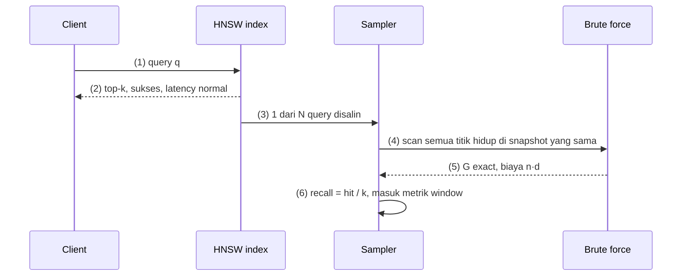

## Pernyataan inti
Recall@k butuh `G_i`, top-k exact untuk setiap query. Satu-satunya cara mendapatkan `G_i`
yang pasti benar adalah brute force: `n·d` multiply-add per query. Metode yang lebih cepat
adalah ANN juga, jadi butuh ground truth sendiri. Akibatnya di produksi recall **tidak
teramati**: menghitungnya untuk setiap query sama mahalnya dengan tidak memakai index, dan
`G_i` basi begitu data di-insert atau di-delete. Index bisa membusuk tanpa satu pun error.
Yang tersisa hanya sampling dengan biaya `s·n·d` per window, atau probe set yang
ground truth-nya dirawat secara inkremental.

## Istilah
| Istilah | Arti | Contoh |
|---|---|---|
| ground truth (GT) | `G_i` untuk setiap query, hasil brute force. Kunci jawaban recall. | file `sift_groundtruth.ivecs` |
| `.ivecs` | Format file: tiap baris = int32 jumlah elemen, lalu sejumlah int32 (ID). | 100 ID per query |
| titik hidup | Titik yang belum di-delete pada saat query dijalankan. | setelah delete p6, p6 bukan titik hidup |
| snapshot | Himpunan titik hidup pada satu waktu. GT hanya sah untuk satu snapshot. | data jam 10:00 |
| observability | Bisa melihat kondisi sistem dari luar lewat metrik. | error rate, p99 |
| silent degradation | Kualitas turun tanpa gejala: query sukses, latency normal, hasil makin salah. | recall 0.95 → 0.80 diam-diam |
| sampling / shadow query | Menyalin 1 dari N query produksi dan menjawabnya ulang dengan brute force. | 1 dari 1.000 |
| standard error (SE) | Simpangan baku estimasi rata-rata: `sd / √s` untuk `s` sampel. | s = 100 → SE ≤ 0.05 |
| probe set | Sekumpulan query tetap yang GT-nya disimpan dan dirawat. | 1.000 query tetap |
| margin `K − k` | Simpan top-K (K > k) supaya delete bisa diserap tanpa brute force ulang. | K = 100, k = 10 |
| radius cakupan `τ` | Jarak ke-K saat top-K dihitung. Semua titik hidup yang lebih dekat dari `τ` pasti ada di list. | τ = 25 |
| argpartition | Seleksi top-k `O(n)` per baris tanpa sort penuh. | `np.argpartition` |

## Gambaran


> [!info] Cara membaca
> Jalur (1)–(2) adalah produksi, dan tidak ada yang tampak salah di sana. Recall hanya
> muncul di jalur (3)–(6), yang biayanya `n·d` per sampel. Jalur ini harus membaca
> snapshot yang sama dengan index, kalau tidak selisih snapshot terbaca sebagai error.

## Penjelasan bertahap
1. **Recall itu relatif.** Angka recall selalu "relatif terhadap `G_i`". Kalau `G_i` sendiri
   dihitung dengan ANN, kamu mengukur kesepakatan dua index, bukan kebenaran. Jadi `G_i`
   wajib exact, dan exact tanpa index berarti `n·d` per query
   ([[07-concepts/T2-01-exact-knn-dan-biaya-o-nd]]).
2. **Di lab: mahal tapi sekali.** SIFT1M: 10.000 query × 10^6 × 128 = 1,28 × 10^12
   multiply-add, dihitung offline sekali. Trik standar: `‖x − q‖² = ‖x‖² − 2x·q + ‖q‖²`.
   `‖x‖²` dihitung sekali, `‖q‖²` konstan per query (tidak mengubah ranking), dan `x·q` untuk
   satu blok query menjadi satu perkalian matriks (lihat
   [[07-concepts/T2-04-qps-throughput-batching]]). Ekspansi ini kehilangan presisi di float32
   saat dua jarak hampir sama, jadi bandingkan hasilmu dengan file GT resmi.
3. **Di produksi: tidak teramati.** Menghitung `G_i` untuk setiap query = melayani semua
   query dengan brute force. Kalau itu terjangkau, index tidak dibutuhkan. Sementara itu
   HNSW tetap mengembalikan k hasil dengan latency normal walau graf rusak. Error rate dan
   p99 tidak bergerak. Itulah silent degradation.
4. **GT basi saat data berubah.** `G_i` adalah fungsi dari `(q_i, snapshot)`. Insert bisa
   memasukkan titik baru ke top-k; delete mengeluarkan titik. GT yang dihitung kemarin
   menghukum index karena tidak mengembalikan titik yang sudah dihapus.
5. **Pilihan 1: sampling.** Ambil `s` query per window, jawab ulang dengan brute force.
   Recall per query ada di [0, 1], jadi `sd ≤ 0.5` dan `SE ≤ 0.5/√s`. Mendeteksi penurunan
   1 poin (0.01) butuh SE jauh di bawah 0.01, artinya ribuan sampel per window, masing-masing
   `n·d`. Brute force harus membaca snapshot yang sama dengan index; insert yang belum masuk
   index akan ditemukan brute force tapi tidak oleh index, lalu terbaca sebagai recall turun.
6. **Pilihan 2: probe set inkremental.** Simpan top-K untuk P query tetap, plus `τ`.
   Delete: buang dari list, `O(K)`. Insert: hitung jarak ke P query (`P·d` per insert); masuk
   list hanya kalau jaraknya ≤ `τ`. Invariant: list = semua titik hidup berjarak < `τ`. Maka
   selama list berisi ≥ k, k teratasnya = top-k exact. Kalau < k, brute force ulang (`n·d`).
   Delete terklaster di sekitar query menghabiskan margin paling cepat (C-001).

## Mekanisme / formula
```
biaya_GT_lab      = Q · n · d                    (sekali, offline)
biaya_sampling    = s · n · d per window          SE(recall) ≤ 0.5 / √s
biaya_probe       = P · d per insert,  O(K) per delete per probe, n · d saat margin habis
invariant probe   : list = { x hidup : dist(q, x) < τ } ;  |list| ≥ k ⇒ top-k(list) = top-k exact
```
Kenapa benar: titik hidup di luar list berjarak ≥ `τ`, sedangkan semua isi list berjarak
≤ `τ`. Kalau list berisi ≥ k, titik luar tidak bisa masuk top-k (kecuali tie tepat di `τ`).
Jebakan: memotong list ke K setelah insert tanpa menurunkan `τ`, atau memasukkan insert
yang lebih jauh dari `τ`, merusak invariant ini.

### Contoh angka kecil
n = 10, d = 2 (acak, seed 3), probe `q = (5, 5)`, k = 3, K = 5. Jarak = L2 kuadrat.
Top-5 tersimpan awal: p6:2, p5:5, p8:5, p3:9, p1:25, jadi `τ = 25` (p2 dan p7 juga 25; tie
diputus ID).

### Trace langkah demi langkah
Setiap baris dicek terhadap brute force ulang atas semua titik hidup.

| Event | Isi top-K tersimpan | top-k inkremental | top-k brute force | Status |
|---|---|---|---|---|
| delete p6 | p5:5, p8:5, p3:9, p1:25 | [5, 8, 3] | [5, 8, 3] | ok |
| insert p10 = (5, 6), jarak 1 ≤ τ | p10:1, p5:5, p8:5, p3:9, p1:25 | [10, 5, 8] | [10, 5, 8] | ok |
| insert p11 = (0, 9), jarak 41 > τ | tidak berubah (diabaikan) | [10, 5, 8] | [10, 5, 8] | ok |
| delete p5 | p10:1, p8:5, p3:9, p1:25 | [10, 8, 3] | [10, 8, 3] | ok |
| delete p8 | p10:1, p3:9, p1:25 | [10, 3, 1] | [10, 3, 1] | ok |
| delete p10 | p3:9, p1:25 | — (sisa 2 < k) | [3, 1, 2] | brute force ulang |

Empat delete di sekitar `q` menghabiskan margin K − k = 2 (insert p10 sempat menambal satu).

### Di level loop
Biaya sampling untuk SIFT1M (n = 10^6, d = 128), batas atas SE dengan `sd ≤ 0.5`:

| Sampel per window | SE ≤ | multiply-add per window |
|---|---|---|
| 100 | 0.0500 | 12,800,000,000 |
| 1,000 | 0.0158 | 128,000,000,000 |
| 10,000 | 0.0050 | 1,280,000,000,000 |

`sd` sebenarnya biasanya lebih kecil dari 0.5; ukur dari array recall per query milikmu.
Memori brute force berblok: matriks jarak sementara `bs × n × 4` byte (bs = 64 → 256 MB).

## Kenapa ini penting untuk risetku
Ini problem statement-mu dalam satu halaman. Deliverable Fase 0 "ground truth top-100,
catat berapa lama" memberi angka biaya nyata. RQ1 (C-002) bertanya apakah sinyal murah bisa
menggantikan jalur (3)–(6); baseline upper bound-nya adalah recall dari GT ini, dan fallback
C-002 ("berapa anggaran sampling minimum") adalah tabel SE di atas. Di Fase 1–2, setiap
eksperimen delete wajib menghitung ulang GT atas titik hidup; margin top-100 untuk
recall@10 membuat sebagian bisa dirawat inkremental. Delete terklaster (C-001) menghabiskan
margin itu lebih cepat.

## Salah paham yang umum
- "Pakai GT bawaan dataset setelah delete." Salah. GT itu untuk snapshot awal; setelah
  delete ia memuat titik mati dan recall terukur jadi terlalu rendah.
- "Monitor latency dan error rate cukup." Keduanya tidak bergerak saat recall turun.
- "GT dari index dengan ef sangat besar sudah cukup exact." Tetap ANN; kalau graf punya
  node yang tidak terjangkau, ef besar pun tidak menemukannya.
- "Sampling 100 query per jam cukup." SE-nya sampai 0.05, terlalu kasar untuk alarm 1 poin.

## Cara memverifikasi ini sendiri
```python
import numpy as np
def ground_truth(X, Q, k=100, bs=64):                       # dipakai untuk SIFT1M
    xx = (X ** 2).sum(1); out = np.empty((len(Q), k), np.int64)
    for s in range(0, len(Q), bs):
        D = xx[None, :] - 2 * (Q[s:s + bs] @ X.T)            # ‖q‖² dibuang: konstan per baris
        I = np.argpartition(D, k, axis=1)[:, :k]             # O(n) per baris, belum terurut
        out[s:s + bs] = np.take_along_axis(I, np.argsort(np.take_along_axis(D, I, 1), 1), 1)
    return out
rng = np.random.default_rng(0)
X = rng.random((5000, 32), dtype=np.float32); Q = rng.random((100, 32), dtype=np.float32)
naive = np.argsort(((Q[:, None, :].astype(np.float64) - X[None]) ** 2).sum(2), 1)[:, :10]
print(np.array_equal(ground_truth(X, Q, k=10), naive))      # True

# trace probe set inkremental
rng = np.random.default_rng(3); X = {i: rng.integers(0, 10, 2).astype(float) for i in range(10)}
q = np.array([5.0, 5.0]); k, K = 3, 5
dist = lambda i: float(((X[i] - q) ** 2).sum()); key = lambda i: (dist(i), i)
live = set(X); stored = sorted(live, key=key)[:K]; tau = dist(stored[-1])        # tau = 25.0
for ev, i, v in [("del", 6, 0), ("ins", 10, [5., 6.]), ("ins", 11, [0., 9.]),
                 ("del", 5, 0), ("del", 8, 0), ("del", 10, 0)]:
    if ev == "del": live.discard(i); stored = [j for j in stored if j != i]
    else:
        X[i] = np.array(v); live.add(i)
        if dist(i) <= tau: stored = sorted(stored + [i], key=key)     # di luar tau: abaikan
    print(ev, i, stored[:k] if len(stored) >= k else "rebuild", sorted(live, key=key)[:k])
# del 6 [5, 8, 3] [5, 8, 3] / ins 10 [10, 5, 8] [10, 5, 8] / ins 11 [10, 5, 8] [10, 5, 8]
# del 5 [10, 8, 3] [10, 8, 3] / del 8 [10, 3, 1] [10, 3, 1] / del 10 rebuild [3, 1, 2]
for s in [100, 1000, 10000]: print(s, round(0.5 / np.sqrt(s), 4), s * 10**6 * 128)
# 100 0.05 12800000000 / 1000 0.0158 128000000000 / 10000 0.005 1280000000000
```
Di SIFT1M: jalankan `ground_truth` pada base + query, ukur waktunya, lalu bandingkan dengan
`sift_groundtruth.ivecs` **per jarak** (bukan per ID, karena tie).

## Rujukan
- Isi dan format file SIFT1M (korpus TEXMEX, GT top-100 dalam `.ivecs`) `[cukup yakin]`;
  pastikan saat mengunduh.
- Invariant probe set dan batas SE: diturunkan di catatan ini, dicek dengan kode, bukan
  dari paper. Batas `sd ≤ 0.5` untuk variabel di [0, 1] adalah fakta statistik dasar.
