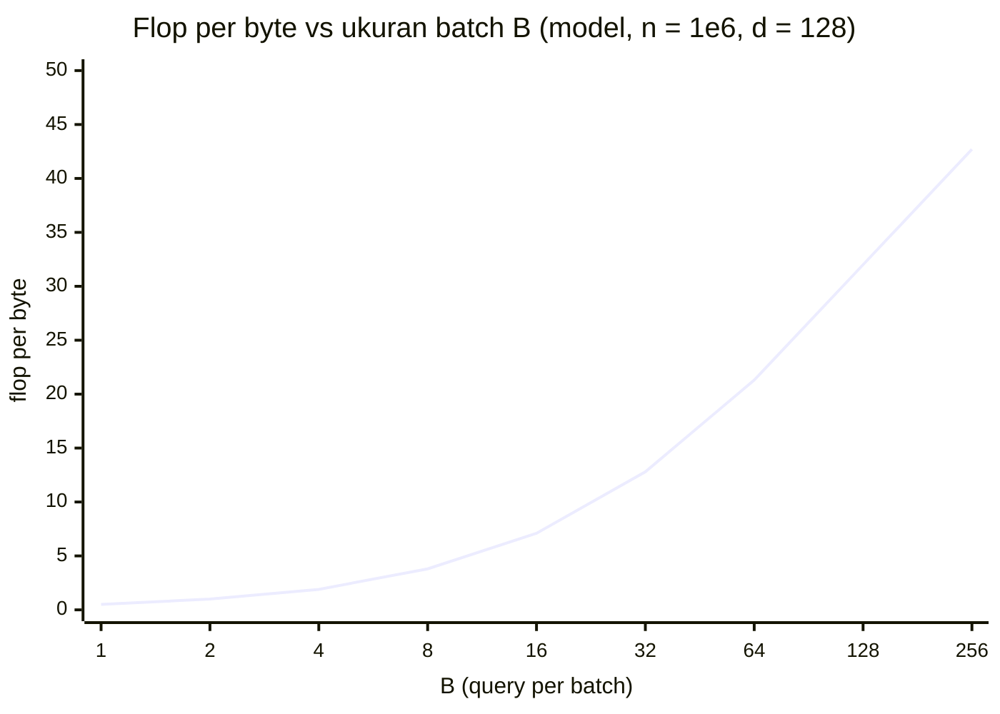

## Pernyataan inti
QPS = jumlah query selesai / waktu wall-clock pengukuran. Pada satu thread yang mengirim
query satu per satu, `QPS = 1 / mean latency`. Dengan concurrency `c`, Little's law memberi
`QPS = c / mean latency`, sampai sebuah resource jenuh. Batching mengirim B query sekaligus.
Untuk brute force, batching mengubah matrix-vector menjadi matrix-matrix: setiap byte `X`
dipakai untuk B query, jadi byte per query turun dari `n·d·4` ke `n·d·4/B`. Jumlah
multiply-add **tidak** berubah. Untuk HNSW, setiap query menempuh jalur graf sendiri,
jadi keuntungan batching terutama dari paralelisme dan overhead per panggilan.
Harganya sama: latency tiap query dalam batch naik.

## Istilah
| Istilah | Arti | Contoh |
|---|---|---|
| latency | Waktu satu query dari dikirim sampai hasil diterima. | 2 ms |
| QPS / throughput | Query selesai per detik, diukur dari wall-clock seluruh run. | 1.024 query / 0,5 s = 2.048 QPS |
| wall-clock | Waktu jam dinding (`time.perf_counter`), bukan CPU time. | |
| concurrency `c` | Jumlah query yang sedang diproses bersamaan. | 4 thread |
| Little's law | `c = QPS × mean latency` dalam kondisi stabil. Identitas antrian, bukan klaim empiris. | c = 4, latency 2 ms → 2.000 QPS |
| batch / batching | Mengirim B query dalam satu panggilan; hasilnya kembali bersama. | `knn_query(Q[0:256])` |
| GEMV / GEMM | Matrix-vector vs matrix-matrix multiply, rutin BLAS. Brute force 1 query = GEMV; B query = GEMM. | `X @ q` vs `Q @ X.T` |
| BLAS | Library aljabar linear yang dipakai numpy/faiss untuk GEMV/GEMM. | OpenBLAS, Accelerate |
| arithmetic intensity | flop per byte yang dipindahkan dari memori. Rendah = memory-bound. | GEMV ≈ 0.5 |
| memory-bound / compute-bound | Dibatasi kecepatan memori vs kecepatan hitung CPU. | |
| tiling | Memproses potongan `X` yang muat di cache untuk semua query di blok sebelum pindah. | |
| warm-up | Panggilan awal yang dibuang dari pengukuran (alokasi, page fault, thread pool). | 8 query pertama |

## Gambaran
Arithmetic intensity brute force untuk n = 10^6, d = 128 (model hitungan ideal: baca `X`
sekali per batch, baca blok query, tulis matriks jarak `B × n`; hasil kode di bawah).



> [!info] Cara membaca
> B = 1 (GEMV): setiap byte `X` dipakai untuk 0.5 flop, CPU menunggu memori. Makin besar B,
> makin banyak hitungan per byte. Kurvanya melandai karena matriks output `B × n` ikut
> membesar; batas atasnya `d/2 = 64` di model ini. Ini model, bukan pengukuran mesin.

## Penjelasan bertahap
1. **Dua pertanyaan berbeda.** Latency: berapa lama *satu* query menunggu. Throughput:
   berapa *banyak* query selesai per detik. Pengguna merasakan latency; tagihan server
   ditentukan throughput. Keduanya bisa bergerak berlawanan.
2. **Kasus paling sederhana.** Satu thread, query dikirim satu per satu, tidak ada antrean:
   total waktu = jumlah latency, jadi `QPS = N / Σ latency = 1 / mean latency`. Artinya QPS
   pada setup ini mencerminkan **mean**, bukan tail ([[07-concepts/T2-05-latency-percentile]]).
3. **Concurrency.** Little's law: `c = QPS × W` (W = mean latency). Dengan 4 thread dan W
   tetap, QPS 4×. Tapi W tidak tetap: thread berebut core dan memory bandwidth. Setelah
   resource jenuh, menambah `c` hanya menaikkan W. Karena itu angka QPS tanpa jumlah thread
   tidak bisa dibandingkan.
4. **Batching brute force: dari GEMV ke GEMM.** Satu query membaca seluruh `X` untuk `n·d`
   multiply-add: 2 flop per 4 byte. B query dalam satu `Q_B @ X.T` membaca `X` sekali untuk
   `B·n·d` multiply-add. Kerja total sama, data yang dipindahkan per query turun B kali.
   SIFT1M, byte `X` per query: 512.000.000 (B = 1) → 2.000.000 (B = 256). Kalau matriks jarak
   ditulis penuh, tiap query menambah `4n` = 4.000.000 byte output; itu masalah langkah 5.
5. **Di level cache: tiling.** Reuse hanya terjadi kalau potongan `X` masih di cache saat
   query berikutnya memakainya. BLAS memotong `X` dan blok query menjadi tile yang muat di
   cache, lalu memakai setiap tile untuk semua query di blok. Matriks output `B × n` juga
   harus ditulis; implementasi yang baik langsung mereduksi tiap potongan jarak ke top-k
   supaya output tidak membesar `[implementasi: faiss]` `[cukup yakin]`.
6. **Batching HNSW berbeda.** Tiap query berjalan di node yang berbeda, jadi tidak ada `X`
   bersama yang dipakai ulang secara sistematis. Keuntungan batch di sini: overhead per
   panggilan (batas Python→C++, alokasi) dibayar sekali, dan query dalam batch dibagi ke
   beberapa thread `[implementasi: hnswlib]` `[cukup yakin]`. Harga di semua kasus: query
   pertama dalam batch menunggu query terakhir. Throughput naik, latency per query naik.

## Mekanisme / formula
```
QPS                  = N_query / wall_clock
QPS (1 thread, seq)  = 1 / mean(latency)
Little's law         : c = QPS · W                         (kondisi stabil)
multiply-add batch   = B · n · d                           (sama dengan B query terpisah)
byte per query       = (n·d + B·d + B·n) · 4 / B  =  n·d·4/B  +  d·4  +  n·4   (X, query, output)
intensity (flop/byte)= 2·B·n·d / (4·(n·d + B·d + B·n))     → d/2 saat B → ∞
```

### Contoh angka kecil
Q = 8 query, n = 6 titik, d = 2 (acak, seed 4), float32 → satu baris `X` = 8 byte.
Hitungan "baris X dibaca" memakai model: satu lintasan atas `X` melayani satu blok.

| B | Lintasan atas X | Baris X dibaca | Byte X dibaca | multiply-add jarak | top-1 tiap query |
|---|---|---|---|---|---|
| 1 | 8 | 48 | 384 | 96 | [0, 5, 0, 5, 4, 5, 1, 4] |
| 4 | 2 | 12 | 96 | 96 | [0, 5, 0, 5, 4, 5, 1, 4] |
| 8 | 1 | 6 | 48 | 96 | [0, 5, 0, 5, 4, 5, 1, 4] |

### Trace langkah demi langkah
| Langkah (B = 4) | Query di blok | Baris X dibaca kumulatif | Bandingkan B = 1 |
|---|---|---|---|
| blok 1 | 0..3 | 6 | 24 setelah query 0..3 |
| blok 2 | 4..7 | 12 | 48 setelah query 4..7 |

Hasil identik, multiply-add identik, data yang dialirkan 4× lebih sedikit.

### Di level loop
Loop ukur yang benar: warm-up dulu, ukur wall-clock seluruh run untuk QPS, dan simpan
latency per panggilan sebagai list (bahan p50/p99). Jangan menghitung QPS dari satu query.
BLAS numpy bisa diam-diam memakai banyak thread; cek `np.show_config()` dan set variabel
thread BLAS-nya ke 1 kalau ingin pengukuran single-thread.

## Kenapa ini penting untuk risetku
Kolom QPS di E-2026-08-02-01 dan plot "recall@10 vs QPS" Fase 0 wajib menyebut: jumlah
thread, batch atau satu per satu, dan apakah build dihitung. ANN-Benchmarks secara default
mengirim query satu per satu dan menghitung QPS sebagai `1 / waktu rata-rata per query`
(terbaik dari beberapa run); mode batch (flag `--batch`) dicatat terpisah sebagai atribut `batch_mode`
`[implementasi: ann-benchmarks]` `[dicek di source ANN-Benchmarks branch main, 2026-11-23]`. Kalau kurvamu memakai `num_threads` default hnswlib, bentuknya tidak bisa
dibandingkan dengan kurva mereka. Metrik "CPU-second" dan "cost-per-query" di RQ2 juga
lebih dekat ke QPS single-thread daripada QPS multi-thread.

## Salah paham yang umum
- "QPS = 1 / latency." Hanya untuk satu thread, sekuensial, tanpa batch.
- "Batching mengurangi kerja." Tidak. Multiply-add sama; yang turun adalah byte per query.
- "QPS tinggi berarti latency rendah." Batch besar bisa menaikkan keduanya sekaligus.
- "Batching HNSW pasti secepat batching brute force." Mekanismenya beda (paralelisme, bukan
  reuse data). Ukur.

## Cara memverifikasi ini sendiri
```python
import numpy as np
n, d = 10**6, 128
print([round(2*B*n*d / (4*(n*d + B*d + B*n)), 1) for B in [1, 2, 4, 8, 16, 32, 64, 128, 256]])
# [0.5, 1.0, 1.9, 3.8, 7.1, 12.8, 21.3, 32.0, 42.7]
rng = np.random.default_rng(4)
X = rng.integers(0, 10, (6, 2)).astype(np.float32); Q = rng.integers(0, 10, (8, 2)).astype(np.float32)
for B in [1, 4, 8]:
    loads, top1 = 0, []
    for s in range(0, len(Q), B):
        blk = Q[s:s + B]; loads += len(X)                  # model: 1 lintasan X per blok
        D = (X ** 2).sum(1)[None] - 2 * blk @ X.T + (blk ** 2).sum(1)[:, None]
        top1 += D.argmin(1).tolist()
    print(B, loads, loads * 8, top1)
# 1 48 384 [0, 5, 0, 5, 4, 5, 1, 4] / 4 12 96 [0, 5, 0, 5, 4, 5, 1, 4] / 8 6 48 [0, 5, 0, 5, 4, 5, 1, 4]
```
Loop ukur QPS untuk dijalankan di mesinmu (hasilnya bergantung mesin, tidak ditulis di sini):
```python
import time, numpy as np
rng = np.random.default_rng(0)
X = rng.random((100_000, 128), dtype=np.float32); Q = rng.random((1024, 128), dtype=np.float32)
xx = (X ** 2).sum(1)
def search(blk, k=10):                       # "index" = brute force; ganti dengan hnswlib nanti
    return np.argpartition(xx[None] - 2 * (blk @ X.T), k, axis=1)[:, :k]
search(Q[:8])                                # warm-up
for B in [1, 16, 256]:
    lat = []; t0 = time.perf_counter()
    for s in range(0, len(Q), B):
        t = time.perf_counter(); search(Q[s:s + B]); lat.append(time.perf_counter() - t)
    wall = time.perf_counter() - t0
    print(f"B={B:4d}  QPS={len(Q) / wall:8.0f}  latency per panggilan (mean) = {np.mean(lat) * 1e3:7.2f} ms")
```
Di source: hnswlib `python_bindings/bindings.cpp`, method `knnQuery_return_numpy`
(parameter `num_threads`) dan helper `ParallelFor` yang didefinisikan di file yang sama
`[dicek di source hnswlib master, 2026-11-23]`. ANN-Benchmarks `[dicek di source ANN-Benchmarks branch main, 2026-11-23]`:
`queries_per_second` di `ann_benchmarks/plotting/metrics.py` isinya
`1.0 / attrs["best_search_time"]`. Di `ann_benchmarks/runner.py`, timer hanya membungkus
`algo.query(v, count)` di fungsi `single_query`, dan `best_search_time` adalah minimum dari
`total_time / len(X_test)` antar run.

## Rujukan
- Little's law: identitas teori antrian (J. D. C. Little, 1961) `[cukup yakin]` untuk tahun.
- GEMV/GEMM dan arithmetic intensity: materi arsitektur komputer standar; angka di grafik
  dari model hitungan di atas, bukan dari pengukuran.
- Konvensi QPS ANN-Benchmarks: [[04-papers/aumuller-ann-benchmarks]], cek di Pass 2.
