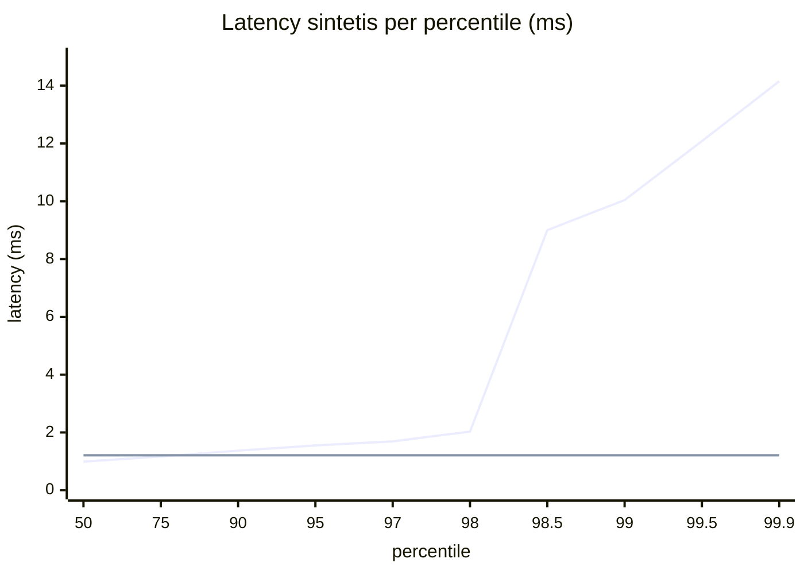

## Pernyataan inti
Latency bukan satu angka, tapi distribusi: setiap query punya latency sendiri. Percentile
`pX` adalah nilai yang tidak dilampaui X% query; p50 = median, p99 = batas 1% query
terlambat. Mean mencampur badan distribusi dengan ekornya, jadi sering tidak mewakili
query mana pun dan tetap tidak menunjukkan seberapa buruk ekornya. Percentile dihitung dari
list latency yang diurutkan, dengan dua metode umum: **nearest-rank** dan **linear
interpolation**. Keduanya berbeda di N kecil, jadi metodenya harus disebut. Percentile
tidak bisa dirata-rata antar shard atau antar run; gabungkan sampel mentahnya.

## Istilah
| Istilah | Arti | Contoh |
|---|---|---|
| sampel latency | Satu angka latency per query; N query → list N angka. | `[1.2, 0.9, …]` ms |
| mean | Jumlah dibagi N. | 3.19 ms di contoh |
| percentile `pX` | Nilai yang tidak dilampaui X% sampel. | p99 = 13.6 ms |
| p50 / median | Titik tengah: separuh query lebih cepat. | 1.1 ms |
| tail latency | Ujung lambat distribusi: p99, p99.9, max. | 9.5 dan 14.0 ms |
| heavy tail / bimodal | Sebagian kecil sampel jauh lebih besar dari mayoritas; atau dua kelompok terpisah. | cache hit vs miss |
| rank (1-based) | Posisi di list terurut, mulai dari 1. | rank 1 = tercepat |
| nearest-rank | `pX = x_(r)`, `r = ceil(X/100 · N)` (rank 1-based). Selalu nilai yang benar-benar terjadi. | p90, N = 10 → rank 9 |
| linear interpolation | `h = (N−1)·X/100` (indeks 0-based), interpolasi antara `x[floor h]` dan berikutnya. Default `np.percentile`. | h = 8.1 |
| histogram bucket | Hitungan sampel per rentang latency. Bisa dijumlahkan antar server. | bucket 1–2 ms: 440 |
| fanout | Satu request dikirim ke N shard dan menunggu semuanya. | 8 shard |

## Gambaran
Kurva percentile 1.000 latency **sintetis** (98% lognormal median ≈ 1 ms, 2% ekor 8–15 ms,
seed 7; kode di bawah). Garis kedua = mean.



> [!info] Cara membaca
> Garis datar adalah mean (1.21 ms). Sampai p98 latency di bawah 2 ms, lalu melompat ke
> 9–14 ms. Mean tidak memberi petunjuk adanya lompatan itu, dan 79.4% query lebih cepat
> dari mean. Sumbu x tidak linear: jarak antar kategori sama, nilainya tidak.

## Penjelasan bertahap
1. **Distribusi, bukan angka.** Run 10.000 query menghasilkan 10.000 latency. Ringkasan
   apa pun membuang informasi; pertanyaannya informasi mana yang boleh dibuang.
2. **Kenapa mean menipu.** Di contoh 10 sampel, delapan query ≤ 1.3 ms dan dua query 9.5 dan
   14.0 ms. Mean = 3.19 ms: tidak ada satu query pun yang mengalami 3.19 ms. Mean naik karena
   ekor, tapi tidak memberi tahu apakah itu banyak query agak lambat atau sedikit query
   sangat lambat. Pada distribusi bimodal, mean jatuh di celah kosong di antara dua kelompok.
3. **Cara menghitung percentile.** Urutkan list (`O(N log N)`, atau seleksi `O(N)` dengan
   `np.partition`). **Nearest-rank:** rank `r = ceil(X/100·N)`, ambil elemen ke-r (1-based).
   **Linear:** posisi `h = (N−1)·X/100` (0-based), ambil `x[lo] + (h − lo)·(x[lo+1] − x[lo])`.
   Di N = 10, p90 nearest-rank = 9.5, linear = 9.95. `np.percentile` default = linear;
   `method="inverted_cdf"` = nearest-rank. Tulis metodenya di laporan.
4. **p99 butuh banyak sampel.** p99 dari N sampel ditentukan oleh sekitar N/100 sampel
   teratas. N = 100 → satu atau dua angka. Simulasi 200 run sintetis: estimasi p99 dengan
   N = 100 berkisar 1.51–14.71 ms; dengan N = 10.000 berkisar 10.58–12.28 ms. Heuristik
   praktis (bukan standar): pastikan puluhan sampel berada di atas percentile yang dilaporkan.
5. **Percentile tidak bisa dirata-rata.** Shard A p99 = 1.72 ms, shard B p99 = 13.69 ms.
   Rata-ratanya 7.70 ms, padahal p99 gabungan = 12.95 ms. Yang bisa dijumlah adalah sampel
   mentah atau hitungan bucket histogram. Dari histogram, percentile diestimasi dengan
   interpolasi di dalam bucket, jadi presisinya dibatasi lebar bucket
   `[implementasi: prometheus histogram_quantile]` `[cukup yakin]`.
6. **Kenapa ekor jadi masalah sistem.** Request yang fanout ke N shard menunggu shard
   terlambat. Kalau tiap shard independen melewati p99-nya dengan peluang 1%, peluang
   minimal satu shard lambat = `1 − 0.99^N`: 3.94% untuk N = 4, 7.73% untuk N = 8. Ekor
   per shard menjadi pengalaman yang biasa di level request (dibahas di T6-03).

## Mekanisme / formula
```
nearest-rank : pX = x_(r),  r = max(1, ceil(X/100 · N))           (x_(1) ≤ … ≤ x_(N), 1-based)
linear       : h = (N−1)·X/100,  lo = floor(h)
               pX = x[lo] + (h − lo)·(x[lo+1] − x[lo])               (0-based)
fanout       : P(≥1 dari N shard di atas p99-nya) = 1 − 0.99^N      (asumsi independen)
```
Invariant: `min ≤ pX ≤ max`, dan `pX` tidak turun saat X naik. Nearest-rank selalu
mengembalikan sampel yang benar-benar ada; linear bisa mengembalikan nilai di antaranya.

### Contoh angka kecil
Sepuluh latency (ms): `[1.2, 0.9, 1.1, 1.0, 14.0, 1.3, 0.8, 1.1, 1.0, 9.5]`. Mean = 3.19.

| Rank (1-based) | 1 | 2 | 3 | 4 | 5 | 6 | 7 | 8 | 9 | 10 |
|---|---|---|---|---|---|---|---|---|---|---|
| Terurut (ms) | 0.8 | 0.9 | 1.0 | 1.0 | 1.1 | 1.1 | 1.2 | 1.3 | 9.5 | 14.0 |

### Trace langkah demi langkah
| X | r = ceil(X·N/100) | nearest-rank | h = (N−1)·X/100 | x[lo], x[lo+1] | linear |
|---|---|---|---|---|---|
| 50 | 5 | 1.1 | 4.5 | 1.1, 1.1 | 1.1 |
| 90 | 9 | 9.5 | 8.1 | 9.5, 14.0 | 9.5 + 0.1·4.5 = 9.95 |
| 99 | 10 | 14.0 | 8.91 | 9.5, 14.0 | 9.5 + 0.91·4.5 = 13.595 |

Nearest-rank di N = 10 membuat p99 = max. Itu gejala sampel terlalu sedikit, bukan p99 yang
sebenarnya.

### Di level loop
Simpan latency sebagai array float64 (8 byte per sampel; 10^6 sampel = 8 MB), hitung
percentile setelah run selesai. Untuk monitoring jangka panjang, simpan hitungan bucket
(memori tetap) dan terima error sebesar lebar bucket. Jebakan loop ukur tertutup (query
berikutnya baru dikirim setelah yang sebelumnya selesai, seperti di
[[07-concepts/T2-04-qps-throughput-batching]]): saat satu query macet, query lain tidak
dikirim, jadi kemacetan hanya tercatat sekali. Ini disebut *coordinated omission* (istilah
Gil Tene `[cukup yakin]`). Untuk benchmark offline gaya ANN-Benchmarks itu wajar; untuk
mengklaim p99 produksi tidak.

## Kenapa ini penting untuk risetku
Tabel E-2026-08-02-01 punya kolom "p99 (ms)" dan proposal memakai "p99 latency" sebagai
metrik. Untuk itu: (a) simpan list latency per query, bukan hanya rata-rata; (b) tulis metode
percentile; (c) pastikan N cukup (10.000 query SIFT1M memberi ~100 sampel di atas p99);
(d) jangan merata-rata p99 antar run atau shard. Fase 3 (4–8 shard) langsung kena efek
fanout di langkah 6. Untuk RQ1 (C-002), kandidat sinyal "distribusi panjang traversal" juga
sebuah distribusi: pertimbangkan ekornya, bukan hanya mean-nya.

## Salah paham yang umum
- "Mean latency 1.2 ms, jadi sistemnya cepat." 2% query bisa 10× lebih lambat.
- "p99 dari 100 sampel." Itu praktis max; tidak stabil antar run.
- "p99 cluster = rata-rata p99 node." Salah (7.70 vs 12.95 di langkah 5).
- "Semua tool menghitung percentile sama." Metode default berbeda antar tool; cek.

## Cara memverifikasi ini sendiri
```python
import math, numpy as np
def nearest_rank(xs, p): s = sorted(xs); return s[max(1, math.ceil(p / 100 * len(s))) - 1]
lat = [1.2, 0.9, 1.1, 1.0, 14.0, 1.3, 0.8, 1.1, 1.0, 9.5]
print(np.mean(lat), [nearest_rank(lat, p) for p in (50, 90, 99)])          # 3.19 [1.1, 9.5, 14.0]
print([float(np.percentile(lat, p, method="inverted_cdf")) for p in (50, 90, 99)])  # [1.1, 9.5, 14.0]
print([round(float(np.percentile(lat, p)), 3) for p in (50, 90, 99)])      # [1.1, 9.95, 13.595]

rng = np.random.default_rng(7)                                             # data grafik (sintetis)
x = np.concatenate([rng.lognormal(0.0, 0.25, 980), rng.uniform(8, 15, 20)]); rng.shuffle(x)
ps = [50, 75, 90, 95, 97, 98, 98.5, 99, 99.5, 99.9]
print([round(float(np.percentile(x, p)), 2) for p in ps], round(float(x.mean()), 2), (x < x.mean()).mean())
# [0.99, 1.17, 1.37, 1.55, 1.69, 2.03, 9.0, 10.04, 12.08, 14.15] 1.21 0.794

def sample(r, N):                                                          # 2% ekor, sintetis
    return np.where(r.random(N) < 0.02, r.uniform(8, 15, N), r.lognormal(0.0, 0.25, N))
for N in [100, 10000]:
    r = np.random.default_rng(11); est = [np.percentile(sample(r, N), 99) for _ in range(200)]
    print(N, round(min(est), 2), round(max(est), 2))                       # 100 1.51 14.71 / 10000 10.58 12.28

r = np.random.default_rng(5)
A = r.lognormal(0, 0.25, 1000); B = np.concatenate([r.lognormal(0, 0.25, 900), r.uniform(8, 15, 100)])
pa, pb, pab = (np.percentile(v, 99) for v in (A, B, np.concatenate([A, B])))
print(round(pa, 2), round(pb, 2), round((pa + pb) / 2, 2), round(pab, 2))  # 1.72 13.69 7.7 12.95
print([round(1 - 0.99 ** N, 4) for N in (1, 4, 8)])                        # [0.01, 0.0394, 0.0773]
```

## Rujukan
- Nearest-rank dan linear interpolation adalah dua dari sembilan definisi sample quantile
  yang dibandingkan Hyndman & Fan, "Sample Quantiles in Statistical Packages", The American
  Statistician, 1996 `[cukup yakin]` (linear = tipe 7, inverted CDF = tipe 1).
- Dean & Barroso, "The Tail at Scale", Communications of the ACM, 2013 `[yakin]`, untuk
  argumen fanout dan tail latency.
- *Coordinated omission*: dari presentasi Gil Tene, bukan paper `[⚠️ VERIFY: judul/tahun]`.
