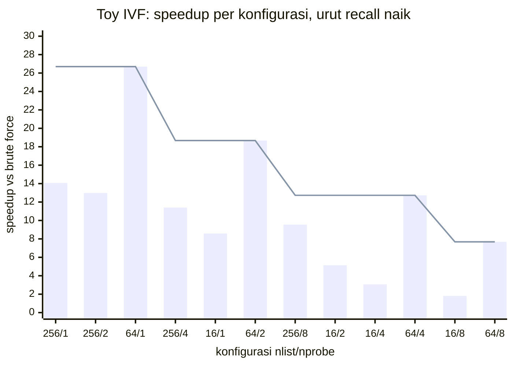

## Pernyataan inti
Setiap konfigurasi index (parameter build + parameter search) menghasilkan satu titik
(recall@k, QPS). Titik A **mendominasi** B kalau recall A ≥ recall B dan QPS A ≥ QPS B, dengan
minimal satu lebih besar. Titik yang tidak didominasi siapa pun membentuk **Pareto
frontier**: tradeoff terbaik yang tersedia dari konfigurasi yang dicoba. Membandingkan dua
algoritma berarti membandingkan frontier-nya, bukan satu titik. Frontier dihitung dengan
sort berdasarkan recall menurun lalu sapuan running max QPS, `O(m log m)` untuk `m` titik.

## Istilah
| Istilah | Arti | Contoh |
|---|---|---|
| konfigurasi | Satu set nilai parameter. Satu konfigurasi = satu run = satu titik. | HNSW M = 16, ef = 80 |
| parameter sweep | Menjalankan banyak konfigurasi untuk mengisi plot. | ef = 10, 20, …, 320 |
| dominasi | A ≥ B di kedua sumbu dan > di minimal satu sumbu. | (0.674, 26.7) mendominasi (0.631, 12.98) |
| Pareto-optimal / frontier | Titik yang tidak didominasi; himpunannya = frontier. | 4 dari 12 titik |
| dominated | Ada konfigurasi lain yang lebih baik di kedua sumbu. Tidak ada alasan memakainya. | 256/2 |
| running max | Nilai maksimum yang sudah terlihat selama sapuan. | 18.67 |
| speedup (proxy QPS) | `n / jumlah distance computation per query`. Tidak bergantung mesin; brute force = 1. Dipakai di toy ini sebagai pengganti QPS. | 26.7× |
| nlist / nprobe | Parameter toy IVF: data dibagi ke nlist kelompok, query memeriksa nprobe kelompok terdekat. Detail di [[07-concepts/T3-03-ivf-coarse-quantizer-nprobe]]. | 64 / 2 |
| log scale | Sumbu yang jaraknya proporsional dengan log nilai. Plot ANN biasanya memakai log untuk QPS. | 10, 100, 1000 berjarak sama |

## Gambaran
Toy IVF **sintetis** (n = 4.000, d = 8, 20 cluster, 200 query, k = 10, seed 0; kode di bawah).
Bar = speedup tiap konfigurasi `nlist/nprobe`, diurut recall naik (recall di tabel trace).
Garis = speedup terbaik yang tersedia di recall ≥ titik itu (selubung frontier).



> [!info] Cara membaca
> Bar yang menyentuh garis adalah Pareto-optimal (64/1, 64/2, 64/4, 64/8). Bar di bawah garis
> didominasi: ada konfigurasi lain dengan recall sama atau lebih tinggi **dan** lebih cepat.
> Sumbu x kategorikal, bukan skala recall; plot sungguhan memakai recall di sumbu x.

## Penjelasan bertahap
1. **Satu knob, dua tujuan.** Setiap ANN punya knob yang menukar kecepatan dengan recall:
   `ef` di HNSW, `nprobe` di toy ini. Memeriksa lebih banyak kandidat = recall naik, QPS
   turun. Satu nilai knob = satu titik. Sweep satu knob = satu kurva.
2. **Tidak ada urutan tunggal.** (0.908, 18.67) dan (0.996, 12.73): mana yang lebih baik?
   Tergantung kebutuhan. Yang bisa dikatakan pasti hanya dominasi: (0.674, 26.7) lebih baik
   dari (0.631, 12.98) di kedua sumbu, jadi 256/2 tidak pernah layak dipilih.
3. **Frontier = semua titik yang tidak didominasi.** Algoritmanya: urutkan menurut recall
   menurun (tie: QPS menurun), sapu dari atas, simpan titik hanya kalau QPS-nya lebih besar
   dari running max. Alasannya: semua titik yang sudah lewat punya recall ≥ titik sekarang;
   kalau salah satunya juga lebih cepat, titik sekarang didominasi.
4. **Kurva per build, frontier lintas build.** Parameter build (M, efConstruction di HNSW;
   nlist di toy) menghasilkan keluarga kurva. Parameter search menggeser titik di sepanjang
   kurvanya. Frontier algoritma = selubung atas semua kurva. Di toy ini semua titik frontier
   berasal dari nlist = 64; nlist = 16 dan 256 kalah di setiap level recall.
5. **Kenapa ini plot standar.** Membandingkan algoritma dengan satu titik bisa dimenangkan
   siapa saja dengan memilih titiknya. Frontier menunjukkan seluruh tradeoff, termasuk
   crossover (A unggul di recall rendah, B di recall tinggi). ANN-Benchmarks memplot recall
   di sumbu x, QPS (log) di sumbu y, satu garis frontier per algoritma; kanan-atas lebih baik
   `[implementasi: ann-benchmarks]` `[cukup yakin]`.
6. **Frontier itu hasil sampling.** Frontier hanya sebaik konfigurasi yang dicoba: sweep kasar
   memberi tangga di bawah frontier sebenarnya. QPS punya noise antar run, jadi dua titik
   berdekatan bisa bertukar status dominasi (varians: T7-02). Di toy ini sumbu cepatnya
   dihitung dari distance computation supaya deterministik; QPS asli juga dipengaruhi pola
   akses memori.

## Mekanisme / formula
```
A mendominasi B  ⇔  (rA ≥ rB ∧ qA ≥ qB) ∧ (rA > rB ∨ qA > qB)
frontier         = { p : tidak ada p' yang mendominasi p }
sapuan           : urut (r menurun, q menurun); best = −∞
                   untuk tiap p: kalau q_p > best → simpan p, best = q_p
```
Invariant sapuan: setelah memproses titik dengan recall ≥ r, `best` = QPS maksimum di antara
titik-titik itu. Titik disimpan ⇔ tidak ada titik dengan recall ≥ dan QPS ≥ yang lebih awal.

### Contoh angka kecil
Lima dari 12 titik toy (nlist/nprobe), dicek berpasangan dengan definisi dominasi:

| Titik | recall@10 | speedup | Didominasi oleh (di antara lima ini) |
|---|---|---|---|
| 64/1 | 0.674 | 26.70 | — (frontier) |
| 256/2 | 0.631 | 12.98 | 64/1, 64/2 |
| 64/2 | 0.908 | 18.67 | — (frontier) |
| 16/1 | 0.878 | 8.58 | 64/2 |
| 256/4 | 0.844 | 11.40 | 64/2 |

Cek berpasangan yang sama (`O(m²)`) dijalankan untuk ke-12 titik di blok verifikasi.

### Trace langkah demi langkah
| nlist | nprobe | recall@10 | speedup | running max sebelum | Status |
|---|---|---|---|---|---|
| 64 | 8 | 1.000 | 7.68 | — | simpan |
| 16 | 8 | 1.000 | 1.81 | 7.68 | buang |
| 64 | 4 | 0.996 | 12.73 | 7.68 | simpan |
| 16 | 4 | 0.996 | 3.07 | 12.73 | buang |
| 16 | 2 | 0.987 | 5.14 | 12.73 | buang |
| 256 | 8 | 0.978 | 9.55 | 12.73 | buang |
| 64 | 2 | 0.908 | 18.67 | 12.73 | simpan |
| 16 | 1 | 0.878 | 8.58 | 18.67 | buang |
| 256 | 4 | 0.844 | 11.40 | 18.67 | buang |
| 64 | 1 | 0.674 | 26.70 | 18.67 | simpan |
| 256 | 2 | 0.631 | 12.98 | 26.70 | buang |
| 256 | 1 | 0.424 | 14.07 | 26.70 | buang |

### Di level loop
Sapuannya murah: sort `m` titik lalu satu loop. Yang mahal adalah **membuat** tiap titik:
satu run penuh atas semua query, ditambah build ulang setiap kali parameter build berubah.
E-2026-08-02-01 (satu build, 6 nilai ef) = 6 run search dan 1 build. Menambah 3 nilai M
berarti 3 build × 6 run.

## Kenapa ini penting untuk risetku
Deliverable Fase 0 "plot recall@10 vs ef" adalah tampilan parameter; "plot recall@10 vs
QPS" adalah tampilan tradeoff, dan inilah yang dipakai untuk membandingkan dengan kurva di
[[04-papers/aumuller-ann-benchmarks]]. Gate Fase 0 (menjelaskan tradeoff recall–QPS tanpa
catatan) pada dasarnya adalah menjelaskan langkah 1–5. Untuk RQ2, policy compaction juga
akan dibandingkan sebagai frontier (recall vs biaya, misalnya CPU-second), bukan satu angka.

## Salah paham yang umum
- "Algoritma X lebih baik karena titiknya di atas." Hanya kalau seluruh frontier-nya di atas
  di rentang recall yang kamu pedulikan.
- "Titik dominated itu error." Bukan; itu konfigurasi buruk yang sah. Buang dari kurva,
  tapi simpan datanya.
- "Frontier dari 3 titik cukup." Terlalu kasar; tangga yang terbentuk menyembunyikan bentuk
  kurva sebenarnya.
- "Recall 1.0 berarti konfigurasi terbaik." 16/8 recall 1.0 tapi didominasi 64/8.

## Cara memverifikasi ini sendiri
```python
import numpy as np
rng = np.random.default_rng(0); n, d, nq, k = 4000, 8, 200, 10
C0 = rng.normal(0, 4, (20, d)); X = C0[rng.integers(0, 20, n)] + rng.normal(0, 1, (n, d))
Q = C0[rng.integers(0, 20, nq)] + rng.normal(0, 1, (nq, d))
sq = lambda A, B: ((A[:, None, :] - B[None]) ** 2).sum(2)
G = np.argsort(sq(Q, X), 1)[:, :k]; pts = []
for nlist in [16, 64, 256]:
    C = X[rng.choice(n, nlist, replace=False)]; lab = sq(X, C).argmin(1)   # centroid acak, tanpa k-means
    order = np.argsort(sq(Q, C), 1)
    for nprobe in [1, 2, 4, 8]:
        rec = comps = 0
        for i in range(nq):
            cand = np.flatnonzero(np.isin(lab, order[i, :nprobe])); comps += nlist + len(cand)
            top = cand[np.argsort(((X[cand] - Q[i]) ** 2).sum(1))[:k]]
            rec += len(set(top) & set(G[i])) / k
        pts.append((nlist, nprobe, round(rec / nq, 3), round(n / (comps / nq), 2)))
best, front = -1, []
for p in sorted(pts, key=lambda p: (-p[2], -p[3])):                      # sapuan Pareto
    if p[3] > best: best = p[3]; front.append(p)
print(front)   # [(64, 8, 1.0, 7.68), (64, 4, 0.996, 12.73), (64, 2, 0.908, 18.67), (64, 1, 0.674, 26.7)]
brute = [p for p in pts if not any(o[2] >= p[2] and o[3] >= p[3] and o != p for o in pts)]
print(sorted(brute) == sorted(front))                                    # True: cek O(m²)
```
Di source ANN-Benchmarks `[dicek di source ANN-Benchmarks branch main, 2026-11-23]`: fungsi `create_pointset` di
`ann_benchmarks/plotting/utils.py` mengurutkan titik dari y terbaik, lalu menyapu dan hanya
menyimpan titik yang x-nya lebih baik dari x terbaik sejauh ini. Itu sapuan yang sama dengan
trace di atas. Titik dengan nilai x atau y nol dilewati.

## Rujukan
- Dominasi dan Pareto frontier: konsep standar optimasi multi-objektif, tidak butuh sitasi.
- Konvensi plot ANN-Benchmarks: Aumüller, Bernhardsson, Faithfull, 2020 `[yakin]` untuk
  paper-nya; detail sumbu dan log scale `[cukup yakin]`, cek di Pass 1 paper itu.
