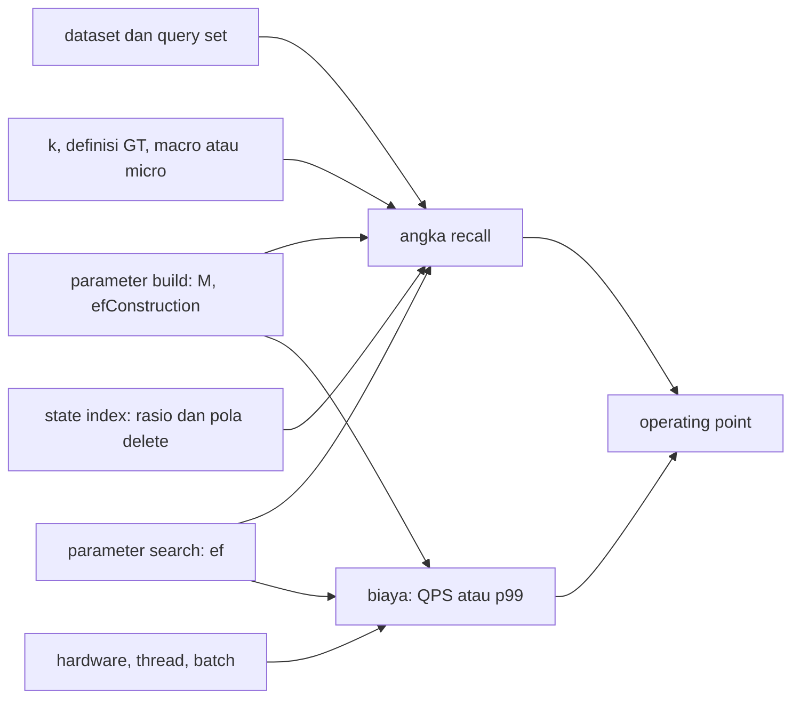
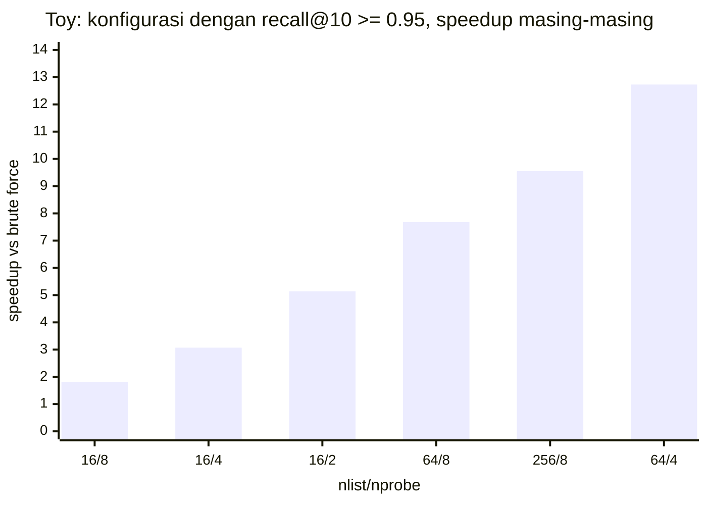

## Pernyataan inti
Recall bukan sifat sebuah index, tapi fungsi:
`recall = f(dataset, query set, k, definisi GT, parameter build, parameter search, state index)`.
Selain itu recall bisa "dibeli" dengan menaikkan budget search: brute force selalu 100%.
Jadi "95% recall" tanpa biayanya tidak bisa membedakan sistem bagus dari sistem lambat.
**Operating point** = pasangan (recall@k, QPS atau latency) pada satu konfigurasi, plus
semua kondisi pengukurannya. Cara melaporkan yang jujur: tetapkan satu sumbu, laporkan
sumbu lainnya, dibaca dari Pareto frontier ([[07-concepts/T2-06-kurva-pareto-recall-qps]]).

## Istilah
| Istilah | Arti | Contoh |
|---|---|---|
| operating point | (recall@k, QPS atau p99) pada satu konfigurasi, beserta dataset, k, hardware, thread, state index. | recall@10 = 0.996, speedup 12.73, 64/4, dataset mudah |
| budget search | Seberapa banyak kandidat yang boleh diperiksa per query. | `ef` HNSW, `nprobe` toy |
| target recall | Recall minimum yang diminta; laporkan QPS terbaik yang mencapainya. | QPS pada recall@10 ≥ 0.95 |
| budget biaya | QPS minimum atau p99 maksimum; laporkan recall terbaik di dalamnya. | recall terbaik dengan p99 ≤ 5 ms |
| state index | Kondisi index saat diukur: rasio delete, pola delete, umur sejak rebuild. | delete_ratio = 20%, terklaster |
| speedup | `n / distance computation per query`, proxy QPS yang deterministik di toy. | 12.73× |
| dataset mudah / sulit | Toy: 20 cluster, noise 1.0 vs 2.5. Makin besar noise, cluster makin bertumpuk. | |

## Gambaran


Semua konfigurasi toy (dataset mudah) yang mencapai recall@10 ≥ 0.95, dengan biayanya:



> [!info] Cara membaca
> Diagram pertama: angka recall punya lima "input" dan biaya punya tiga. Operating point
> butuh keduanya. Diagram kedua: enam konfigurasi lolos klaim "≥ 95% recall", dengan biaya
> yang berbeda sampai 7×. Klaim recall saja tidak memilih di antara mereka.

## Penjelasan bertahap
1. **Recall itu fungsi.** Konfigurasi 64/4 yang sama memberi enam angka berbeda: 1.000, 0.996,
   0.993 (dataset mudah, k = 1, 10, 50) dan 0.930, 0.897, 0.817 (dataset sulit). Tanpa
   menyebut k dan dataset, "recall 64/4" tidak punya satu nilai.
2. **Recall bisa dibeli.** Menaikkan budget search memeriksa lebih banyak kandidat, recall
   naik, QPS turun. Brute force mencapai 1.0 ([[07-concepts/T2-01-exact-knn-dan-biaya-o-nd]]).
   Jadi pertanyaan yang bermakna selalu "recall berapa, **dengan biaya berapa**". Di toy,
   16/8 dan 64/8 sama-sama 1.000, tapi biayanya berbeda 4×.
3. **Dua cara melapor yang jujur.** (a) Tetapkan target recall, laporkan QPS terbaik yang
   mencapainya. (b) Tetapkan budget biaya (QPS atau p99), laporkan recall terbaik. Keduanya
   adalah satu titik yang dibaca dari Pareto frontier. Kompetisi big-ann-benchmarks memakai
   salah satu bentuk ini sebagai metrik ranking `[⚠️ VERIFY: bentuk mana dan ambangnya]`.
4. **Kondisi yang harus ikut.** Dataset dan query set; k, definisi GT (ID atau jarak, macro
   atau micro: [[07-concepts/T2-02-definisi-recall-at-k]]); parameter build dan search;
   hardware, jumlah thread, batch atau tidak ([[07-concepts/T2-04-qps-throughput-batching]]);
   metrik latency (mean atau p99, metode percentile: [[07-concepts/T2-05-latency-percentile]]).
5. **Mean recall juga menyembunyikan sebaran.** Dataset sulit, 16/4, k = 10: mean 0.957 (lolos
   klaim 95%). Tapi 5% query di bawah 0.8 dan query terburuk hanya 0.2. Hanya 77.5% query
   yang sempurna. Operating point yang lengkap menyebut juga sebaran per query, misalnya
   persentil bawah recall.
6. **State index adalah variabel tersembunyi.** Untuk risetmu ini yang paling penting.
   Konfigurasi dan dataset yang sama memberi recall berbeda setelah delete. Angka "95%"
   yang diukur sebelum delete tidak mengatakan apa pun tentang sesudahnya. Jadi setiap angka
   recall di eksperimen delete wajib membawa `delete_ratio`, pola delete, dan strategi
   (tombstone-only, repair, rebuild).

## Mekanisme / formula
```
operating_point = (recall@k, biaya) | dataset, query_set, k, GT_def, build, search, hw, thread, batch, state
laporan (a)     = max QPS        s.t. recall@k ≥ r_target          (dibaca dari frontier)
laporan (b)     = max recall@k   s.t. p99 ≤ L  atau  QPS ≥ q_min
```
Invariant yang bisa dicek: kalau sebuah klaim hanya menyebut recall, selalu ada
konfigurasi brute force yang memenuhinya. Klaim yang tidak bisa membedakan brute force dari
index tidak sedang mengklaim apa pun tentang index.

### Contoh angka kecil
Satu konfigurasi (nlist 64, nprobe 4), toy dari T2-06 (n = 4.000, d = 8, 200 query, seed 0):

| Dataset | recall@1 | recall@10 | recall@50 | speedup |
|---|---|---|---|---|
| mudah (noise 1.0) | 1.000 | 0.996 | 0.993 | 12.73 |
| sulit (noise 2.5) | 0.930 | 0.897 | 0.817 | 10.83 |

### Trace langkah demi langkah
Mulai dari 72 kombinasi (12 konfigurasi × 3 nilai k × 2 dataset). Setiap baris menambah
satu syarat ke klaim, lalu menghitung berapa kombinasi yang masih cocok.

| Klaim setelah langkah ini | Kombinasi cocok | Rentang speedup |
|---|---|---|
| "recall ≥ 0.95" | 26 | 1.71 – 12.73 |
| + "recall@10" | 9 | 1.71 – 12.73 |
| + "dataset mudah" | 6 | 1.81 – 12.73 |
| + "speedup ≥ 10" | 1 (64/4) | 12.73 |

Baru setelah biaya ikut disebut, klaimnya menunjuk satu operating point.

### Di level loop
Simpan per run satu baris lengkap: semua parameter, k, dataset, state, `n_thread`, batch,
array recall per query, dan array latency per query. Dari situ titik frontier, mean, dan
persentil bisa dihitung ulang kapan saja. Yang tidak disimpan saat run tidak bisa
direkonstruksi.

## Kenapa ini penting untuk risetku
`05-proposal/05-metrik.md` sudah mewajibkan "sebutkan operating point untuk tiap angka
recall". Prediksi C-001 sudah berbentuk operating point (SIFT1M, `ef` tetap, tombstone-only,
delete_ratio 20%), dan salah satu kondisi pembantahnya ("selisih hilang begitu `ef` dinaikkan")
justru pertanyaan operating point: penurunan recall akibat delete mungkin bisa dibeli
kembali dengan `ef` lebih besar, dan harganya adalah QPS. Untuk RQ2, SLO recall harus
dirumuskan lengkap (k, definisi, budget latency, sebaran per query), lihat T6-04.

## Salah paham yang umum
- "Index X mencapai 95% recall, jadi bagus." Brute force mencapai 100%.
- "Recall@10 di dataset A bisa dibandingkan dengan dataset B." Kesulitan dataset berbeda.
- "Mean recall 0.957 berarti semua query baik-baik saja." Query terburuk 0.2 di contoh.
- "Recall dari Fase 0 berlaku setelah delete." State index berubah, recall-nya juga.

## Cara memverifikasi ini sendiri
```python
import numpy as np
def run(noise, n=4000, d=8, nq=200, ks=(1, 10, 50)):          # generator sama dengan T2-06 (seed 0)
    rng = np.random.default_rng(0)
    C0 = rng.normal(0, 4, (20, d)); X = C0[rng.integers(0, 20, n)] + rng.normal(0, noise, (n, d))
    Q = C0[rng.integers(0, 20, nq)] + rng.normal(0, noise, (nq, d))
    sq = lambda A, B: ((A[:, None, :] - B[None]) ** 2).sum(2)
    G = np.argsort(sq(Q, X), 1); out = []
    for nlist in [16, 64, 256]:
        C = X[rng.choice(n, nlist, replace=False)]; lab = sq(X, C).argmin(1); order = np.argsort(sq(Q, C), 1)
        for nprobe in [1, 2, 4, 8]:
            rec = dict.fromkeys(ks, 0); per10 = []; comps = 0
            for i in range(nq):
                cand = np.flatnonzero(np.isin(lab, order[i, :nprobe])); comps += nlist + len(cand)
                srt = cand[np.argsort(((X[cand] - Q[i]) ** 2).sum(1))]
                for k in ks: rec[k] += len(set(srt[:k]) & set(G[i, :k])) / k
                per10.append(len(set(srt[:10]) & set(G[i, :10])) / 10)
            out += [dict(data=noise, cfg=f"{nlist}/{nprobe}", k=k, rec=round(rec[k] / nq, 3),
                         sp=round(n / (comps / nq), 2), per=np.array(per10)) for k in ks]
    return out
rows = run(1.0) + run(2.5)                                       # "mudah" dan "sulit"
print([(r["data"], r["k"], r["rec"]) for r in rows if r["cfg"] == "64/4"])
# [(1.0, 1, 1.0), (1.0, 10, 0.996), (1.0, 50, 0.993), (2.5, 1, 0.93), (2.5, 10, 0.897), (2.5, 50, 0.817)]
cur = rows
for name, f in [("recall ≥ 0.95", lambda r: r["rec"] >= 0.95), ("k = 10", lambda r: r["k"] == 10),
                ("dataset mudah", lambda r: r["data"] == 1.0), ("speedup ≥ 10", lambda r: r["sp"] >= 10)]:
    cur = [r for r in cur if f(r)]
    print(name, len(cur), min(r["sp"] for r in cur), max(r["sp"] for r in cur))
# recall ≥ 0.95 26 1.71 12.73 / k = 10 9 1.71 12.73 / dataset mudah 6 1.81 12.73 / speedup ≥ 10 1 12.73 12.73
r = next(r for r in rows if r["data"] == 2.5 and r["k"] == 10 and r["cfg"] == "16/4")
print(r["rec"], r["per"].min(), (r["per"] == 1).mean(), (r["per"] < 0.8).mean())   # 0.957 0.2 0.775 0.05
```
Di SIFT1M: ulangi E-2026-08-02-01 dengan k = 1, 10, 100 dari file GT yang sama, lalu lihat
berapa angka "recall" berbeda yang keluar dari satu index.

## Rujukan
- Konvensi "throughput pada recall tertentu": Simhadri et al., laporan kompetisi NeurIPS'21
  Billion-Scale ANN `[⚠️ VERIFY: judul/tahun/penulis belum dipastikan]`.
- Argumen "recall bisa dibeli dengan biaya" adalah konsekuensi langsung dari T2-01 dan T2-06,
  bukan klaim paper.
