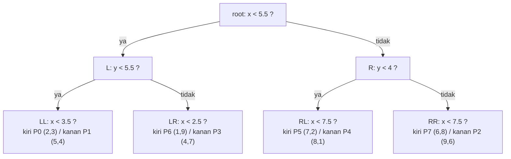
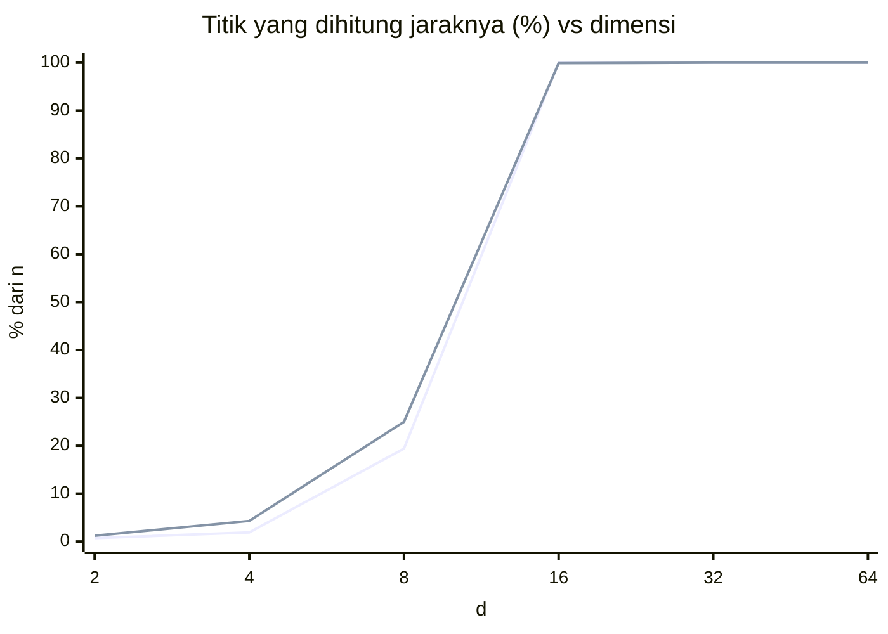

## Pernyataan inti
KD-tree dan ball tree memotong ruang secara rekursif. Saat query, subtree yang **pasti** tidak
memuat tetangga lebih dekat dibuang (*prune*), dengan bukti berupa *lower bound* jarak. Hasilnya
selalu eksak. Di dimensi tinggi lower bound itu hampir tak pernah melewati jarak tetangga
terbaik, jadi hampir tidak ada yang di-prune: pada data uniform sintetis di bawah, mulai d = 16
kedua tree menghitung jarak ke ~100% titik, sama dengan brute force.

## Istilah
| Istilah | Arti | Contoh |
|---|---|---|
| KD-tree | Binary tree. Tiap node internal memotong ruang dengan satu bidang tegak lurus satu axis. | node "x < 5.5 ?" |
| axis, split | Axis = dimensi yang dipotong. Split = nilai potongnya. | axis x, split 5.5 |
| daun (leaf) | Node tanpa anak yang menyimpan sekelompok titik (bucket). | daun berisi 16 titik |
| ball tree | Binary tree yang tiap node-nya menyimpan bola: pusat `c` dan radius `r` yang memuat semua titik subtree. | c = (0.5, 0.5), r = 0.7 |
| best | Jarak² tetangga terdekat yang sudah ditemukan sejauh ini. Mulai dari tak hingga. | best = 9 |
| lower bound (batas) | Angka yang dijamin ≤ jarak² q ke **setiap** titik di sebuah subtree. | gap² = 0.25 |
| prune | Melewati seluruh subtree karena batasnya ≥ best. Aman: tak mungkin ada titik lebih dekat di sana. | "PRUNE: batas 6.25 ≥ 2" |
| backtracking | Setelah sampai di daun, kembali ke node atas dan memeriksa sisi yang belum dikunjungi. | balik ke root, masuk L |
| triangle inequality | `‖q − x‖ ≥ ‖q − c‖ − ‖x − c‖`. Berlaku untuk semua metrik. | dasar batas ball tree |

## Gambaran
Tree hasil `build` dari 8 titik 2D (kode di bawah), daun berisi 1 titik:


Sintetis: uniform `[0,1]^d`, n = 4096, daun 16 titik, rata-rata 50 query (kode di bawah):


> [!info] Cara membaca
> Diagram pertama: tiap node satu pertanyaan `q[axis] < split ?`. Diagram kedua: dua garis,
> KD-tree (lebih rendah di d kecil) dan ball tree. Di d = 2 query menyentuh <2% titik. Di
> d = 16 keduanya menyentuh hampir semua titik. Tree tidak lagi menghemat apa pun.

## Penjelasan bertahap
1. **Intuisi: binary search multi-dimensi.** Di 1D, data terurut membuang separuh data per
   langkah. KD-tree meniru ini: tiap node membelah titiknya di median satu axis. Kedalaman
   tree sekitar `log2(n / ukuran_daun)`.
2. **Turun ke daun belum cukup.** Daun yang memuat q belum tentu berisi NN. Di trace, daun
   pertama memberi P7 (jarak² 9). NN sebenarnya P1 (jarak² 2), di sisi lain root. Jadi
   search harus *backtrack*.
3. **Prune memakai lower bound.** Jarak² = jumlah kuadrat selisih **semua** koordinat, jadi
   ≥ kuadrat selisih **satu** koordinat. Titik di sisi jauh bidang `x = s` pasti berjarak²
   ≥ `(q[x] − s)²`. Kalau itu ≥ best, subtree dibuang. Invariant ini membuat hasilnya eksak.
4. **Ball tree: kotak diganti bola.** Dari triangle inequality, setiap x di bola (c, r)
   memenuhi `‖q − x‖ ≥ ‖q − c‖ − r`. Batas ini cuma butuh metrik, bukan koordinat.
5. **Kenapa gagal di d tinggi.** (a) Batas KD hanya satu koordinat; di `[0,1]^d` nilainya
   paling besar 1. Jarak² ke NN adalah jumlah d suku, jadi tumbuh dengan d. Di d = 32 jarak²
   NN terkecil 1.369 > 1 (output kode). Jadi untuk data sintetis ini, batas satu koordinat
   tidak pernah bisa ≥ best, dan prune **mustahil secara matematis**.
   (b) Untuk n = 1 juta dan daun 16, tree hanya 16 level. Jalur root→daun bertanya ke paling
   banyak 16 dari 128 axis; 112 axis lain tak pernah dipotong. (c) Bola di d tinggi punya
   radius besar dibanding selisih jarak antar titik
   ([[07-concepts/T1-04-distance-concentration]]), jadi `‖q − c‖ − r` jarang melewati best.
6. **Di level mesin.** Kalau prune gagal, tree tetap menghitung n jarak, plus lompatan pointer
   ke node yang tersebar di memori. Brute force membaca satu array kontigu. Tree tak bisa
   lebih cepat, hanya lebih lambat.

## Mekanisme / formula
```
KD   : ∀x di sisi jauh bidang (axis a, split s):  ‖q − x‖² ≥ (q[a] − s)²
Ball : ∀x di bola (c, r):                        ‖q − x‖² ≥ max(0, ‖q − c‖ − r)²
prune subtree  ⇔  batas ≥ best
```

### Contoh angka kecil
Query q = (6, 5). Jarak² brute force ke 8 titik (dari kode): NN = P1.

| Titik | P0 (2,3) | P1 (5,4) | P2 (9,6) | P3 (4,7) | P4 (8,1) | P5 (7,2) | P6 (1,9) | P7 (6,8) |
|---|---|---|---|---|---|---|---|---|
| jarak² ke q | 20 | **2** | 10 | 8 | 20 | 10 | 41 | 9 |

### Trace langkah demi langkah
KD search q = (6, 5). "batas" = `(q[axis] − split)²` bidang yang diseberangi menuju node itu.

| # | node | aksi | best | id |
|---|---|---|---|---|
| 1 | RRL | jarak² ke P7 = 9 (daun pertama) | 9 | P7 |
| 2 | RRR | batas 2.25 < best → masuk; jarak² ke P2 = 10 | 9 | P7 |
| 3 | RLL | batas 1 < best → masuk; jarak² ke P5 = 10 | 9 | P7 |
| 4 | RLR | batas 2.25 < best → masuk; jarak² ke P4 = 20 | 9 | P7 |
| 5 | LLR | batas 0.25 < best → masuk; jarak² ke P1 = 2 | 2 | P1 |
| 6 | LLL | PRUNE: batas 6.25 ≥ best | 2 | P1 |
| 7 | LRR | batas 0.25 < best → masuk; jarak² ke P3 = 8 | 2 | P1 |
| 8 | LRL | PRUNE: batas 12.25 ≥ best | 2 | P1 |

6 dari 8 jarak dihitung; P0 dan P6 di-prune. Baris 5 adalah backtracking menyeberangi bidang
root x = 5.5. Prune baru terjadi setelah best turun ke 2: prune butuh best yang sudah kecil.

### Di level loop
```go
type kdNode struct{ axis, left, right, start, end int32; split float32 } // 24 B; left<0 = daun
type item struct{ node int32; bound float32 }

func nn1(q []float32) (best float32, id int32) {
	best, st := inf, []item{{0, 0}}
	for len(st) > 0 {
		it := pop(&st)
		if it.bound >= best { continue } // cek saat pop: best mungkin sudah turun
		nd := nodes[it.node]
		if nd.left < 0 { // daun: loop d per titik, persis brute force
			for _, i := range idx[nd.start:nd.end] { if d := l2sq(q, X[i]); d < best { best, id = d, i } }
			continue
		}
		gap, near, far := q[nd.axis]-nd.split, nd.left, nd.right
		if gap >= 0 { near, far = far, near }
		push(&st, item{far, gap * gap}); push(&st, item{near, 0}) // near di-pop duluan
	}
	return
}
```
n = 1.000.000, d = 128, daun 16 → 131.071 node. KD-tree: 131.071 × 24 B ≈ 3,1 MB (+ `idx` 4 MB).
Ball tree menyimpan pusat d float32 per node: 131.071 × 516 B ≈ 67,6 MB. Data mentah 512 MB.
Memori bukan masalahnya; jumlah titik yang disentuh adalah masalahnya.

## Kenapa ini penting untuk risetku
Tree menunjukkan harga eksak: invariant prune menjamin hasil benar, tapi gagal menghemat di
d tinggi. HNSW membuang jaminan itu. Ia tidak punya lower bound, jadi hasilnya approximate
dan recall harus diukur ([[07-concepts/T2-02-definisi-recall-at-k]]). Kontras untuk delete:
menghapus titik dari daun tidak merusak invariant tree (split dan radius lama tetap batas
yang sah, hanya lebih longgar). Di HNSW, node yang dihapus juga jalur routing (T5-02).

## Salah paham yang umum
- "KD-tree itu approximate." Versi ini eksak (lihat `assert`). Varian approximate ada.
- "Tree gagal karena memori." Tidak. Yang gagal adalah prune.
- "Data nyata sama buruknya dengan uniform." Belum tentu: intrinsic dimensionality data nyata
  sering lebih rendah ([[07-concepts/T1-06-intrinsic-vs-ambient-dimensionality]]). Tak kuukur.

## Cara memverifikasi ini sendiri
```python
import numpy as np

def build(X, idx, leaf):                      # node = dict; daun menyimpan index titik
    P = X[idx]; c = P.mean(0); r = np.sqrt(((P - c) ** 2).sum(1).max())
    if len(idx) <= leaf: return {"idx": idx, "c": c, "r": r}
    ax = int(np.argmax(P.max(0) - P.min(0)))   # dimensi dengan sebaran terbesar
    o = idx[np.argsort(X[idx, ax], kind="stable")]; m = len(o) // 2
    return {"ax": ax, "s": (X[o[m-1], ax] + X[o[m], ax]) / 2, "c": c, "r": r,
            "L": build(X, o[:m], leaf), "R": build(X, o[m:], leaf)}

def search(X, nd, q, mode, st, log=None, name=""):
    def note(w, a):                           # baris tabel Trace; "masuk" digabung ke baris berikutnya
        if log is not None: log.append(f"| {len(log)+1} | {w} | {st.pop('pre', '')}{a} | {st['best']:g} | P{st['id']} |")
    if "idx" in nd:                           # daun: hitung jarak ke titiknya
        for i in nd["idx"]:
            st["n"] += 1; d2 = float(((X[i] - q) ** 2).sum())
            if d2 < st["best"]: st["best"], st["id"] = d2, int(i)
            note(name, f"jarak² ke P{i} = {d2:g}")
        return
    kids = [("L", nd["L"]), ("R", nd["R"])]
    if mode == "kd":                          # sisi q dulu; sisi jauh berbatas gap²
        if q[nd["ax"]] >= nd["s"]: kids.reverse()
        lbs = [0.0, (q[nd["ax"]] - nd["s"]) ** 2]
    else:                                     # ball: batas = max(0, ‖q − c‖ − r)²
        lbs = [max(0.0, np.sqrt(((q - k["c"]) ** 2).sum()) - k["r"]) ** 2 for _, k in kids]
        if lbs[1] < lbs[0]: kids.reverse(); lbs.reverse()
    for (side, k), lb in zip(kids, lbs):
        if lb >= st["best"]: note(name + side, f"PRUNE: batas {lb:g} ≥ best"); continue
        if lb > 0: st["pre"] = f"batas {lb:g} < best → masuk; "
        search(X, k, q, mode, st, log, name + side)

new = lambda: {"best": np.inf, "id": -1, "n": 0}
# (1) trace: 8 titik 2D, daun 1 titik, query (6, 5)
X = np.array([[2,3],[5,4],[9,6],[4,7],[8,1],[7,2],[1,9],[6,8]], float)
q = np.array([6.0, 5.0]); st = new(); log = []
search(X, build(X, np.arange(8), 1), q, "kd", st, log)
print("\n".join(log))                         # = tabel Trace (8 baris)
print(((X - q) ** 2).sum(1), st["n"])         # [20. 2. 10. 8. 20. 10. 41. 9.] 6

# (2) uniform [0,1]^d, n = 4096, daun 16, 50 query, 1-NN eksak
rng = np.random.default_rng(0)
for d in (2, 4, 8, 16, 32, 64):
    X = rng.random((4096, d)); Q = rng.random((50, d)); T = build(X, np.arange(4096), 16)
    nn2 = np.array([((X - q) ** 2).sum(1).min() for q in Q]); frac = []
    for mode in ("kd", "ball"):
        sts = [new() for _ in Q]
        for q, st in zip(Q, sts): search(X, T, q, mode, st)
        assert all(st["best"] == m for st, m in zip(sts, nn2))   # hasil tetap eksak
        frac.append(round(100 * sum(st["n"] for st in sts) / (50 * 4096), 1))
    print(d, frac, round(nn2.min(), 3), round(nn2.mean(), 3))
# d  [% KD, % ball]  jarak² NN min  jarak² NN rata-rata
# 2  [0.7, 1.2] 0.0 0.0
# 4  [1.9, 4.3] 0.001 0.007
# 8  [19.4, 25.0] 0.033 0.103
# 16 [100.0, 99.9] 0.36 0.584
# 32 [100.0, 100.0] 1.369 2.052
# 64 [100.0, 100.0] 4.962 5.865
```
Ganti `rng.random` dengan subset SIFT1M untuk melihat efek intrinsic dimensionality.

## Rujukan
- Bentley, "Multidimensional binary search trees used for associative searching", CACM 1975
  `[yakin]`; axis diputar per level.
- Friedman, Bentley, Finkel, "An algorithm for finding best matches in logarithmic expected
  time", ACM TOMS 1977 `[yakin]`. Bahwa mereka memilih axis sebaran terbesar + split median
  seperti kode ini: `[cukup yakin]`.
- Omohundro, "Five balltree construction algorithms", ICSI TR-89-063, 1989 `[yakin]`.
- Weber, Schek, Blott, "A quantitative analysis and performance study for similarity-search
  methods in high-dimensional spaces", VLDB 1998 `[yakin]`: metode partitioning memburuk ke
  arah linear scan saat d naik. Ambang dimensinya baca di paper, jangan kutip dari sini.
