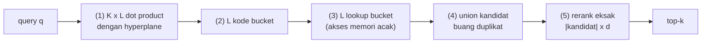
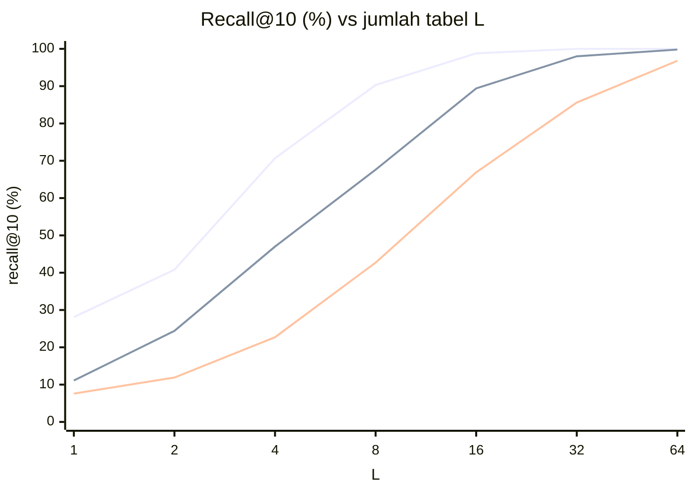

## Pernyataan inti
LSH memakai fungsi hash yang **sengaja** membuat vektor dekat sering bertabrakan (masuk
bucket sama) dan vektor jauh jarang. Query hanya membandingkan isi bucket-nya, lalu
rerank eksak. Untuk cosine, satu bit = sisi mana dari hyperplane acak, dan peluang dua
vektor dapat bit sama adalah `1 − θ/π`. Kelemahannya: hash tidak melihat data. Untuk recall
tinggi dibutuhkan banyak tabel (memori L × n id) dan banyak hash per query. Makin kecil beda
sudut "tetangga" vs "titik acak", makin banyak tabel yang dibutuhkan.

## Istilah
| Istilah | Arti | Contoh |
|---|---|---|
| hyperplane acak | Bidang lewat origin dengan normal `r` acak Gaussian. Satu bit = `r · v ≥ 0`. | r = (0.3, −1.2) |
| kode (K bit) | Gabungan K bit dari K hyperplane. Jadi nomor bucket. | K = 3 → `101` |
| bucket | Kumpulan id vektor dengan kode sama di satu tabel. | bucket `110` = {P0..P3} |
| tabel (L) | Satu set K hyperplane + bucket-nya. LSH memakai L tabel independen. | L = 2 |
| tabrakan (collision) | Dua vektor dapat kode sama di sebuah tabel. | q dan P2 di tabel 2 |
| θ (sudut) | Sudut antar dua vektor, `arccos(cos(a,b))`. | 20° |
| kandidat | Union isi bucket q dari L tabel. Hanya ini yang dihitung jaraknya. | {P0, P1, P2, P3} |
| rerank | Menghitung jarak eksak ke kandidat, ambil top-k. | P2 menang |
| ρ (rho) | `ln(1/p1) / ln(1/p2)`: p1 = peluang bit sama untuk tetangga, p2 untuk titik jauh. Makin kecil makin mudah. | 0.26 vs 0.77 |
| data-independent | Hash dipilih acak tanpa melihat data. Lawan: centroid IVF yang dilatih dari data. | hyperplane acak |

## Gambaran


Recall@10 (%) vs jumlah tabel L, untuk K = 8, 12, 16 bit (sintetis: 50 cluster, d = 32,
n = 10.000, 100 query; kode di bawah):


> [!info] Cara membaca
> Flowchart: biaya query = langkah (1) + (3) + (5). Grafik: garis paling atas K = 8, paling
> bawah K = 16. Satu tabel memberi recall rendah. Recall naik hanya dengan menambah tabel.
> K besar membuat bucket kecil (kandidat sedikit) tapi butuh lebih banyak tabel.

## Penjelasan bertahap
1. **Intuisi: hash yang menjaga kedekatan.** Hash biasa (md5, map Go) menyebar key sejauh
   mungkin. LSH kebalikannya: vektor mirip sering dapat hash sama, jadi cukup lihat bucket q.
2. **Satu bit dari satu hyperplane.** Di 2D, hyperplane = garis lewat origin dengan arah
   acak. Garis itu memisahkan a dan b hanya kalau arahnya jatuh di antara keduanya, peluangnya
   `θ/π`. Jadi `P[bit sama] = 1 − θ/π`. Di d dimensi sama saja: Gaussian simetris ke segala
   arah, jadi proyeksi `r` ke bidang (a, b) tetap berarah acak seragam. Kode di bawah mengecek
   ini di d = 128: empiris 0.7668 vs rumus 0.7679.
3. **K bit menajamkan, L tabel menyelamatkan.** Peluang tabrakan di satu tabel adalah `p^K`.
   Untuk p = 0.9 (tetangga) dan p = 0.5 (acak), K = 12 memberi 0.28 vs 0.0002: titik jauh
   terbuang, tapi tetangga juga sering terpisah. Maka dipakai L tabel:
   `P[ketemu] = 1 − (1 − p^K)^L`. Inilah sebabnya garis di grafik naik pelan terhadap L.
4. **ρ menentukan berapa tabel.** Skema klasik memilih K = `log_{1/p2} n` dan L ≈ `n^ρ`
   `[cukup yakin]`. ρ tergantung seberapa jauh sudut tetangga dari sudut acak (contrast,
   [[07-concepts/T1-05-contrast-ratio]]). Data cluster sintetis: ρ = 0.26 → L ≈ 36 untuk
   n = 1 juta. Gaussian iid d = 128: ρ = 0.77 → L ≈ 40.000 tabel, ~160 GB hanya untuk id
   (4 B per tabel per vektor). Ini inti "kalah di praktik": jaminan sublinear tetap ada,
   tapi konstantanya tidak terbayar di data sulit.
5. **Data-independent berarti bucket timpang.** Hyperplane tidak tahu di mana data menumpuk.
   Di satu tabel K = 12 pada data cluster, hanya 1787 dari 4096 bucket terisi, dan bucket
   terbesar berisi 232 id (rata-rata ideal 2,4). IVF dan graph menyesuaikan diri ke data.
6. **Di level mesin.** Biaya hash sendiri bisa lebih mahal dari rerank. K = 16, L = 64 di
   d = 32: 1024 dot product hanya untuk menghitung kode, padahal kandidatnya ~1.9% × 10.000 =
   190 vektor. Ditambah L akses bucket di lokasi memori acak.

## Mekanisme / formula
```
bit_j(v) = [r_j · v ≥ 0],  r_j ~ N(0, I)          P[bit sama] = 1 − θ(a,b)/π
P[tabrakan di 1 tabel] = p^K                       P[ketemu di ≥1 dari L tabel] = 1 − (1 − p^K)^L
biaya query ≈ K·L·d (hash) + L (lookup) + |kandidat|·d (rerank)
```

### Contoh angka kecil
8 unit vector 2D, query di 95°. NN sebenarnya P2 (75°, sudut 20°). L = 2 tabel, K = 3.

| Titik | sudut | sudut ke q | kode tabel 1 | kode tabel 2 |
|---|---|---|---|---|
| P0 | 10° | 85° | 101 | **110** |
| P1 | 40° | 55° | 101 | **110** |
| P2 | 75° | **20°** | 101 | **110** |
| P3 | 120° | 25° | **111** | **110** |
| P4 | 160° | 65° | 010 | 000 |
| P5 | 200° | 105° | 010 | 001 |
| P6 | 250° | 155° | 010 | 001 |
| P7 | 310° | 145° | 000 | 001 |
| q | 95° | – | **111** | **110** |

### Trace langkah demi langkah
| # | langkah | state |
|---|---|---|
| 1 | hash q di tabel 1 | kode `111` |
| 2 | lookup bucket `111` tabel 1 | kandidat {P3}. **Miss**: satu hyperplane memisahkan q dari P2 |
| 3 | hash q di tabel 2 | kode `110` |
| 4 | lookup bucket `110` tabel 2 | kandidat {P0, P1, P2, P3} |
| 5 | rerank 4 kandidat | NN = P2 (benar), 4 dari 8 jarak dihitung |

Rumus untuk P2: p = 1 − 20/180 = 0.889, per tabel p³ = 0.702, dengan L = 2: 0.911.
Tabel 1 adalah kasus 30% yang gagal; tabel 2 menyelamatkan.

### Di level loop
```go
type table struct {
	planes     []float32 // K*d normal hyperplane
	keys, offs []uint32  // kode bucket terurut; ids[offs[b]:offs[b+1]] = isi bucket b
	ids        []int32   // n id, dikelompokkan per bucket
}

func query(q []float32, k int) []int32 {
	for _, t := range tables { // L kali
		var code uint32
		for j := 0; j < K; j++ { code = code<<1 | b2u(dot(t.planes[j*d:(j+1)*d], q) >= 0) }
		if b, ok := find(t.keys, code); ok { // akses memori acak
			for _, id := range t.ids[t.offs[b]:t.offs[b+1]] { if !seen.testAndSet(id) { cand = append(cand, id) } }
		}
	}
	return topkExact(q, cand, k) // |cand| kali dot sepanjang d
}
```
Memori per tabel ≈ 4n byte (`ids`) + 8 byte per bucket terisi + K·d·4 (`planes`). Untuk
L = 64 itu 256 byte id per vektor, lebih besar dari vektornya sendiri (d = 32 × 4 = 128 B).

## Kenapa ini penting untuk risetku
LSH adalah kontras paling bersih untuk maintenance. Hash tidak bergantung data: insert =
hash lalu append, delete = hapus id dari L bucket. Tidak ada struktur yang diperbaiki, dan
peluang vektor lain ditemukan tidak berubah. Di HNSW edge dipilih relatif ke tetangga, jadi
delete bisa merusak routing (T5-01, T5-02). Untuk related work: LSH murah dirawat tapi mahal
per recall; HNSW efisien tapi peka mutasi. Angka pembanding harus dari eksperimen sendiri.

## Salah paham yang umum
- "LSH itu satu algoritma." Ini keluarga: hyperplane (cosine), p-stable (L2), MinHash
  (Jaccard), plus varian multi-probe yang memeriksa bucket tetangga.
- "Bucket sama = pasti dekat." Tidak: P0 (85° dari q) ikut di bucket q di tabel 2. Rerank wajib.
- "LSH tidak berguna." Ia punya jaminan teoretis yang tidak dimiliki HNSW `[cukup yakin]`,
  dan update-nya murah. Yang kalah adalah efisiensi recall per byte dan per operasi di data umum.

## Cara memverifikasi ini sendiri
```python
import numpy as np
def codes(R, V):                     # R: (L, K, d) normal hyperplane -> kode int per (tabel, vektor)
    return (np.einsum("lkd,nd->lnk", R, V) >= 0) @ (1 << np.arange(R.shape[1])[::-1])

# (1) trace: 8 unit vector 2D (sudut dalam derajat), query di 95°
ang = np.array([10, 40, 75, 120, 160, 200, 250, 310]); unit = lambda a: np.c_[np.cos(np.radians(a)), np.sin(np.radians(a))]
X, q = unit(ang), unit([95])
R = np.random.default_rng(6).normal(size=(2, 3, 2))  # L = 2 tabel, K = 3; seed 6 dipilih agar ada kasus miss
cx, cq = codes(R, X), codes(R, q)
for i in range(8): print(f"P{i}", ang[i], min(abs(ang[i]-95), 360-abs(ang[i]-95)), [format(c, "03b") for c in cx[:, i]])
for t in range(2): print("tabel", t+1, format(cq[t, 0], "03b"), np.nonzero(cx[t] == cq[t, 0])[0])
cand = np.nonzero((cx == cq).any(0))[0]; print(cand, cand[np.argmax(X[cand] @ q[0])])  # union, lalu rerank
p = 1 - 20 / 180; print(round(p, 3), round(p**3, 3), round(1 - (1 - p**3)**2, 3))   # 0.889 0.702 0.911

# (2) cek rumus tabrakan: P[bit sama] = 1 - θ/π, juga di d = 128
rng = np.random.default_rng(0)
a = rng.normal(size=128); b = a + 0.8 * rng.normal(size=128); th = np.arccos(a @ b / np.linalg.norm(a) / np.linalg.norm(b))
H = rng.normal(size=(200000, 128)); print(np.mean((H @ a >= 0) == (H @ b >= 0)).round(4), round(1 - th / np.pi, 4))

# (3) sintetis: 50 cluster, d = 32, n = 10000, 100 query, recall@10 setelah rerank eksak
n, d, nq, k = 10000, 32, 100, 10
C = rng.normal(size=(50, d)); X = C[rng.integers(0, 50, n)] + 0.5 * rng.normal(size=(n, d))
Q = C[rng.integers(0, 50, nq)] + 0.5 * rng.normal(size=(nq, d))
X /= np.linalg.norm(X, axis=1, keepdims=True); Q /= np.linalg.norm(Q, axis=1, keepdims=True)
gt = np.argsort(-(Q @ X.T), axis=1)[:, :k]
for K in (8, 12, 16):
    out = []
    for L in (1, 2, 4, 8, 16, 32, 64):
        R = rng.normal(size=(L, K, d)); cx, cq = codes(R, X), codes(R, Q); rec = cand = 0
        for j in range(nq):
            c = np.nonzero((cx == cq[:, j:j+1]).any(0))[0]          # union bucket dari L tabel
            top = c[np.argsort(-(X[c] @ Q[j]))[:k]]; rec += len(set(top) & set(gt[j])); cand += len(c)
        out.append((round(100 * rec / (nq * k), 1), round(100 * cand / (nq * n), 1)))
    print(K, out)
    if K == 12: print("bucket terisi", len(np.unique(cx[0])), "dari", 2**K, "terbesar", np.bincount(cx[0]).max())

# (4) rho = ln(1/p1) / ln(1/p2): p1 dari sudut ke tetangga ke-10, p2 dari sudut median
def rho(X, Q):
    X = X / np.linalg.norm(X, axis=1, keepdims=True); Q = Q / np.linalg.norm(Q, axis=1, keepdims=True)
    th = np.degrees(np.arccos(np.clip(Q @ X.T, -1, 1))); p1 = 1 - np.sort(th, 1)[:, 9].mean() / 180; p2 = 1 - np.median(th) / 180
    return [round(float(v), 3) for v in (p1, p2, np.log(1 / p1) / np.log(1 / p2))]
r1, r2 = rho(X, Q), rho(rng.normal(size=(n, 128)), rng.normal(size=(nq, 128))); print(r1, r2)
print([round(1e6 ** r[2]) for r in (r1, r2)])     # L ≈ n^rho untuk n = 1 juta
# P0 10 85 ['101', '110'] ... (8 baris = tabel Contoh angka kecil), lalu: tabel 1 111 [3]
# tabel 2 110 [0 1 2 3]
# [0 1 2 3] 2
# 0.7668 0.7679
# K [(recall@10 %, kandidat % dari n) untuk L = 1, 2, 4, 8, 16, 32, 64]:
# 8 [(28.1, 0.9), (40.8, 1.4), (70.7, 2.9), (90.3, 6.0), (98.8, 9.5), (100.0, 17.6), (100.0, 27.4)]
# 12 [(11.1, 0.2), (24.4, 0.4), (47.0, 0.8), (67.6, 1.4), (89.4, 2.2), (98.0, 3.3), (99.8, 5.0)]
# bucket terisi 1787 dari 4096 terbesar 232
# 16 [(7.6, 0.1), (11.9, 0.1), (22.7, 0.2), (42.7, 0.5), (66.9, 0.8), (85.6, 1.3), (96.8, 1.9)]
# [0.835, 0.499, 0.259] [0.588, 0.5, 0.767]
# [36, 39994]
```
Untuk data nyata: ganti bagian (3) dengan subset SIFT1M (dinormalisasi) dan bandingkan ρ-nya.

## Rujukan
- Indyk & Motwani, "Approximate nearest neighbors: towards removing the curse of
  dimensionality", STOC 1998 `[yakin]`. Query ~`n^ρ`, memori ~`n^(1+ρ)`, skema K/L: `[cukup yakin]`.
- Hyperplane acak untuk sudut: Charikar, "Similarity estimation techniques from rounding
  algorithms", STOC 2002 `[yakin]`.
- Multi-probe LSH: Lv dkk., VLDB 2007 `[cukup yakin]`. p-stable LSH untuk L2: Datar,
  Immorlica, Indyk, Mirrokni, 2004 `[cukup yakin]`.
- "Kalah di praktik": di plot recall–QPS ANN-Benchmarks (Aumüller, Bernhardsson, Faithfull;
  [[04-papers/aumuller-ann-benchmarks]]), metode graph umumnya di atas implementasi LSH
  `[cukup yakin]`. Lihat plotnya sendiri; jangan kutip angka dari ingatan.
