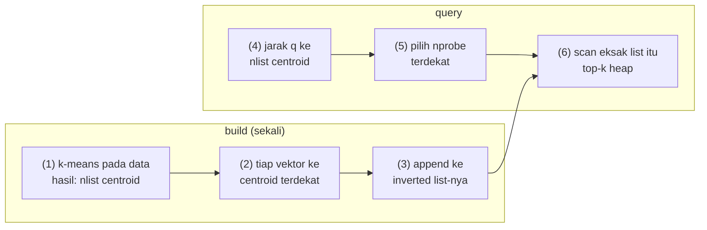
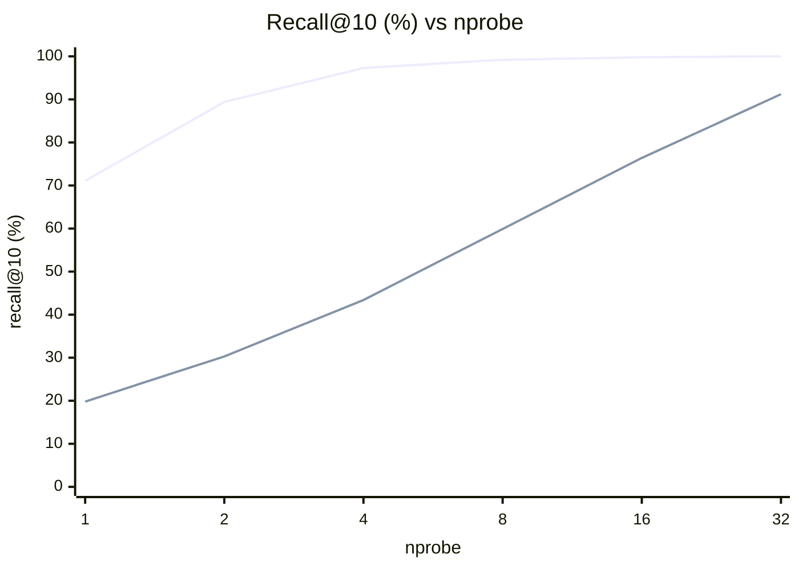

## Pernyataan inti
IVF (inverted file) mempartisi data dengan k-means menjadi `nlist` cell. Tiap cell diwakili
satu centroid dan menyimpan inverted list berisi vektor anggotanya. Query menghitung jarak ke
semua centroid (*coarse quantizer*), memilih `nprobe` centroid terdekat, lalu scan eksak hanya
list itu. Recall hilang ketika tetangga sejati ada di cell yang tidak di-probe, terutama di
dekat batas cell. `nprobe` menukar recall dengan jumlah titik yang discan, kira-kira linear.

## Istilah
| Istilah | Arti | Contoh |
|---|---|---|
| k-means (Lloyd) | Ulangi: tiap titik ke centroid terdekat, lalu centroid = rata-rata anggotanya. | 3 centroid dari 10 titik |
| centroid | Titik wakil sebuah cell; hasil k-means, umumnya bukan titik data. | C0 = (1.75, 1.75) |
| cell (Voronoi) | Wilayah ruang yang centroid terdekatnya sama. | semua titik terdekat ke C1 |
| nlist | Jumlah centroid / cell / list. | 100 |
| coarse quantizer | Struktur yang memetakan vektor ke centroid terdekat. Di IVF sederhana: brute force ke nlist centroid. | `argmin_c ‖x − c‖²` |
| inverted list (posting list) | Daftar (id, vektor) anggota satu cell, disimpan kontigu. | list C1 = {P4, P5, P6} |
| nprobe | Jumlah list terdekat yang discan saat query. | nprobe = 2 |
| boundary effect | NN q ada di cell tetangga karena q dekat batas. | trace di bawah |
| top-k heap | Max-heap ukuran k berisi kandidat terbaik sementara. | k = 10 |

## Gambaran


Recall@10 vs nprobe (sintetis: 50 cluster Gaussian, d = 32, n = 10.000, nlist = 100,
100 query; kode di bawah):


> [!info] Cara membaca
> Flowchart: list dibangun sekali, query hanya menyentuh nprobe list. Grafik: garis atas =
> cluster terpisah jelas (noise 1.0), garis bawah = cluster tumpang tindih (noise 2.0).
> Titik yang discan naik hampir linear: ~1.1–1.3% di nprobe = 1, ~31–34% di nprobe = 32.
> Data yang lebih sulit butuh nprobe jauh lebih besar untuk recall yang sama.

## Penjelasan bertahap
1. **Intuisi: indeks buku.** Daripada membaca semua halaman, lihat dulu daftar bab, lalu baca
   bab yang relevan. Centroid = judul bab. Inverted list = isi bab. Tapi formalnya: IVF
   adalah aturan `cell(x) = argmin_c ‖x − c‖²`, bukan analogi.
2. **Build = k-means + assignment.** k-means memilih centroid yang meminimalkan jumlah
   jarak² titik ke centroid-nya. Karena centroid dilatih dari data, cell mengikuti kepadatan
   data. Ini kebalikan dari hyperplane acak LSH ([[07-concepts/T3-02-locality-sensitive-hashing]]).
3. **Query dua tahap.** Tahap coarse: nlist jarak ke centroid. Tahap fine: scan eksak isi
   nprobe list. Dengan list seimbang, biaya ≈ `nlist·d + nprobe·(n/nlist)·d`. Untuk
   nprobe = 1, minimum di `nlist = √n`. Untuk nprobe umum, di `√(nprobe·n)`.
4. **Kenapa recall hilang: batas cell.** Centroid terdekat ke q tidak menjamin NN q ada di
   cell itu. Di trace, q = (4.5, 3) lebih dekat ke C1 (9.03) daripada ke C0 (9.12), tapi NN-nya
   P3 milik C0. Di dimensi tinggi tiap cell punya lebih banyak tetangga, jadi tetangga sejati
   lebih tersebar ke banyak cell. nprobe > 1 menambal ini.
5. **List tidak seimbang.** k-means tidak menjamin ukuran sama. Di data sintetis (rata-rata
   100 per list) ukuran list 2 sampai 225. Query cenderung jatuh di daerah padat, jadi titik
   yang discan di nprobe = 1 adalah 1.3%, bukan 1.0% ideal.
6. **Di level mesin.** Scan satu list = membaca array vektor kontigu dari awal sampai akhir:
   prefetch dan SIMD bekerja penuh. Ini kelebihan IVF dibanding graph yang melompat ke
   alamat acak per hop.

## Mekanisme / formula
```
build : C = kmeans(X, nlist);   list[c] = { (id, x) : argmin_j ‖x − C_j‖² = c }
query : P = nprobe centroid dengan ‖q − C_j‖² terkecil;  hasil = top-k eksak atas ∪_{c∈P} list[c]
biaya : nlist·d  +  Σ_{c∈P} |list[c]|·d        (list seimbang: nlist·d + nprobe·(n/nlist)·d)
```

### Contoh angka kecil
10 titik 2D, nlist = 3, k-means dengan init P0, P4, P7. Query q = (4.5, 3).

| | P0 (1,1) | P1 (2,1) | P2 (1,3) | P3 (3,2) | P4 (6,1) | P5 (7,2) | P6 (8,1) | P7 (4,6) | P8 (5,7) | P9 (6,6) |
|---|---|---|---|---|---|---|---|---|---|---|
| list | C0 | C0 | C0 | C0 | C1 | C1 | C1 | C2 | C2 | C2 |
| jarak² ke q | 16.25 | 10.25 | 12.25 | **3.25** | 6.25 | 7.25 | 16.25 | 9.25 | 16.25 | 11.25 |

Centroid akhir: C0 = (1.75, 1.75), C1 = (7.0, 1.33), C2 = (5.0, 6.33).

### Trace langkah demi langkah
| # | langkah | state |
|---|---|---|
| 1 | jarak² q ke centroid | C0 = 9.12, C1 = 9.03, C2 = 11.36 |
| 2 | urutkan | C1, C0, C2 |
| 3 | nprobe = 1: scan list C1 = {P4, P5, P6} | best = P4 (6.25). **Salah**. 3 + 3 = 6 jarak |
| 4 | nprobe = 2: scan juga list C0 = {P0..P3} | best = P3 (3.25). **Benar**. 3 + 7 = 10 jarak |

Selisih jarak² q ke C0 dan C1 kurang dari 0.1, padahal itu yang menentukan list mana yang discan.

### Di level loop
```go
type invList struct {
	ids  []int64   // [implementasi: faiss] id bertipe idx_t = int64
	vecs []float32 // len(ids)*d, kontigu
}

func search(q []float32, nprobe, k int) []hit {
	cd := make([]hit, nlist) // tahap coarse: nlist·d
	for c := range cd { cd[c] = hit{int64(c), l2sq(q, centroids[c*d:(c+1)*d])} }
	h := newMaxHeap(k)
	for _, c := range smallestN(cd, nprobe) { // tahap fine: scan berurutan
		L := lists[c.id]
		for i, id := range L.ids {
			if dist := l2sq(q, L.vecs[i*d:(i+1)*d]); h.Len() < k || dist < h.Worst() { h.PushPop(id, dist) }
		}
	}
	return h.Sorted()
}
```
Memori IVF-Flat, n = 1.000.000, d = 128, nlist = 1000: vektor 512 MB + id 8 MB (int64) +
centroid 1000 × 512 B = 0,5 MB. Overhead struktur hanya ~1,7% di atas data. Contoh biaya:
nprobe = 8 dengan list seimbang = 1000 + 8000 jarak, 0,9% dari brute force.

## Kenapa ini penting untuk risetku
- **Sharding (fase 3).** Partisi berbasis cluster di T6-01 adalah IVF di level shard: tiap
  shard = satu list, fanout = nprobe. Boundary effect di trace adalah sumber recall loss
  sharding berbasis cluster. Partisi acak tidak punya efek ini, tapi harus fanout ke semua.
- **Delete.** Di IVF delete = hapus dari satu list. Centroid bukan titik data, jadi routing
  tidak rusak. Masalah maintenance IVF adalah *drift*: insert dari distribusi baru membuat
  centroid basi dan list timpang. Itu masalah berbeda dari HNSW, dan di luar scope.
- **Kombinasi.** `[implementasi: faiss]` `[cukup yakin]` coarse quantizer bisa berupa index
  HNSW atas centroid, saat nlist besar. Jadi kedua family sering hidup berdampingan.

## Salah paham yang umum
- "nprobe = 1 cukup kalau nlist kecil." Tidak dijamin: trace di atas gagal dengan nlist = 3.
- "IVF itu quantization." Coarse quantizer memang memetakan ke centroid, tapi IVF-Flat
  menyimpan vektor asli dan scan-nya eksak. Kompresi vektor adalah PQ/SQ (T3-04, T3-05).
- "Recall IVF hanya ditentukan nprobe." Juga oleh nlist, kualitas k-means, dan data (grafik).

## Cara memverifikasi ini sendiri
```python
import numpy as np
def d2(A, B):                                # matriks jarak² |A| x |B|
    return (A**2).sum(1)[:, None] - 2 * A @ B.T + (B**2).sum(1)
def kmeans(X, C, iters=20):                  # Lloyd: assign ke centroid terdekat, centroid = rata-rata
    for _ in range(iters):
        a = d2(X, C).argmin(1)
        C = np.array([X[a == j].mean(0) if (a == j).any() else C[j] for j in range(len(C))])
    return C, d2(X, C).argmin(1)

# (1) 10 titik 2D, nlist = 3, init centroid = P0, P4, P7
X = np.array([[1,1],[2,1],[1,3],[3,2],[6,1],[7,2],[8,1],[4,6],[5,7],[6,6]], float)
C, a = kmeans(X, X[[0, 4, 7]]); print(C.round(2).tolist(), a)
lists = [np.nonzero(a == j)[0] for j in range(3)]; print([l.tolist() for l in lists])
q = np.array([[4.5, 3.0]]); dc = d2(q, C)[0]; dx = d2(q, X)[0]
print(dc.round(2), np.argsort(dc), dx.round(2))
for nprobe in (1, 2):
    cand = np.concatenate([lists[c] for c in np.argsort(dc)[:nprobe]])
    print(nprobe, cand, cand[dx[cand].argmin()], 3 + len(cand))   # NN, jumlah jarak dihitung

# (2) sintetis: 50 cluster Gaussian, d = 32, n = 10000, nlist = 100, 100 query, recall@10
for noise in (1.0, 2.0):                     # 2.0 = cluster lebih tumpang tindih (lebih sulit)
    rng = np.random.default_rng(0); n, k = 10000, 10
    G = rng.normal(size=(50, 32)); X = G[rng.integers(0, 50, n)] + noise * rng.normal(size=(n, 32))
    Q = G[rng.integers(0, 50, 100)] + noise * rng.normal(size=(100, 32))
    C, a = kmeans(X, X[rng.choice(n, 100, replace=False)])
    D = d2(Q, X); gt = np.argsort(D, 1)[:, :k]; order = np.argsort(d2(Q, C), 1); out = []
    for nprobe in (1, 2, 4, 8, 16, 32):
        rec = scan = 0
        for j in range(100):
            cand = np.nonzero(np.isin(a, order[j, :nprobe]))[0]; scan += len(cand)
            rec += len(set(cand[np.argsort(D[j, cand])[:k]]) & set(gt[j]))
        out.append((round(rec / 10, 1), round(scan / 1e4, 1)))   # (recall %, % titik discan)
    print(noise, np.bincount(a, minlength=100).min(), np.bincount(a).max(), out)
# [[1.75, 1.75], [7.0, 1.33], [5.0, 6.33]] [0 0 0 0 1 1 1 2 2 2]
# [[0, 1, 2, 3], [4, 5, 6], [7, 8, 9]]
# [ 9.12  9.03 11.36] [1 0 2] [16.25 10.25 12.25  3.25  6.25  7.25 16.25  9.25 16.25 11.25]
# 1 [4 5 6] 4 6
# 2 [4 5 6 0 1 2 3] 3 10
# noise, ukuran list min, max, [(recall@10 %, % titik discan) untuk nprobe = 1..32]
# 1.0 2 225 [(71.1, 1.3), (89.4, 2.2), (97.3, 4.3), (99.2, 8.5), (99.8, 17.3), (100.0, 34.4)]
# 2.0 1 164 [(19.8, 1.1), (30.3, 2.1), (43.4, 4.0), (59.9, 8.0), (76.4, 15.8), (91.2, 31.5)]
```
`[implementasi: faiss]` padanannya: `faiss.IndexFlatL2(d)` sebagai quantizer,
`faiss.IndexIVFFlat(quantizer, d, nlist)`, `index.train(X)`, `index.add(X)`, lalu atur
`index.nprobe` `[yakin]`. Baca `IndexIVF::search` dan `search_preassigned` untuk dua tahap
query `[cukup yakin]`.

## Rujukan
- IVF + kompresi (IVFADC): Jégou, Douze, Schmid, "Product quantization for nearest neighbor
  search", IEEE TPAMI 2011 `[yakin]`.
- k-means Lloyd: S. P. Lloyd, "Least squares quantization in PCM", IEEE Trans. Information
  Theory, 1982 `[cukup yakin]`.
- Asal istilah inverted file dari information retrieval (posting list per kata). Pemakaian
  awal untuk visual words: Sivic & Zisserman, "Video Google", 2003 `[cukup yakin]`.
