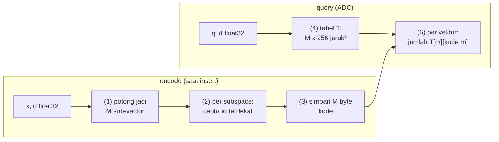
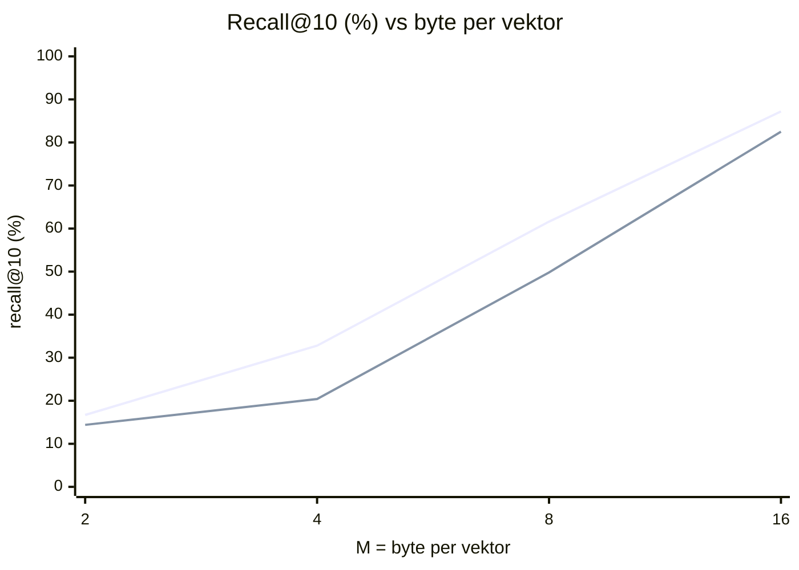

## Pernyataan inti
Product Quantization (PQ) memotong vektor d dimensi menjadi M sub-vector, lalu mengganti
tiap sub-vector dengan **nomor** centroid terdekat di codebook subspace itu. Dengan 256
centroid per subspace, satu vektor jadi M byte. Jarak ke query dihitung tanpa dekode: buat
tabel `M × 256` berisi jarak² sub-query ke setiap centroid, lalu jarak ke tiap vektor = M
lookup + M penjumlahan. Ini eksak untuk vektor rekonstruksi `x̂`. Galatnya hanya dari
`x ≠ x̂`, dan galat itu tidak bisa diperbaiki tanpa vektor asli.

## Istilah
| Istilah | Arti | Contoh |
|---|---|---|
| subspace, sub-vector | Potongan kontigu d/M koordinat dari vektor. | x = (1,2 \| 8,9): x₁ = (1,2), x₂ = (8,9) |
| M | Jumlah subspace. | d = 128, M = 16 → 8 dim per subspace |
| codebook | Daftar ks centroid hasil k-means **per subspace**. M codebook total. | sub 1: c₀ = (1.5, 1.5), ... |
| ks (k*) | Jumlah centroid per codebook. ks = 256 → kode muat di 1 byte. | ks = 4 di trace |
| kode | M angka, index centroid terdekat per subspace. | P0 → (0, 0) |
| x̂ (rekonstruksi) | Gabungan centroid yang ditunjuk kode. Ini yang "diketahui" index tentang x. | P0 → (1.5,1.5 \| 8.5,8.5) |
| distortion | Galat kuantisasi `‖x − x̂‖²`. | > 0 kecuali x tepat di centroid |
| ADC | Asymmetric distance: q tetap asli, x diganti x̂. `‖q − x̂‖²`. | dipakai faiss `IndexPQ` |
| SDC | Symmetric distance: q juga dikuantisasi. `‖q̂ − x̂‖²`. | galat dobel |
| lookup table T | `T[m][j] = ‖q_m − c_{m,j}‖²`, dihitung sekali per query. | 2 × 4 angka di trace |

## Gambaran


Recall@10 kalau semua n diurutkan pakai jarak kode, tanpa rerank (sintetis: 50 cluster,
d = 32, n = 10.000, ks = 256, 100 query; kode di bawah). Byte per vektor = M; float32 = 128 B.


> [!info] Cara membaca
> Flowchart: encode sekali per vektor; query hanya membangun satu tabel, lalu tiap vektor
> cukup M lookup. Grafik: garis atas ADC, garis bawah SDC. Byte makin sedikit, recall makin
> rendah. Di grafik ini ADC selalu di atas SDC, karena q tidak ikut dibulatkan.

## Penjelasan bertahap
1. **Kenapa tidak k-means biasa.** Satu codebook untuk seluruh vektor dengan 2^64 centroid
   akan memberi kode 8 byte, tapi mustahil dilatih atau disimpan. PQ memakai M codebook
   kecil. Kombinasinya memberi `ks^M` titik rekonstruksi (256^8 = 2^64) dengan hanya
   `M × ks` centroid yang disimpan. Itu arti "product": produk Kartesius codebook.
2. **Encode = M k-means kecil.** Tiap subspace dilatih terpisah. Encode x = untuk tiap m,
   cari centroid terdekat ke x_m dari ks pilihan. Biayanya ks·d operasi per vektor, sekali.
3. **L2² terurai per subspace.** Subspace tidak saling tumpang tindih, jadi
   `‖q − x̂‖² = Σ_m ‖q_m − x̂_m‖²`. Ini identitas eksak, bukan pendekatan. Karena itu jarak
   bisa dihitung per potongan, dan tiap potongan hanya punya ks kemungkinan nilai.
4. **ADC = tabel lalu lookup.** Sekali per query, hitung T (M × ks angka). Setelah itu jarak
   ke vektor apa pun = `Σ_m T[m][kode_m]`. Trace di bawah menunjukkan ini persis sama dengan
   jarak ke x̂ (`assert` di kode).
5. **Dari mana galat datang.** Satu-satunya galat adalah `x ≠ x̂`. Dua vektor dengan kode sama
   tidak bisa dibedakan sama sekali: P0 (jarak² asli 4) dan P1 (asli 8) sama-sama 5. SDC
   menambah galat kedua dengan membulatkan q juga, sehingga recall-nya lebih rendah.
6. **Di level mesin.** Untuk d = 128 float32, jarak penuh = 128 kurang + 128 kali + 128
   tambah, membaca 512 byte. ADC dengan M = 16 = 16 lookup + 16 tambah, membaca 16 byte kode.
   Tabel T = 16 × 256 × 4 B = 16 KiB, cukup kecil untuk tinggal di cache `[cukup yakin]`.
   Biaya membangun T = 256 × 128 operasi, setara ~256 jarak penuh, dibayar sekali per query.

## Mekanisme / formula
```
x = [x_1 | x_2 | ... | x_M],  x_m ∈ R^(d/M)
kode_m(x) = argmin_j ‖x_m − c_{m,j}‖²                x̂ = [c_{1,kode_1} | ... | c_{M,kode_M}]
ADC(q, x) = ‖q − x̂‖² = Σ_m T[m][kode_m(x)],          T[m][j] = ‖q_m − c_{m,j}‖²
SDC(q, x) = ‖q̂ − x̂‖²
```

### Contoh angka kecil
d = 4 (minimum yang masuk akal: 2 subspace × 2 dim), M = 2, ks = 4. Codebook dilatih
k-means dari 8 titik, init P0, P2, P4, P6. Query q = (2, 3 | 7, 8).

| j | codebook sub 1 | T[1][j] | codebook sub 2 | T[2][j] |
|---|---|---|---|---|
| 0 | (1.5, 1.5) | 2.5 | (8.5, 8.5) | 2.5 |
| 1 | (8.5, 7.5) | 62.5 | (1.5, 1.5) | 72.5 |
| 2 | (1.5, 8.5) | 30.5 | (4.5, 5.5) | 12.5 |
| 3 | (7.5, 1.5) | 32.5 | (8.5, 1.5) | 44.5 |

### Trace langkah demi langkah
Per vektor: baca kode, ambil dua angka dari T, jumlahkan. Bandingkan dengan jarak² asli.

| Titik | x | kode | T[1][k₁] | + T[2][k₂] | = ADC | jarak² asli |
|---|---|---|---|---|---|---|
| P0 | (1,2 \| 8,9) | (0, 0) | 2.5 | 2.5 | **5** | 4 |
| P1 | (2,1 \| 9,8) | (0, 0) | 2.5 | 2.5 | **5** | 8 |
| P2 | (8,8 \| 1,2) | (1, 1) | 62.5 | 72.5 | 135 | 133 |
| P3 | (9,7 \| 2,1) | (1, 1) | 62.5 | 72.5 | 135 | 139 |
| P4 | (1,8 \| 5,5) | (2, 2) | 30.5 | 12.5 | 43 | 39 |
| P5 | (2,9 \| 4,6) | (2, 2) | 30.5 | 12.5 | 43 | 49 |
| P6 | (7,2 \| 8,1) | (3, 3) | 32.5 | 44.5 | 77 | 76 |
| P7 | (8,1 \| 9,2) | (3, 3) | 32.5 | 44.5 | 77 | 80 |

Urutan antar-pasangan benar (P0/P1 < P4/P5 < P6/P7 < P2/P3). Di dalam pasangan, PQ buta.
Kode 2 + 2 bit menggantikan 16 byte float32.

### Di level loop
```go
// codes: n*M byte kontigu. T: M*256 float32, dibangun sekali per query.
func buildTable(q []float32) (T []float32) {
	T = make([]float32, M*256)
	for m := 0; m < M; m++ {
		for j := 0; j < 256; j++ { T[m*256+j] = l2sq(q[m*s:(m+1)*s], codebook[m][j*s:(j+1)*s]) }
	}
	return
}

func adcScan(T []float32, codes []uint8) { // tanpa float vektor sama sekali
	for i := 0; i < n; i++ {
		var dist float32
		for m, c := range codes[i*M : (i+1)*M] { dist += T[m*256+int(c)] } // M lookup
		heap.PushIfBetter(int32(i), dist)
	}
}
```
d = 128, n = 1.000.000: float32 = 512 B/vektor (512 MB). PQ M = 16: 16 B/vektor (16 MB, 32×
lebih kecil); M = 8: 8 B (64×). Semua codebook = M × 256 × (d/M) × 4 B = 256 × 128 × 4 B =
128 KiB, tidak bergantung M.

## Kenapa ini penting untuk risetku
Scope-ku tidak memasukkan quantization ([[00-dashboard/Scope]]). Tapi aku harus mengenalinya karena:
`[implementasi: hnswlib]` `[cukup yakin]` hnswlib menyimpan vektor float penuh, sedangkan
`[implementasi: faiss]` `[cukup yakin]` ada `IndexHNSWPQ` yang menjalankan HNSW di atas jarak
PQ. Kalau recall turun di setup seperti itu, penyebabnya bisa graph rusak **atau** distortion
PQ. Dua sumber galat bercampur. Untuk eksperimen delete, pakai vektor float32 agar recall
loss bisa diatribusikan ke struktur graph saja.

## Salah paham yang umum
- "PQ mengompres lalu dekompresi saat search." Tidak perlu: ADC tidak pernah merekonstruksi x̂.
- "ADC eksak." Eksak terhadap x̂, bukan terhadap x. Tabel trace membuktikan keduanya beda.
- "Makin banyak M selalu lebih baik." Lebih akurat, tapi byte dan lookup bertambah linear.
- "PQ = IVF." Beda peran. IVF memilih list; PQ mengompres isi list. faiss `IndexIVFPQ`
  menggabungkan keduanya dan mengkuantisasi *residual* `x − centroid` `[cukup yakin]`.

## Cara memverifikasi ini sendiri
```python
import numpy as np
def d2(A, B): return (A**2).sum(1)[:, None] - 2 * A @ B.T + (B**2).sum(1)
def kmeans(X, C, iters=20):                  # Lloyd, init centroid C diberikan
    for _ in range(iters):
        a = d2(X, C).argmin(1)
        C = np.array([X[a == j].mean(0) if (a == j).any() else C[j] for j in range(len(C))])
    return C
def train(X, M, init):                       # satu codebook per subspace; hasil (M, ks, d/M)
    s = X.shape[1] // M; return np.stack([kmeans(X[:, m*s:(m+1)*s], X[init, m*s:(m+1)*s]) for m in range(M)])
def encode(X, CB):                           # kode = index centroid terdekat per subspace
    M, ks, s = CB.shape; return np.stack([d2(X[:, m*s:(m+1)*s], CB[m]).argmin(1) for m in range(M)], 1).astype(np.uint8)
def table(q, CB):                            # ADC lookup table: T[m, j] = ‖q_m − c_{m,j}‖²
    M, ks, s = CB.shape; return np.stack([((CB[m] - q[m*s:(m+1)*s]) ** 2).sum(1) for m in range(M)])
def adc(T, codes): return T[np.arange(T.shape[0]), codes].sum(1)   # M lookup + M tambah per vektor

# (1) trace: d = 4, M = 2 subspace (2 dim), ks = 4 centroid per subspace, init = P0, P2, P4, P6
X = np.array([[1,2,8,9],[2,1,9,8],[8,8,1,2],[9,7,2,1],[1,8,5,5],[2,9,4,6],[7,2,8,1],[8,1,9,2]], float)
CB = train(X, 2, [0, 2, 4, 6]); codes = encode(X, CB); q = np.array([2, 3, 7, 8.0]); T = table(q, CB)
print(CB.tolist()); print(codes.tolist()); print(T.tolist())
print(adc(T, codes), ((X - q) ** 2).sum(1))
xhat = np.hstack([CB[0][codes[:, 0]], CB[1][codes[:, 1]]])   # dekode = gabungan centroid
assert np.allclose(adc(T, codes), ((xhat - q) ** 2).sum(1))   # ADC = jarak eksak ke x-hat

# (2) sintetis: 50 cluster, d = 32, n = 10000, ks = 256, 100 query; ranking semua n pakai kode
rng = np.random.default_rng(0); n, k = 10000, 10
G = rng.normal(size=(50, 32)); X = G[rng.integers(0, 50, n)] + rng.normal(size=(n, 32))
Q = G[rng.integers(0, 50, 100)] + rng.normal(size=(100, 32))
D = d2(Q, X); gt = np.argsort(D, 1)[:, :k]
for M in (2, 4, 8, 16):                      # byte per vektor = M (ks = 256 → 1 byte per kode)
    CB = train(X, M, rng.choice(n, 256, replace=False)); codes = encode(X, CB); ra = rs = 0; err = []
    for j in range(100):
        da = adc(table(Q[j], CB), codes)                            # ADC: q asli
        ds = adc(table(np.hstack([CB[m][c] for m, c in enumerate(encode(Q[j:j+1], CB)[0])]), CB), codes)  # SDC: q ikut dikuantisasi
        ra += len(set(np.argsort(da)[:k]) & set(gt[j])); rs += len(set(np.argsort(ds)[:k]) & set(gt[j]))
        err.append(np.mean(np.abs(da - D[j]) / D[j]))
    print(M, ra / 10, rs / 10, round(100 * np.mean(err), 1))    # recall@10 ADC %, SDC %, galat relatif ADC %
# [[[1.5, 1.5], [8.5, 7.5], [1.5, 8.5], [7.5, 1.5]], [[8.5, 8.5], [1.5, 1.5], [4.5, 5.5], [8.5, 1.5]]]
# [[0, 0], [0, 0], [1, 1], [1, 1], [2, 2], [2, 2], [3, 3], [3, 3]]
# [[2.5, 62.5, 30.5, 32.5], [2.5, 72.5, 12.5, 44.5]]
# [  5.   5. 135. 135.  43.  43.  77.  77.] [  4.   8. 133. 139.  39.  49.  76.  80.]
# M, recall@10 ADC %, SDC %, galat relatif ADC %
# 2 16.7 14.4 20.5
# 4 32.8 20.4 14.2
# 8 61.6 49.8 6.8
# 16 87.2 82.5 2.2
```
`[implementasi: faiss]` padanannya `faiss.IndexPQ(d, M, 8)` `[yakin]`. Baca kelas
`ProductQuantizer`, cari fungsi yang membangun distance table (`compute_distance_table`)
`[cukup yakin]`.

## Rujukan
- Jégou, Douze, Schmid, "Product quantization for nearest neighbor search", IEEE TPAMI 2011
  `[yakin]`. Sumber istilah ADC/SDC dan IVFADC `[yakin]`.
