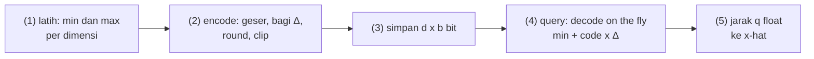
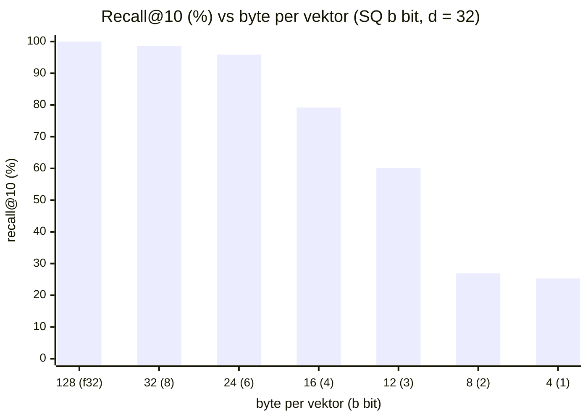

## Pernyataan inti
Scalar quantization (SQ) mengganti tiap koordinat float32 dengan integer b bit, **per dimensi,
sendiri-sendiri**. SQ8 memetakan rentang `[min, max]` tiap dimensi ke 256 level:
`code = round((x − min) / Δ)` dengan `Δ = (max − min) / 255`. Memori turun 4× (32 → 8 bit).
Galat per koordinat paling besar `Δ/2` selama x ada di dalam rentang latih, dan rata-rata
galat kuadratnya ≈ `Δ²/12`. Tiap bit yang dibuang menggandakan Δ. Nilai di luar rentang latih
di-clip, dan galatnya tidak lagi dibatasi `Δ/2`.

## Istilah
| Istilah | Arti | Contoh |
|---|---|---|
| b (bit) | Jumlah bit per koordinat. Level = `2^b`. | SQ8: 256 level, SQ4: 16 |
| min, max (rentang latih) | Nilai terkecil dan terbesar tiap dimensi di data latih. | dim 0: −1.3 .. 3.0 |
| Δ (step) | Jarak antar level: `(max − min) / (2^b − 1)`. | 4.3 / 255 = 0.01686 |
| encode | `code = clip(round((x − min) / Δ), 0, 2^b − 1)`. | 0.75 → 122 |
| decode | `x̂ = min + code · Δ`. | 122 → 0.75725 |
| galat kuantisasi | `abs(x − x̂)`. Di dalam rentang: ≤ Δ/2. | 0.00725 ≤ 0.00843 |
| clip | Nilai di luar rentang dipaksa ke level 0 atau `2^b − 1`. | 3.5 → 255 → 3.0 |
| fp16 | Bukan SQ berlevel, tapi float 16-bit: 2 byte per koordinat. | 256 B untuk d = 128 |
| asymmetric | q tetap float, hanya x yang di-decode. Sama prinsipnya dengan ADC di PQ. | `‖q − x̂‖²` |

## Gambaran


Sintetis, data sama dengan T3-04 (50 cluster, d = 32, n = 10.000, 100 query). Semua n
diurutkan pakai `‖q − x̂‖²`. f32 = 100 per definisi (itu ground truth-nya).


> [!info] Cara membaca
> Flowchart: hanya min/max per dimensi yang dilatih; tidak ada k-means. Grafik: dari 32 ke 8
> bit recall nyaris tidak turun. Di bawah 6 bit recall jatuh cepat. Pada 16 byte, SQ4 memberi
> 79.2%; PQ M = 16 di data yang sama memberi 87.2% (T3-04).

## Penjelasan bertahap
1. **Intuisi: penggaris dengan 256 garis.** Rentang tiap dimensi dibagi 255 interval sama
   lebar. Setiap nilai dicatat sebagai nomor garis terdekat. Formalnya:
   `code = round((x − min)/Δ)`. Satu byte, bukan empat.
2. **Kenapa galatnya terbatas.** Nilai x ada di antara dua garis yang berjarak Δ. Garis
   terdekat paling jauh Δ/2. Kalau x tersebar rata di dalam interval, rata-rata `(x − x̂)²`
   adalah `Δ²/12`. Kode di bawah mengecek: rasio empiris/rumus 0.999 untuk 8 dan 4 bit.
3. **Bit vs galat.** Δ berbanding terbalik dengan `2^b − 1`. Dari 8 ke 4 bit, Δ naik 255/15 =
   17×, galat kuadrat naik 289×. Inilah tebing di grafik: sampai titik tertentu galat lebih
   kecil dari selisih jarak antar tetangga, setelah itu tidak.
4. **Galat koordinat → galat jarak.** Jarak² menjumlahkan d galat koordinat. Yang penting
   bukan galatnya sendiri, tapi apakah galat itu cukup besar untuk menukar urutan tetangga
   ke-10 dan ke-11. Di data dengan distance concentration
   ([[07-concepts/T1-04-distance-concentration]]) selisih itu kecil, jadi bit lebih berharga.
5. **SQ vs PQ.** SQ memperlakukan tiap dimensi independen, tanpa codebook. PQ mengkuantisasi
   beberapa dimensi bersama dengan k-means, jadi bisa menangkap korelasi antar dimensi. Itu
   sebabnya PQ menang di byte yang sama pada data ini. SQ menang di kesederhanaan, tanpa
   training mahal, dan galat per koordinat yang bisa dihitung.
6. **Di level mesin: bandwidth vs compute.** Jarak SQ8 membaca d byte, bukan 4d byte, tapi
   menambah satu kali-tambah per dimensi untuk decode. Kalau scan dibatasi bandwidth memori,
   ini menguntungkan. Integer SIMD pada kode juga mungkin kalau q ikut dikuantisasi
   `[cukup yakin]`; itu di luar catatan ini.

## Mekanisme / formula
```
Δ_i  = (max_i − min_i) / (2^b − 1)
code = clip(round((x_i − min_i) / Δ_i), 0, 2^b − 1)      x̂_i = min_i + code · Δ_i
x_i ∈ [min_i, max_i]  ⇒  |x_i − x̂_i| ≤ Δ_i / 2            E[(x_i − x̂_i)²] ≈ Δ_i² / 12
```

### Contoh angka kecil
d = 3, n = 4, SQ8. Rentang dilatih dari 4 vektor ini.

| | dim 0 | dim 1 | dim 2 |
|---|---|---|---|
| x₀ / kode | −1.3 / 0 | 0.20 / 118 | 5.0 / 0 |
| x₁ / kode | 0.75 / 122 | −0.4 / 0 | 7.5 / 159 |
| x₂ / kode | 2.1 / 202 | 0.90 / 255 | 6.1 / 70 |
| x₃ / kode | 3.0 / 255 | 0.05 / 88 | 9.0 / 255 |
| min, max | −1.3, 3.0 | −0.4, 0.9 | 5.0, 9.0 |
| Δ | 0.01686 | 0.0051 | 0.01569 |
| galat terbesar | 0.0073 | 0.0016 | 0.0059 |

Semua galat ≤ Δ/2 dimensinya. Titik min dan max sendiri galatnya 0.

### Trace langkah demi langkah
Encode lalu decode satu komponen di dim 0 (min = −1.3, max = 3.0). Baris kedua adalah nilai
insert baru di luar rentang latih.

| x | x − min | ÷ Δ (= ×255/4.3) | round, clip | x̂ = min + code·Δ | galat | batas Δ/2 |
|---|---|---|---|---|---|---|
| 0.75 | 2.05 | 121.57 | 122 | 0.75725 | 0.00725 | 0.00843 |
| 3.5 | 4.8 | 284.651 | **255** (clip) | 3.0 | **0.5** | 0.00843 |

Nilai 3.5 kehilangan 0.5. Itu 59× batas normal, dan tidak ada yang memberi tahu.

### Di level loop
```go
// global: lo[i], step[i] per dimensi (2*d float32 total, bukan per vektor)
func encode(x []float32, out []uint8) {
	for i, v := range x { out[i] = uint8(clamp(roundf((v-lo[i])/step[i]), 0, 255)) }
}

func l2sqSQ8(q []float32, code []uint8) (s float32) { // decode on the fly, tanpa buffer
	for i, c := range code { t := q[i] - (lo[i] + float32(c)*step[i]); s += t * t }
	return
}
```
Byte per vektor untuk d = 128 (n = 1 juta dalam kurung): float32 512 B (512 MB), fp16 256 B
(256 MB, 2×), SQ8 128 B (128 MB, 4×), SQ4 64 B (64 MB, 8×). Bandingkan PQ M = 16: 16 B (32×,
T3-04). Parameter SQ8 sendiri hanya 2 × 128 × 4 B = 1 KiB.

## Kenapa ini penting untuk risetku
- **Scope.** Tuning quantization ada di daftar KELUAR ([[00-dashboard/Scope]]). Eksperimenku
  pakai float32 di hnswlib.
- **Tapi ini sumber confounder untuk RQ1.** Index produksi sering menjalankan HNSW di atas
  vektor terkuantisasi: `[implementasi: faiss]` `IndexHNSWSQ` `[cukup yakin]`;
  `[implementasi: Lucene/Elasticsearch]` ada scalar quantization untuk HNSW (opsi `int8_hnsw`)
  `[cukup yakin]`, apakah jadi default di versi tertentu `[⚠️ VERIFY]`. Di workload streaming
  insert, rentang min/max yang dilatih di awal bisa basi. Nilai baru di-clip (trace baris 2),
  dan recall turun **tanpa** graph rusak. Sinyal degradasi online harus bisa membedakan dua
  penyebab ini, atau setup-nya harus menghilangkan salah satunya. Tulis di threat to validity.

## Salah paham yang umum
- "SQ8 kehilangan 75% informasi, jadi recall turun banyak." Byte turun 75%, tapi di grafik
  recall SQ8 98.6%. Yang menentukan adalah galat dibanding selisih jarak tetangga.
- "Galat SQ selalu ≤ Δ/2." Hanya di dalam rentang latih. Di luar itu clip, galat bebas.
- "SQ = PQ dengan M = d." Mirip bentuknya, tapi PQ dengan M = d melatih k-means 1D per
  dimensi (level tidak sama lebar), SQ memakai level sama lebar dari min/max.

## Cara memverifikasi ini sendiri
```python
import numpy as np
def train(X):     return X.min(0), X.max(0)                    # rentang per dimensi
def encode(X, lo, hi, b):                                       # round ke level terdekat, clip ke [0, 2^b − 1]
    L = 2**b - 1; return np.clip(np.rint((X - lo) / (hi - lo) * L), 0, L).astype(np.uint8)
def decode(c, lo, hi, b): return lo + c * (hi - lo) / (2**b - 1)

# (1) contoh kecil: d = 3, n = 4, SQ8
X = np.array([[-1.3, 0.20, 5.0], [0.75, -0.4, 7.5], [2.1, 0.90, 6.1], [3.0, 0.05, 9.0]])
lo, hi = train(X); print(lo, hi, ((hi - lo) / 255).round(5))
c = encode(X, lo, hi, 8); print(c.tolist()); print(np.abs(X - decode(c, lo, hi, 8)).round(4).tolist())

# (2) trace satu komponen: x = 0.75 di dimensi 0, lalu nilai baru 3.5 di luar rentang latih
for x in (0.75, 3.5):
    t = (x - lo[0]) / (hi[0] - lo[0]) * 255; code = int(np.clip(np.rint(t), 0, 255)); xh = lo[0] + code * (hi[0] - lo[0]) / 255
    print(x, round(x - lo[0], 4), round(t, 3), code, round(xh, 5), round(abs(x - xh), 5))

# (3) galat: |x − x̂| ≤ Δ/2 di dalam rentang, MSE ≈ Δ²/12
rng = np.random.default_rng(1); V = rng.random((100000, 1))
for b in (8, 4):
    l, h = train(V); e = V - decode(encode(V, l, h, b), l, h, b); D = (h - l)[0] / (2**b - 1)
    print(b, bool(np.abs(e).max() <= D / 2 + 1e-12), round(float((e**2).mean()) / (D**2 / 12), 3))

# (4) sintetis sama dengan T3-04: 50 cluster, d = 32, n = 10000, 100 query, q float vs x̂
rng = np.random.default_rng(0); n, k = 10000, 10
G = rng.normal(size=(50, 32)); X = G[rng.integers(0, 50, n)] + rng.normal(size=(n, 32))
Q = G[rng.integers(0, 50, 100)] + rng.normal(size=(100, 32))
d2 = lambda A, B: (A**2).sum(1)[:, None] - 2 * A @ B.T + (B**2).sum(1)
gt = np.argsort(d2(Q, X), 1)[:, :k]; lo, hi = train(X)
for b in (8, 6, 4, 3, 2, 1):
    Xh = decode(encode(X, lo, hi, b), lo, hi, b); top = np.argsort(d2(Q, Xh), 1)[:, :k]
    rec = np.mean([len(set(t) & set(g)) / k for t, g in zip(top, gt)])
    print(b, 32 * b // 8, round(100 * rec, 1))                 # bit, byte per vektor, recall@10 %
# [-1.3 -0.4  5. ] [3.  0.9 9. ] [0.01686 0.0051  0.01569]
# [[0, 118, 0], [122, 0, 159], [202, 255, 70], [255, 88, 255]]
# [[0.0, 0.0016, 0.0], [0.0073, 0.0, 0.0059], [0.0063, 0.0, 0.002], [0.0, 0.0014, 0.0]]
# 0.75 2.05 121.57 122 0.75725 0.00725
# 3.5 4.8 284.651 255 3.0 0.5
# 8 True 0.999
# 4 True 0.999
# bit, byte per vektor, recall@10 %:
# 8 32 98.6
# 6 24 95.9
# 4 16 79.2
# 3 12 60.1
# 2 8 26.9
# 1 4 25.3
```
`[implementasi: faiss]` padanannya `faiss.IndexScalarQuantizer(d, faiss.ScalarQuantizer.QT_8bit)`
`[yakin]`. `QT_8bit` memakai rentang per dimensi, `QT_8bit_uniform` satu rentang untuk semua
dimensi `[yakin]`. Rumus pembulatan persis di faiss bisa beda dari catatan ini (misalnya
decode ke tengah bin) `[⚠️ VERIFY: cek kelas codec 8-bit di source ScalarQuantizer faiss]`.

## Rujukan
Kuantisasi uniform dan galat `Δ²/12` adalah hasil standar pemrosesan sinyal, bukan klaim
paper tertentu. Untuk faiss dan Lucene, rujukannya source code dan dokumentasi resmi
(tag implementasi di atas), bukan paper.
