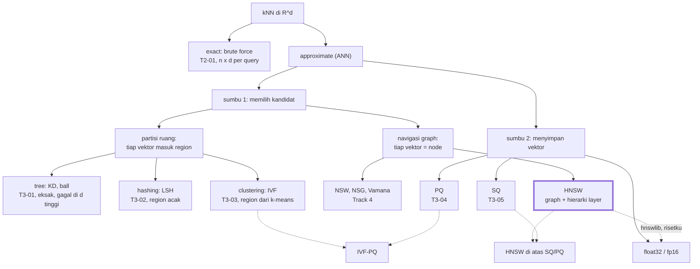

## Pernyataan inti
Setiap index ANN menjawab dua pertanyaan yang saling bebas. **Sumbu 1: vektor mana yang
dihitung jaraknya?** Jawabannya partisi ruang (tree, LSH, IVF: tiap vektor masuk region,
query melihat beberapa region) atau navigasi graph (tiap vektor = node, query berjalan ke
node yang lebih dekat). **Sumbu 2: bagaimana vektor disimpan?** float32, SQ, atau PQ.
HNSW ada di sumbu 1, cabang graph, dengan hierarki layer. Di hnswlib ia menyimpan float32.
Di family partisi, struktur routing (split, hyperplane, centroid) tetap sah walau vektor
dihapus. Di graph, routing adalah edge antar vektor itu sendiri. Itu sebabnya delete menjadi
masalah struktur di HNSW (trace di bawah), bukan sekadar menghapus baris.

## Istilah
| Istilah | Arti | Contoh |
|---|---|---|
| index family | Kelompok index dengan cara memilih kandidat yang sama. | IVF-Flat dan IVF-PQ satu family |
| partisi ruang | Tiap vektor ditaruh di satu region per struktur. Query hanya membuka sebagian region. | daun KD, bucket LSH, list IVF |
| region | Daun tree, bucket hash, atau cell IVF. | cell C1 |
| proximity graph | Graph dengan node = vektor dan edge = pasangan yang berdekatan. | kNN graph k = 2 |
| greedy walk | Dari node sekarang, pindah ke tetangga yang paling dekat ke q. Berhenti kalau tidak ada yang lebih dekat. | P6 → P3 → P1 |
| local minimum | Node tempat greedy berhenti padahal bukan NN. Detailnya di T4-02. | – |
| hierarki layer (HNSW) | Beberapa graph bertumpuk. Layer atas berisi sedikit node untuk lompatan jauh. | level 0 berisi semua |
| representasi | Bentuk vektor di memori: float32, fp16, SQ, PQ. | SQ8 = 128 B di d = 128 |
| routing | Peran node sebagai jalan yang dilewati query lain. | node di jalur P6 → P1 |

## Gambaran


> [!info] Cara membaca
> Garis tegas = klasifikasi. Garis putus-putus = kombinasi yang dipakai orang. Sumbu 1 dan
> sumbu 2 bisa dipasangkan bebas: IVF-PQ = IVF di sumbu 1 + PQ di sumbu 2. Node tebal = HNSW.
> Risetku: HNSW di atas float32, jadi sumbu 2 dibuat konstan.

## Penjelasan bertahap
1. **Satu tujuan: jangan hitung n jarak.** Brute force butuh n·d operasi per query
   ([[07-concepts/T2-01-exact-knn-dan-biaya-o-nd]]). Setiap index adalah cara memilih
   sebagian kecil kandidat, ditambah cara menyimpan vektor lebih murah.
2. **Partisi ruang: recall hilang di batas region.** Tree, LSH, dan IVF sama-sama memotong
   ruang. Bedanya cara memotong: bidang median per axis (tree), hyperplane acak (LSH), cell
   k-means (IVF). Tree tetap eksak tapi prune gagal di d tinggi
   ([[07-concepts/T3-01-kd-tree-dan-ball-tree]]). LSH dan IVF approximate: recall hilang saat
   NN ada di region yang tidak dibuka ([[07-concepts/T3-02-locality-sensitive-hashing]],
   [[07-concepts/T3-03-ivf-coarse-quantizer-nprobe]]).
3. **Graph: tidak ada region.** Kandidat adalah node yang dilewati jalan greedy. Biaya ≈
   jumlah hop × degree × d. Recall hilang kalau jalan berhenti sebelum NN. Trace di bawah
   memakai 8 titik yang sama dengan T3-01.
4. **HNSW = graph + hierarki.** Layer atas berisi makin sedikit node (sekitar 1/M per layer),
   dipakai untuk lompatan jauh. Layer 0 berisi semua node, dipakai untuk pencarian halus
   dengan beam ukuran `ef`. Detail di Track 4 (T4-03 sampai T4-07).
5. **Representasi adalah sumbu terpisah.** SQ/PQ mengurangi byte per vektor
   ([[07-concepts/T3-05-scalar-quantization]], [[07-concepts/T3-04-product-quantization]]).
   Galatnya beda jenis: bukan kandidat yang terlewat, tapi jarak yang salah hitung.
6. **Low level: di mana sebuah vektor "hidup".** Di partisi, vektor hanya isi region. Region
   ditentukan oleh struktur terpisah (split, hyperplane, centroid). Di graph, vektor adalah
   node yang edge-nya dipakai query lain. Menghapusnya berarti menghapus jalan.

## Mekanisme / formula
Trace konseptual satu query q per family, plus apa yang terjadi saat delete:

| family | (1) per query | (2) kandidat | (3) jarak | recall hilang kalau | delete |
|---|---|---|---|---|---|
| brute force | – | semua n | n·d | tidak pernah | hapus baris |
| KD / ball tree | – | daun yang tidak di-prune | kandidat·d | tidak (eksak) | hapus dari daun; batas tetap sah |
| LSH | K·L hash | union L bucket | kandidat·d | NN beda bucket di semua L tabel | hapus dari L bucket |
| IVF | nlist·d ke centroid | nprobe list | kandidat·d | NN di list yang tidak di-probe | hapus dari 1 list; centroid bukan data |
| + PQ / SQ | tabel T (PQ) | sama seperti sumbu 1 | M lookup (PQ) / d decode (SQ) | distortion menukar urutan | hapus kode |
| graph / HNSW | – | node yang dilewati greedy/beam | hop × degree × d | jalan berhenti sebelum NN | **node = jalan**: edge hilang, perlu repair (T5-01..T5-04) |

### Contoh angka kecil
8 titik T3-01, q = (6, 5). kNN graph: tiap titik ke 2 tetangga terdekat, lalu dibuat
undirected (kode di bawah).

| node | P0 (2,3) | P1 (5,4) | P2 (9,6) | P3 (4,7) | P4 (8,1) | P5 (7,2) | P6 (1,9) | P7 (6,8) |
|---|---|---|---|---|---|---|---|---|
| tetangga | 1, 3 | 0, 2, 3, 4, 5 | 1, 7 | 0, 1, 6, 7 | 1, 5 | 1, 4 | 3, 7 | 2, 3, 6 |
| jarak² ke q | 20 | **2** | 10 | 8 | 20 | 10 | 41 | 9 |

### Trace langkah demi langkah
Greedy walk dari P6 (titik terjauh dari q).

| # | node | jarak² | tetangga dicek | tetangga terbaik | aksi |
|---|---|---|---|---|---|
| 1 | P6 | 41 | P3, P7 | P3 (8) | 8 < 41 → pindah |
| 2 | P3 | 8 | P0, P1, P6, P7 | P1 (2) | 2 < 8 → pindah |
| 3 | P1 | 2 | P0, P2, P3, P4, P5 | P3 (8) | 8 ≥ 2 → berhenti. P1 = NN, **benar** |
| | | | *P3 dihapus beserta semua edge-nya, ulangi dari P6* | | |
| 4 | P6 | 41 | P7 | P7 (9) | 9 < 41 → pindah |
| 5 | P7 | 9 | P2, P6 | P2 (10) | 10 ≥ 9 → berhenti di P7, **salah** (NN tetap P1) |

Di n = 8 graph tidak menghemat apa pun (8 jarak terhitung). Yang penting mekanismenya. P3
bukan jawaban query ini, tapi P3 adalah satu-satunya jalan dari P6 ke P1. Setelah P3 hilang,
greedy murni (beam 1) terjebak di P7. Di partisi, menghapus satu vektor tidak pernah
mengubah region tempat vektor lain dicari. Ini masalah inti risetku, dalam 8 titik.

### Di level loop
Byte per vektor untuk n = 1.000.000, d = 128 (dari kode, deterministik):

| index | vektor tersimpan | struktur tambahan | total |
|---|---|---|---|
| brute force | 512 B | 0 | 512 MB |
| KD-tree, daun 16 | 512 B | 7.1 B | 519 MB |
| LSH, L = 64 | 512 B | 256 B | 768 MB |
| IVF-Flat, nlist 1000 `[implementasi: faiss]` id int64 | 512 B | 8.5 B | 520.5 MB |
| IVF-PQ, nlist 1000, M = 16 | 16 B | 8.6 B | 24.6 MB |
| HNSW, M = 16 `[implementasi: hnswlib]` | 512 B | 144.5 B | 656.5 MB |

Rincian HNSW `[implementasi: hnswlib]` `[cukup yakin]`: layer 0 menyimpan `maxM0 = 2M = 32`
link × 4 B + 4 B jumlah link = 132 B, label 8 B, layer atas rata-rata `(M·4 + 4)/(M − 1)` =
4.5 B karena tiap elemen punya rata-rata `1/(M − 1)` layer atas (disimulasikan di kode).
Ada juga beberapa byte bookkeeping per elemen yang tidak kuhitung di sini.

## Kenapa ini penting untuk risetku
- **Posisi di proposal.** Related work cukup menyebut family lain di peta ini, lalu
  menjelaskan kenapa scope hanya HNSW ([[00-dashboard/Scope]]): kolom "delete" di tabel
  menunjukkan hanya graph yang punya masalah struktur saat delete.
- **Variabel yang dikunci.** Sumbu 2 = float32 supaya recall loss hanya dari sumbu 1 (graph).
- **Fase 3.** Sharding berbasis cluster memakai ide IVF di atas banyak HNSW (T6-01).

## Salah paham yang umum
- "HNSW selalu terbaik." Tergantung anggaran memori, dataset, dan operating point
  ([[07-concepts/T2-07-recall-tanpa-operating-point]]). Di ANN-Benchmarks graph umumnya kuat
  untuk in-memory `[cukup yakin]`; di skala sangat besar dengan memori terbatas, IVF-PQ lazim
  dipakai `[cukup yakin]`.
- "Quantization adalah satu family index." Itu sumbu representasi, bisa dipasang ke mana saja.
- "Graph tidak punya partisi, jadi tidak ada batas." Benar tidak ada region, tapi ada local
  minimum. Galatnya pindah bentuk, tidak hilang.

## Cara memverifikasi ini sendiri
```python
import numpy as np
n, d, M, f32 = 1_000_000, 128, 16, 4 * 128         # f32 = byte satu vektor float32
kd_nodes = 2 * 2 ** int(np.ceil(np.log2(n / 16))) - 1  # KD-tree daun 16 (T3-01)
rows = [  # (nama, byte vektor tersimpan, byte struktur tambahan per vektor)
    ("brute force", f32, 0),
    ("KD-tree, daun 16", f32, (kd_nodes * 24 + 4 * n) / n),
    ("LSH, L = 64 tabel", f32, 4 * 64),
    ("IVF-Flat, nlist = 1000", f32, 8 + 1000 * f32 / n),                    # id int64 (faiss)
    ("IVF-PQ, nlist = 1000, M = 16", 16, 8 + (1000 * f32 + 256 * d * 4) / n),  # + codebook PQ
    ("HNSW, M = 16 (hnswlib)", f32, (2 * M * 4 + 4) + 8 + (M * 4 + 4) / (M - 1)),  # layer 0 + label + layer atas
]
for name, vec, extra in rows: print(f"{name:30s} {vec:4d} {extra:7.1f} {(vec + extra) * n / 1e6:7.1f} MB")

# level HNSW ala hnswlib: level = floor(-ln(U) * mult), mult = 1/ln(M). Ekspektasi layer atas = 1/(M-1)
rng = np.random.default_rng(0); lvl = np.floor(-np.log(1 - rng.random(n)) / np.log(M)).astype(int)
print(lvl.mean().round(4), round(1 / (M - 1), 4), np.bincount(lvl).tolist())

# graph: kNN graph k = 2 (dibuat undirected) pada 8 titik T3-01, greedy dari P6, q = (6, 5)
X = np.array([[2,3],[5,4],[9,6],[4,7],[8,1],[7,2],[1,9],[6,8]], float); q = np.array([6.0, 5.0])
D = ((X[:, None] - X[None]) ** 2).sum(-1); np.fill_diagonal(D, np.inf); dq = ((X - q) ** 2).sum(1)
nbr = [set(np.argsort(D[i])[:2].tolist()) for i in range(8)]
for i in range(8):
    for j in list(nbr[i]): nbr[j].add(i)
print([sorted(s) for s in nbr], dq)
def walk(cur):                               # greedy: pindah ke tetangga terdekat ke q selama membaik
    seen = {cur}
    while True:
        nb = sorted(nbr[cur]); seen |= set(nb); best = min(nb, key=lambda j: dq[j])
        print(cur, dq[cur], nb, best, dq[best])
        if dq[best] >= dq[cur]: return cur, len(seen)
        cur = best
print(walk(6))
for s_ in nbr: s_.discard(3)                  # hapus P3 beserta semua edge-nya, ulangi dari P6
nbr[3] = set(); print(walk(6))
# brute force                     512     0.0   512.0 MB
# KD-tree, daun 16                512     7.1   519.1 MB
# LSH, L = 64 tabel               512   256.0   768.0 MB
# IVF-Flat, nlist = 1000          512     8.5   520.5 MB
# IVF-PQ, nlist = 1000, M = 16     16     8.6    24.6 MB
# HNSW, M = 16 (hnswlib)          512   144.5   656.5 MB
# 0.067 0.0667 [937325, 58670, 3735, 255, 14, 1]
# [[1, 3], [0, 2, 3, 4, 5], [1, 7], [0, 1, 6, 7], [1, 5], [1, 4], [3, 7], [2, 3, 6]] [20.  2. 10.  8. 20. 10. 41.  9.]
# 6 41.0 [3, 7] 3 8.0
# 3 8.0 [0, 1, 6, 7] 1 2.0
# 1 2.0 [0, 2, 3, 4, 5] 3 8.0
# (1, 8)
# 6 41.0 [7] 7 9.0
# 7 9.0 [2, 6] 2 10.0
# (7, 3)
```
`[implementasi: hnswlib]` cek di `hnswalg.h`, kelas `HierarchicalNSW`: konstruktor (cari
`maxM0_`, `size_links_level0_`, `size_data_per_element_`, `mult_`) dan `getRandomLevel`
`[cukup yakin]`. Setelah build, `index.get_current_count()` dan ukuran file `save_index`
bisa dibandingkan dengan 656.5 MB.

## Rujukan
- HNSW: Malkov & Yashunin, "Efficient and robust approximate nearest neighbor search using
  Hierarchical Navigable Small World graphs", IEEE TPAMI 42(4), 2020 (online 2018;
  arXiv 1603.09320) `[yakin]`. Catatan paper: [[04-papers/malkov-yashunin-hnsw]].
- NSW: Malkov, Ponomarenko, Logvinov, Krylov, Information Systems, 2014 `[cukup yakin]`.
- NSG: Fu, Xiang, Wang, Cai, PVLDB 2019 `[cukup yakin]`. Vamana/DiskANN: Subramanya dkk.,
  NeurIPS 2019 `[cukup yakin]`.
- Perbandingan family: ANN-Benchmarks ([[04-papers/aumuller-ann-benchmarks]]) `[yakin]`.
  Jangan kutip angkanya dari ingatan; baca plotnya.
